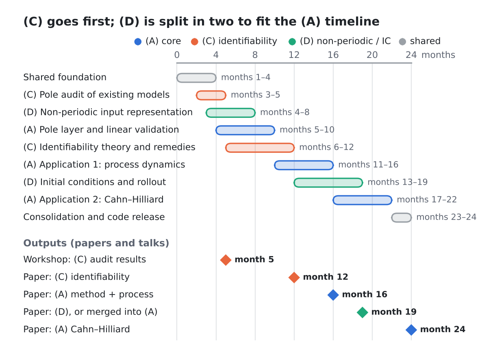

::: {.callout-note appearance="simple"}
## Recommendation

Run the three projects neither strictly in sequence nor fully in parallel. Instead, use a staggered plan: (A) is the backbone of a 24-month schedule, (C) is placed up front, and (D) is split into two parts inserted where (A) needs them. This builds the shared code once and yields one workshop paper and four journal or conference papers in 24 months.
:::

## 1. Comparison of Scheduling Options

The three projects share a code base and evaluation metrics, and results from (C) and (D) are needed at specific points in (A). Staggering the work to match these dependencies is therefore better in both duration and quality than a strict sequence or full parallelism.

| Option | Total duration | Advantages | Drawbacks |
|---|---|---|---|
| Sequential (A → C → D) | about 48 months | focus on one topic at a time | (A)'s interpretability claims go out without (C)'s validation, a weakness in review; (D)'s non-periodic treatment arrives late, forcing a re-implementation of the (A) layer |
| Fully parallel | about 24 months | looks shortest | shared code is built three times; (C)'s diagnostics and (D)'s time-axis computation are not ready when (A) needs them; staff are spread thin |
| **Staggered (recommended)** | **24 months** | shared foundation built once; the (C) audit produces results earliest; (D) is delivered just before (A)'s implementation and application stages | a failed gate can cause cascading delays → handled by the adjustment rules in Section 4 |

: Scheduling options {#tbl-options}

The staggered plan rests on three placements:

- **(C) up front:** the audit of existing models (E1) only needs the models re-implemented in the shared foundation. It yields workshop results in month 5, and (A) reuses the pole-evaluation metrics it produces.
- **(D) split in two:** non-periodic input representation (D1) comes just before the (A) layer is implemented; initial conditions and rollout (D2) come just before (A)'s application stages.
- **(A) as the backbone:** the two main papers come from (A), and the other two projects are scheduled around it.

## 2. Dependencies: What Is Handed Over, and When

The schedule is built around the six hand-offs below. If a hand-off slips, the receiving task slips by the same amount.

| From | To | What is handed over | Needed by |
|---|---|---|---|
| Shared foundation | all | FNO/LNO/ALNO/LFNO implementations; generators for synthetic LTI, PDE, and process data | month 4 |
| (C) audit of existing models | (A) pole layer | pole-matching error and seed-variance metrics, with evaluation scripts | month 5 |
| (D) non-periodic input representation | (A) pole layer | choice of time-axis computation (Chebyshev or exponential-integrator recursion) | month 6 |
| (C) identifiability remedies | (A) applications 1 and 2 | consistency regularization of the steady branch (bound on $R_{\mathrm{res}}$) | month 12 |
| (A) pole layer | (D) initial conditions and rollout | wavenumber-dependent poles $\mu_n(k)$, reused in the PDE initial-condition path | month 13 |
| (D) initial conditions and rollout | (A) application 2 | initial-condition encoder and semigroup regularization, used for long Cahn–Hilliard rollouts | month 17 (interim results) |

: Hand-offs between projects {#tbl-handoffs}

Process application 1 of (A) deals with step inputs and non-zero initial states, so D1 results are reused at that stage as well.

## 3. 24-Month Integrated Schedule

{#fig-gantt width=95%}

Overlapping bars in @fig-gantt mark parallel work. The busiest period is months 5–10, with up to three tasks running at once; this assumes the principal investigator carries the (C) theory during that period. The individual schedules in each proposal will be adjusted to match this integrated schedule.

## 4. Staffing Assumptions and Adjustment Rules

This schedule assumes one full-time PhD student, one MS student (data generation and baseline models), and the principal investigator (theory for (C)). If staffing differs, adjust according to the rules below.

**If staffing differs**

- **Only one student:** the principal investigator takes the (C) theory (H1–H3), and D1 is reduced to the Chebyshev path only, saving two months.
- **Three or more students:** run D2 fully in parallel with (A) application 1, bringing the (D) paper forward to month 16.

**If a gate fails**

| Gate | Month | Adjustment if it fails |
|---|---|---|
| Reproduce the original LNO results | 4 | contact the original authors; record the reproduction error and proceed with relative comparisons |
| (C) audit shows existing models recover true poles well | 5 | narrow (C) to a paper characterizing when recovery succeeds; shorten the remedy stage by two months and bring (A) application 1 forward |
| (D) non-periodic representation barely differs from padded FNO | 8 | fold D1 into an appendix of the (A) paper; keep only D2 as a standalone study |
| (A) recovers dispersion relations on linear benchmarks | 10 | narrow to the polynomial $\mu(k)$; absorb up to two months of delay from the (A) application 2 period |
| Recovery of $k_c$ and $k_{\max}$ on Cahn–Hilliard | 20 | build paper 2 on the linear-regime results alone; move the coarsening rollout to follow-up work |

: Gates and fallback plans {#tbl-gates}
