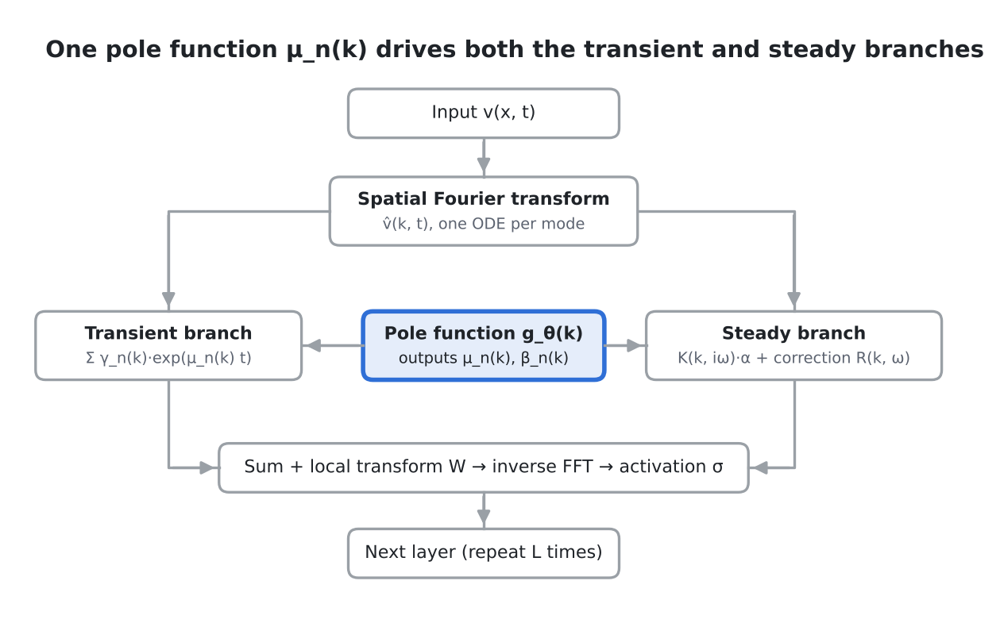
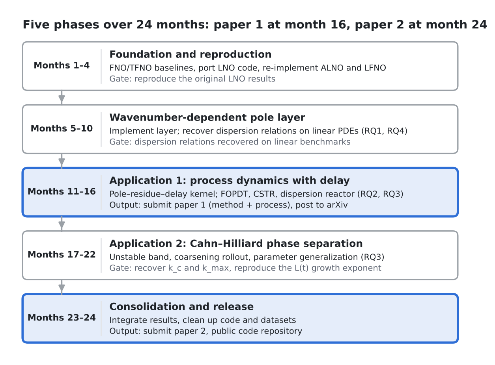

## 1. Overview

This project proposes a neural operator that decomposes space with a Fourier basis and time with a Laplace basis, and learns the temporal poles as continuous functions of the wavenumber, $\mu_n(k)$. A spatial Fourier transform turns a linear PDE into one ODE per mode, and the pole of each ODE is the dispersion relation $\lambda(k)$. The proposed layer builds this structure in directly, so the learned poles can be read as a physical dispersion relation.

The original LNO builds multidimensional kernels from products of independent per-axis poles. It therefore cannot directly represent dispersion relations that couple space and time, such as diffusion ($\lambda = -Dk^2$). Recent Laplace–Fourier hybrids (ALNO, LFNO) focus on the transient/steady split along the time axis and do not address this.

Two application cases are planned:

- **Process dynamics with time delay.** Time delay ($e^{-\theta s}$) is not rational, so the kernel is extended to a pole–residue–delay form. In distributed-parameter systems (an axial-dispersion reactor), the delay instead appears as the imaginary part of the dispersion relation.
- **Cahn–Hilliard phase separation.** In the spinodal region there is an unstable band with $\operatorname{Re}\lambda(k) > 0$. This contrasts sharply with standard LNOs, which impose stability.

The planned duration is 24 months. Deliverables are one paper on the method and the process application, one paper on the phase-separation application, and a public code release.

## 2. Background and Prior Work

The basic Laplace–Fourier hybrid (pole–residue for the transient part, a Fourier multiplier for the steady part) has already appeared in three lines of work. This project therefore targets the next step: poles that couple space and time.

**FNO.** A kernel integral operator that multiplies each truncated Fourier mode by a learnable multiplier $R(k)$. It is expressive and resolution-invariant, but it assumes periodicity and carries no structural prior in the kernel.

**LNO.** Restricts the Laplace transform of the kernel to a rational function:

$$
K_\theta(s) = \sum_{n=1}^{N} \frac{\beta_n}{s-\mu_n}
$$ {#eq-lno-kernel}

The input is expanded in a Fourier series. The output is the sum of a steady response at the input frequencies and a transient response at the poles $\mu_n$. In multiple dimensions the kernel is a product of per-axis poles.

| Model | Transient branch | Steady branch | Multidimensional treatment | Open issue |
|---|---|---|---|---|
| [LNO v1](https://github.com/qianyingcao/Laplace-Neural-Operator) | pole–residue | same pole–residue | product of per-axis poles | limited expressivity for interpolation |
| [LNO v2](https://github.com/qianyingcao/Laplace-Neural-Operator) (Burgers example) | pole–residue | FNO-style FRF | product of per-axis poles | consistency between branches not guaranteed |
| [ALNO/PILNO](https://www.arxiv.org/abs/2602.12706) (Feb 2026) | pole–residue | Fourier multiplier | same | focus on physics-informed training |
| [LFNO](https://papers.cool/arxiv/2606.07601) (May 2026) | pole–residue | Fourier integral operator + nonlinearity | same | strong on ODEs; on PDEs, comparable to FNO |

: Existing Laplace–Fourier hybrids {#tbl-prior}

**Relation to SSMs.** A rational kernel is close to a diagonal linear state-space model. [Work on SSMs as neural operators](https://arxiv.org/pdf/2409.03231) already compares against LNO, so SSM-based operators are included as baselines here.

**Gap.** All of the models above focus on the transient/steady split in time. We have not found work that treats wavenumber-dependent poles, that is, the dispersion relation itself, as the learning target (to be re-checked with a systematic literature review at project start).

## 3. Objectives and Research Questions

The goal is a neural operator whose learned poles read as a physical dispersion relation while keeping accuracy at the level of FNO and LFNO.

**Specific objectives**

1. Formulate the wavenumber-dependent pole layer and implement it in a form compatible with the neuraloperator library.
2. Show that, on linear PDEs with analytical solutions, the learned $\mu_n(k)$ converge to the true dispersion relation.
3. Quantify the advantage over existing models for process dynamics with delay and for Cahn–Hilliard phase separation.

**Research questions**

- **RQ1 (interpretability).** On linear PDEs, how accurately do the learned $\mu_n(k)$ recover the true dispersion relation $\lambda(k)$? How does this depend on the amount of data and the number of poles $N$?
- **RQ2 (performance).** On nonlinear PDEs, how do time extrapolation, resolution transfer, and long-rollout stability compare with FNO, LNO, ALNO, LFNO, and SSM-based operators?
- **RQ3 (non-rational and unstable structure).** Can delays (non-rational transfer functions) and unstable modes with $\operatorname{Re}\lambda > 0$ be learned within the same framework?
- **RQ4 (parameterization).** How does the trade-off between interpretability and accuracy change when $\mu_n(k)$ is a polynomial in $k^2$ versus an MLP?

## 4. Method: The Wavenumber-Dependent Pole Layer

The key idea is to make LNO's poles and residues functions of the wavenumber rather than constants. A single layer then couples spatial structure (Fourier) with temporal dynamics (Laplace).

### 4.1 Motivation: modal decomposition of linear PDEs

Applying a spatial Fourier transform to $u_t = \mathcal{L}u + f$ gives an independent ODE for each mode:

$$
\frac{d\hat u_k}{dt} = \lambda(k)\,\hat u_k + \hat f_k(t), \qquad
\hat u_k(t) = e^{\lambda(k)t}\hat u_k(0) + \int_0^t e^{\lambda(k)(t-\tau)}\hat f_k(\tau)\,d\tau
$$ {#eq-modal}

Representative dispersion relations:

| System | $\lambda(k)$ |
|---|---|
| Diffusion | $-Dk^2$ |
| Advection–diffusion with first-order reaction | $-ivk - Dk^2 - k_r$ |
| Euler–Bernoulli beam (undamped) | $\pm i c k^2$ |
| Linearized Cahn–Hilliard | $-Mk^2\,(f''(\phi_0) + \kappa k^2)$ |

: Dispersion relations of representative linear PDEs {#tbl-dispersion}

### 4.2 Layer definition

For the spatial Fourier coefficients $\hat u_k(t)$, the temporal kernel takes a wavenumber-dependent pole–residue form:

$$
K_\theta(k,s) = \sum_{n=1}^{N} \frac{\beta_n(k)}{s-\mu_n(k)}, \qquad
\hat V(k,s) = K_\theta(k,s)\,\hat U(k,s)
$$ {#eq-layer}

With temporal Fourier coefficients $\alpha_{k,\ell}$ of the input at frequencies $\omega_\ell$, the output splits, as in LNO, into a steady and a transient part:

$$
\hat v_k(t) =
\underbrace{\sum_{\ell} K_\theta(k, i\omega_\ell)\,\alpha_{k,\ell}\,e^{i\omega_\ell t}}_{\text{steady}}
+ \underbrace{\sum_{n} \gamma_n(k)\,e^{\mu_n(k)t}}_{\text{transient}},
\qquad
\gamma_n(k) = \beta_n(k)\sum_{\ell}\frac{\alpha_{k,\ell}}{\mu_n(k)-i\omega_\ell}
$$ {#eq-output}

As an alternative, we also compare an implementation that evaluates the time axis by discrete recursion (exponential integration, zero-order hold). It makes no periodicity assumption on the input, and its cost is linear in the number of time steps (linked to Proposal (D)).

### 4.3 Parameterizing the pole function

- **Polynomial (strong prior):** $\mu_n(k) = \sum_j c_{n,j}\,|k|^{2j} + i\,(d_{n,1}k + \dots)$. The coefficients map directly onto diffusivity, advection speed, and interfacial energy, so interpretation is immediate.
- **MLP (flexible):** $\mu_n(k)$ = $g_\theta(k)$. It can represent nonlocal and anisotropic effects; interpretation is done by post-hoc fitting.
- **Stability option:** a stable variant enforcing $\operatorname{Re}\mu_n(k) = -\operatorname{softplus}(\cdot)$, and an unstable-allowed variant permitting positive values below a cap $\lambda_{\max}$. The latter is needed for Cahn–Hilliard.
- **Real outputs:** conjugate symmetry is imposed on $\mu$ and $\beta$; for isotropic problems, both are restricted to functions of $|k|$.

Because $\mu_n(k)$ is a continuous function of k, it can be evaluated at modes from resolutions never seen in training. This is the basis for resolution invariance, in contrast to FNO's mode truncation.

### 4.4 Overall architecture

Each layer consists of (i) the wavenumber-dependent pole–residue branch, (ii) an optional FNO-style correction branch $R(k,\omega)$, and (iii) a local linear transform W with a nonlinear activation; layers are stacked. Strict pole interpretation is limited to linear problems and the first layer. For nonlinear models, poles are analyzed post hoc with a linear probe: small-amplitude perturbations are injected and the effective transfer function is extracted.

{#fig-architecture width=95%}

The highlighted pole function in @fig-architecture is the core of the proposal. ALNO and LFNO make the steady branch a free multiplier unrelated to the poles. Here, both branches share the same $\mu_n(k)$, and $R(k,\omega)$ remains only a small correction.

## 5. Application 1: Process Dynamics with Time Delay

Delay is not rational and is a structural weakness of LNO. Adding a delay factor to the kernel handles it while keeping interpretability.

### 5.1 Pole–residue–delay kernel

$$
K_\theta(s) = \sum_{n=1}^{N} \frac{\beta_n\,e^{-\theta_n s}}{s-\mu_n}
$$ {#eq-delay}

In the time domain, each term is an exponential response shifted by $\theta_n$. In the steady part, it appears as a phase factor $e^{-i\omega\theta_n}$, which connects naturally to the Fourier branch. $\theta_n \ge 0$ is enforced with a softplus; training starts with a single shared delay and gradually allows per-term delays.

### 5.2 Delay in distributed-parameter systems

In a tubular reactor with axial dispersion, delay is not a separate factor; it appears as the imaginary part ($-ivk$) of the dispersion relation. We test whether the wavenumber-dependent poles of Section 4 alone can represent transport delay, and compare against $\theta$ estimated from the outlet-concentration transfer function (lumped approximation). This comparison links the two representations: lumped delay versus distributed dispersion relation.

### 5.3 Benchmarks

| Problem | Inputs | Ground truth | Evaluation focus |
|---|---|---|---|
| FOPDT / SOPDT | steps, PRBS, random smooth signals | $K$, $\tau$, $\theta$ | recovery of delay and time constants |
| Nonlinear CSTR | coolant-flow changes | linearized poles at steady state | linear-probe poles vs. truth |
| Axial-dispersion reactor | inlet-concentration changes | $\lambda(k) = -ivk - Dk^2 - k_r$ | dispersion-relation recovery, time extrapolation |

: Process-dynamics benchmarks {#tbl-process}

Classical system identification (ARX, vector fitting) is included as a baseline, because it is the first comparison reviewers in process control will ask for.

## 6. Application 2: Cahn–Hilliard Phase Separation

In the Cahn–Hilliard equation, early spinodal decomposition is described exactly by the linear dispersion relation, while late-stage coarsening is strongly nonlinear. A single problem therefore tests both an interpretable linear regime and a nonlinear regime.

### 6.1 Governing equation and linear dispersion relation

$$
\partial_t \phi = \nabla\cdot\big(M\nabla(f'(\phi) - \kappa\nabla^2\phi)\big), \qquad
\lambda(k) = -Mk^2\big(f''(\phi_0) + \kappa k^2\big)
$$ {#eq-ch}

In the spinodal region, where $f''(\phi_0) < 0$, the band $0 < k < k_c = \sqrt{-f''/\kappa}$ is unstable ($\lambda > 0$), and the fastest-growing wavenumber is $k_{\max} = k_c/\sqrt{2}$. A standard LNO with a stability constraint cannot represent this band in principle.

### 6.2 Experimental stages

1. **Linear regime:** train on early-time data while varying the mean composition $\phi_0$ inside and outside the spinodal, and compare the learned $\mu(k)$ with the analytical $\lambda(k)$, with emphasis on the recovery error of $k_c$ and $k_{\max}$.
2. **Nonlinear regime:** roll out into coarsening and compare the peak position of the structure factor $S(k,t)$ and the growth exponent of the characteristic length $L(t)$ (theoretically $t^{1/3}$) against baselines.
3. **Parameter generalization:** feed $M$, $\kappa$, and $\phi_0$ as operator inputs and test extrapolation to compositions outside the training range.

### 6.3 Data

Data are generated in-house with a semi-implicit Fourier spectral solver on periodic 2D grids. Training uses $64^2$ and $128^2$ resolutions; resolution transfer is evaluated at $256^2$.

### 6.4 Follow-on connection

These results can be extended into a surrogate for the ongoing thermodynamic-model-based phase-separation work (LLPS in aerosol droplets), using a non-ideal mixing free energy $f(\phi)$. Droplets, however, are non-periodic spherical domains, so this extension requires the non-periodic treatment from Proposal (D) first.

## 7. Experimental Design, Baselines, and Metrics

All comparisons use the same parameter budget, the same training data, and at least three seeds; means and standard deviations are reported.

### 7.1 Benchmark problems

| Problem | Dimension | True poles / dispersion relation | Purpose |
|---|---|---|---|
| Diffusion | 1D, 2D | $-Dk^2$ | basic validation for RQ1 |
| Advection–diffusion–reaction | 1D | $-ivk - Dk^2 - k_r$ | complex dispersion relation, transport delay |
| Euler–Bernoulli beam | 1D | $\pm i c k^2$ | undamped oscillation, comparison with the original LNO paper |
| Burgers | 1D | (nonlinear) | RQ2, comparison with LNO v2 and LFNO |
| Reaction–diffusion / Brusselator | 2D | (nonlinear) | reuse of the original LNO benchmarks |
| Cahn–Hilliard | 2D | $-Mk^2\,(f'' + \kappa k^2)$ | RQ3, unstable band |
| FOPDT, CSTR, dispersion reactor | 0D, 1D | $K$, $\tau$, $\theta$, $\lambda(k)$ | RQ3, delay |

: Benchmark problems {#tbl-benchmarks}

### 7.2 Baselines

- FNO (including zero-padding) and TFNO, from [neuraloperator](https://neuraloperator.github.io/dev/index.html)
- LNO v1 and v2, porting the original authors' code to current PyTorch
- ALNO and LFNO, re-implemented from the papers (check whether code is public)
- SSM-based operators
- Process problems only: ARX and vector fitting

### 7.3 Metrics

- **Accuracy:** relative L2 error (training window)
- **Time extrapolation:** error on $[T,2T]$, outside the training window $[0,T]$
- **Resolution transfer:** error when training at low and evaluating at high resolution
- **Interpretability:** dispersion-relation error $\lVert \mu(k) - \lambda(k)\rVert$ (per mode, after pole matching); relative error of $K$, $\tau$, $\theta$ for process problems
- **Stability:** number of steps before the error diverges in long rollouts
- **Cost:** parameter count, training time, inference time

### 7.4 Ablations

- Polynomial vs. MLP $\mu_n(k)$
- Number of poles N
- With or without the FNO-style correction branch
- Stability constraint on or off
- Spectral-formula implementation vs. discrete-recursion implementation

## 8. Timeline and Deliverables

{#fig-roadmap width=95%}

The two highlighted phases in @fig-roadmap are the paper submissions. If the Phase 2 gate (dispersion-relation recovery) is not met, the scope narrows to the polynomial $\mu(k)$ and the project moves on to Phase 3.

## 9. Expected Impact, Risks, and Mitigation

The largest risk is a speed race with groups working on the same topic. The project therefore concentrates on the interpretability axis (dispersion-relation recovery) and releases first results early.

**Expected impact**

- Scientific: a framework for reading a neural operator's kernel as a physical quantity, the dispersion relation. It can also serve as a tool for inferring material properties (diffusivity, interfacial energy, transport speed) from data.
- Process applications: a data-driven dynamic model that handles delay and distributed-parameter dynamics together, leading directly to low-order models for controller design.
- Teaching: a case study connecting transfer functions and poles in process control with neural operators, usable as lecture material.

**Risks and mitigation**

| Risk | Warning sign | Mitigation |
|---|---|---|
| Similar extensions by competing groups | new related arXiv postings | sharpen the main contribution around dispersion-relation recovery and the unstable band; post first results to arXiv early |
| Little accuracy gain on nonlinear problems | parity with FNO on Burgers and Brusselator | shift the main claim from accuracy to extrapolation, interpretability, and data efficiency |
| Numerical instability when learning unstable poles | loss blow-up near the $\operatorname{Re}\mu$ cap | clamp at $\lambda_{\max}$; curriculum training from short to longer time windows |
| Questions about novelty relative to SSMs | reviewer comments | show experimentally against SSMs that sharing poles across wavenumbers (a continuous $\mu(k)$) is the difference |
| ALNO/LFNO code not public | reproduced results disagree | contact the original authors; document re-implementation details in an appendix |

: Risks and mitigation {#tbl-risks}

## 10. References

1. Li, Z. et al. Fourier Neural Operator for Parametric Partial Differential Equations. ICLR 2021. [arXiv:2010.08895](https://arxiv.org/abs/2010.08895)
2. Cao, Q., Goswami, S., Karniadakis, G. E. LNO: Laplace Neural Operator for Solving Differential Equations. [arXiv:2303.10528](https://arxiv.org/abs/2303.10528); code on [GitHub](https://github.com/qianyingcao/Laplace-Neural-Operator)
3. Kim, H., Cao, Q., Shin, H., Lee, S., Karniadakis, G. E., Choi, M. Physics-Informed Laplace Neural Operator for Solving Partial Differential Equations. [arXiv:2602.12706](https://www.arxiv.org/abs/2602.12706) (2026)
4. Best of Both Worlds: Bridging Laplace and Fourier for Generalizable and Efficient Operator Learning. [NeurIPS 2025](https://neurips.cc/virtual/2025/122846)
5. Ha, J., Yoon, S., Lee, D. LFNO: Bridging Laplace and Fourier via Transient-Steady Decomposition. [arXiv:2606.07601](https://papers.cool/arxiv/2606.07601) (2026)
6. State-space models are accurate and efficient neural operators for dynamical systems. [arXiv:2409.03231](https://arxiv.org/pdf/2409.03231)
7. Gu, A., Goel, K., Ré, C. Efficiently Modeling Long Sequences with Structured State Spaces (S4). ICLR 2022. [arXiv:2111.00396](https://arxiv.org/abs/2111.00396)
8. Cahn, J. W., Hilliard, J. E. Free Energy of a Nonuniform System. I. Interfacial Free Energy. J. Chem. Phys. 28, 258 (1958).
9. Gustavsen, B., Semlyen, A. Rational approximation of frequency domain responses by vector fitting. IEEE Trans. Power Delivery 14, 1052 (1999).
10. [neuraloperator library documentation](https://neuraloperator.github.io/dev/index.html)
