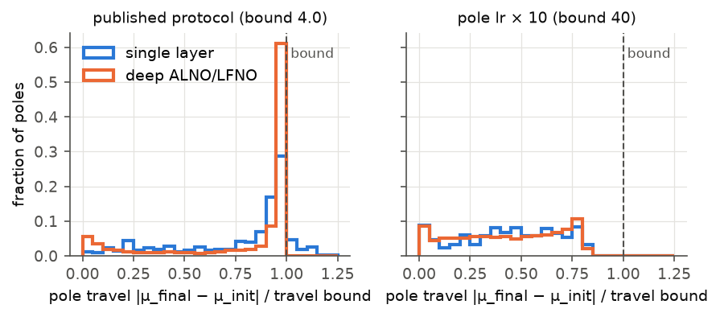
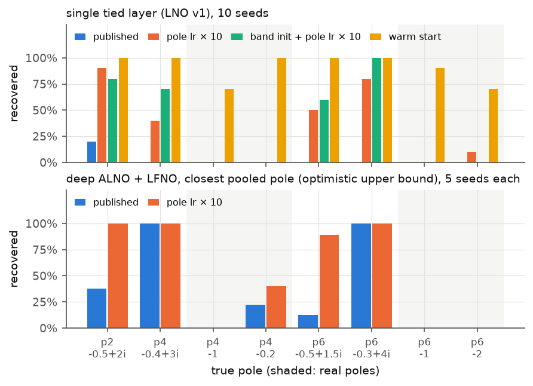
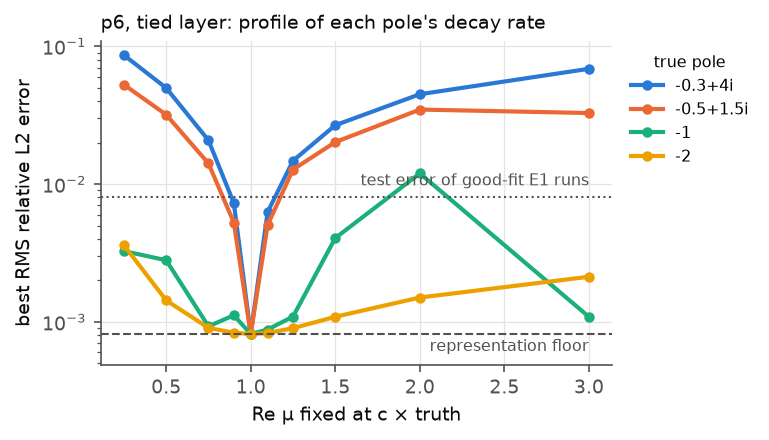

# E1: do Laplace–Fourier operators learn the true poles? (draft summary)

Project (C), RQ1 / E1. Status: draft for the workshop paper, 2026-11-13; part 3 and the
section "Follow-up: E2" updated with the E2 results the same day.
Sources: `README.md` (setup, all findings), `results/summary.md`, `results/per_pole.md`,
`results/identifiability.md`; figures from `figures.py`.

## Question and setup

On linear time-invariant systems with known poles, do the poles learned by LNO v1, ALNO
(= LNO v2 per layer) and LFNO match the truth, and how much do they vary over seeds?

- **Systems:** `p2` (−0.5 ± 2i), `p4` (−0.4 ± 3i, −1, −0.2), `p6` (−0.5 ± 1.5i, −0.3 ± 4i, −1, −2).
  Window T = 20, 1,024 samples; inputs step / ramp / PRBS / smooth random (non-periodic);
  200 / 50 / 100 samples; exact outputs.
- **Settings:** *layer* = one single-channel pole-residue layer (tied = LNO v1, ALNO, LFNO),
  so learned poles are directly comparable; *deep* = full architectures at the LFNO paper
  budget (≈ 5.9k parameters), poles pooled over layers and channels, closest match
  reported (optimistic).
- **Protocols:** published ones (`common` = original LNO 1D protocol; `lfno_paper` for LFNO),
  published-style inits (`lno`, `stable`). Controls: pole learning rate × 10, `band` and
  `warm` (truth + 20 %) inits. Layer 10 seeds, deep 5 seeds; 900 reported training runs (720 layer, 180 deep).
- **Metrics:** `lfo.metrics.pole_error` / `seed_spread` after folding to Im ≥ 0;
  recovered = relative pole error < 0.1.
- **Oracle:** true poles in one tied layer reproduce the outputs to ≈ 1e-3 (the
  representation floor); ALNO/LFNO with 16 steady modes ≈ 4–6e-2 (mode truncation).

## Message in three parts

**1. Under the published protocols the poles cannot move far enough.** Adam moves a
parameter by about lr per step, so the learning-rate schedule bounds the total pole
travel: Σ lr × steps = 4.0 (`common`), 3.6 (`lfno_paper`). The `stable` init starts at
|μ| ≈ 20, while the true poles have Im ≤ 4. Most poles travel the full bound and stop
(Fig. 1, left); deep-model poles move ΔIm ≈ −3.9 with ΔRe ≈ 0. With the original `lno`
init the poles start unstable and nothing trains in the deep setting.

*Fig. 1. Pole travel relative to the travel bound, `stable` init. Left: published
protocol, the mass sits at the bound. Right: with 10× pole learning rate no pole reaches it.*

**2. Once the poles can move, the oscillatory poles are found.** With pole lr × 10,
the tied layer's pole error drops from 5.4 / 14.8 / 6.4 to 0.04 / 1.6 / 0.83 (p2/p4/p6), and
the deep models' closest pooled poles recover the complex pairs in 89–100 % of runs (Fig. 2).
Deep test error is unchanged (ALNO ≈ 1.6e-2): the published models are accurate whether
or not their poles are right.

*Fig. 2. Fraction of runs recovering each true pole (relative error < 0.1).
Shaded: real poles. Only the warm start recovers the fast real poles −1 and −2.*

**3. Fast real poles are not identified, and the E1 data cannot identify them.** Without
a warm start, −1 and −2 are recovered in 0–10 % of runs in every setting, including the
tied layer with enough travel. The models still fit (tied p6: test 8e-3 without −2).
At the truth, a 10 % change of −1 / −2 that the other parameters may compensate costs
4.9e-4 / 1.6e-4 relative error, below the layer's own floor. Fixing Re of −2 anywhere in
[−6, −1] costs at most 2.1e-3 (Fig. 3). The poles are unique in principle (a warm start
converges to them, consistent with H2) but practically non-identifiable from these data.
E2 (below) shows this is specific to the E1 data and grid: with richer inputs or a finer
grid the poles become identifiable, and the remaining failure is optimisation.

*Fig. 3. p6, tied layer: best achievable error with one pole's decay rate fixed at c × truth
(all other parameters re-fitted). Complex poles have sharp profiles; the real poles
are flat to within a few times the representation floor.*

## Follow-up: E2 (data richness and training remedies)

Details: `experiments/C/theory/README.md`. Tied single layer, same systems; 10–50 seeds per condition.

- **Richer data make p4's poles locally identifiable.** Profiled-error / floor ratio
  (≥ 10 = identifiable) of −1 / −0.2: E1 data 4.6 / 9.5; 16 input frequencies 13.9 / 23.8;
  E1 data with T = 40: 11.3 / 30. Ramps alone: nothing.
- **The floor, not the data, hides p6's −1, −2.** No data change tried lifts their
  ratio above 1.8 at dt = 20/1024. The ratio grows ∝ 1/dt: with 16 frequencies, T = 80,
  −1 reaches 11.6 at dt = 20/4096 and 24 at 20/8192; −2 reaches 8.3.
- **Identifiable is not recovered.** On the data where all p4 poles are identifiable,
  the E1 recipe (band init, pole lr × 10) recovers the pair (100 %) but no real pole
  (0 %, 10 seeds); a warm start recovers all (test error at the floor). Learned real
  decays are carried by complex slots (e.g. −0.82 + 0.61i) or by two real slots that
  merge. A real pole's flatness in Im μ holds only for a real residue; with a complex
  residue and Adam a slot leaves the real axis within a few steps.
- **A training recipe recovers them.** Slots on a log grid of decay rates, constrained
  real, plus spare complex slots (`mixed`), multi-start (8 × 100 epochs), and the lowest
  validation loss among 5 independent runs: all poles recovered in 8/10 groups (p4) and
  7/10 (p6) on independent seeds, from 0 % with the E1 recipe. Repulsion, merge-and-split,
  sparsity / pruning and fewer slots add nothing.
- **Open:** the recipe sizes the slots from the true number of real poles. Without it
  (fixed 4 + 4 slots, or a learned real/complex gate) recovery falls to 0–15 %: spare
  complex slots take the slow decays, and the gate is compensated by Im μ̃.

Revised message for part 3: under the E1 data the fast real poles are practically
non-identifiable; with identifiable data they are still not found by the published
recipes, because complex slots absorb real decays. A real-constrained parameterisation
with the right slot count recovers them; doing so without that prior is open.

## Main numbers (proposed reported set)

Pole error = mean relative error after matching; mean ± std over seeds; diverged runs excluded.

| setting | model | protocol / init | p2 | p4 | p6 | test rel. L2 (p6) |
|---|---|---|---|---|---|---|
| layer | tied (LNO v1) | `common`, `stable` | 5.4 ± 4.3 | 14.8 ± 8.3 | 6.4 ± 2.2 | 0.23 |
| layer | tied | + pole lr × 10 | 0.04 ± 0.11 | 1.6 ± 0.3 | 0.83 ± 0.43 | 0.023 |
| layer | tied | warm start | 0.007 ± 0.006 | 0.024 ± 0.036 | 0.042 ± 0.019 | 9.9e-4 |
| deep | ALNO | `common`, `stable` | 0.12 ± 0.03 | 0.35 ± 0.09 | 0.38 ± 0.01 | 1.6e-2 |
| deep | ALNO | + pole lr × 10 | 0.05 ± 0.02 | 0.23 ± 0.05 | 0.32 ± 0.03 | 1.7e-2 |
| deep | LFNO | `common`, `stable` | 0.08 ± 0.02 | 0.37 ± 0.06 | 0.41 ± 0.01 | 2.2e-2 (2/5 diverged) |
| deep | LFNO | `lfno_paper`, `stable` | 0.20 ± 0.01 | 0.44 ± 0.06 | 0.51 ± 0.01 | 4.3e-2 (3/5 diverged) |
| deep | all | `lno` init | 0.94–0.97 | 0.87–0.94 | 0.95–0.97 | ≈ 1.0 (no training) |

Further observations: with the LFNO protocol about 60 % of LFNO's learned poles end
unstable (Re μ > 0), and 10 of 30 deep LFNO runs diverged mid-training. Weight decay
0.01 on the poles pulls real poles toward 0 even from a warm start.

## Limitations

- ALNO and LFNO are re-implementations (no public code); LFNO's layer arrangement and
  both models' initialisations are not specified in the papers.
- Three systems, one data seed, one window and grid. The deep pole error is an
  optimistic bound (closest of ≈ 800–1,000 pooled poles).
- The layer setting does not match parameter budgets across models (they differ by
  construction: 8–56 parameters); the deep setting does (5,927–5,977).
- Local identifiability is evaluated at the truth only; the good-fit / wrong-pole minima
  found in training were not analysed one by one (E2 classifies their types).
- E2 uses only the tied single layer; ALNO / LFNO and the deep setting were not re-run
  with the E2 data or recipe. Training on the finer grids was not run.
- LNO v1 at the matched 5.9k budget does not train from its original init; its published
  1.8k configuration was not run here.

## Open decisions for the paper

1. Reported set: the table above (published protocols + pole-lr control + warm start),
   or the full grid in `results/summary.md` as an appendix.
2. Whether "deep, closest pooled pole" is shown in the main text (optimistic by design)
   or only the layer setting.
3. Whether the parameter-budget rule (CLAUDE.md) is waived for the layer setting, where
   the model is the minimal one by design.
4. Whether E2 goes into the same paper (as "follow-up / remedy") or into a separate one;
   the E2 recipe uses a slot-count prior that a deployable method would have to remove.
