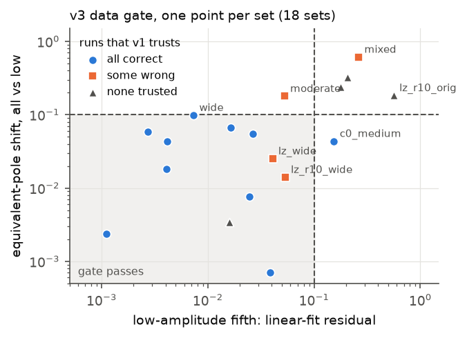

<!-- Companion note to the E1 workshop draft (experiments/C/e1_audit/paper/e1_workshop.qmd); project C, E5 / RQ4.
Sources for every number: experiments/C/e5_probe/README.md (passes 1-10), results/e5_gate.md, results/e5_v4.md and
the pre-registrations results/e5_*prereg*.md. Figures: experiments/C/e5_probe/figures.py. -->

## Abstract {.unnumbered}

Pole–residue neural operators store poles, and these are often read as the system's natural frequencies and decay
rates. For a nonlinear system the comparable quantity is the small-signal pole: the pole of the linearisation at
the operating point. We ask when a stored pole may be read as that pole. We do not trust the stored poles directly.
Instead we probe the trained operator with small inputs, which gives a Jacobian probe and an odd-part LTI probe,
and we check the training data.

The rule was built in four versions. Each version was fixed before the runs that tested it, and each change
answered a failure seen in an earlier test. The tests cover five systems (damped and undamped Duffing, a driven
pendulum, and forced Lorenz at ρ = 5 and 10), 18 data sets and 375 trained models.

The final rule, v4, makes no false trust over all 375 models. On the one system it had not seen (Lorenz ρ = 10,
75 models) it trusts 8 runs, all within 4 % of the small-signal pole. It requires four things:

- the Jacobian is causal and shift-invariant;
- the Jacobian's pole matches a stored pole;
- the two probes agree;
- the data's equivalent linear pole moves less than 10 % from its value at small amplitudes.

Two further results matter for practice. The published LNO configuration never moves its poles from the
initialisation. And the models that do hold physical poles are LNOs with a stable initialisation and a 10× pole
learning rate, but their Jacobians are rarely causal, so the rule certifies mostly a linear pole–residue layer.

## Introduction

Laplace-type neural operators represent the transient part of a solution as a sum of modes
$\sum_n \beta_n/(s-\mu_n)$ with trainable poles $\mu_n$ [@cao2024lno; @kim2026pilno; @ha2026lfno]. A companion
audit on linear systems (E1) found that the poles move far enough to be right only when the training protocol
allows it, and that a good fit does not imply right poles. Most benchmarks in this literature are nonlinear,
however: Duffing and pendulum oscillators, and the Lorenz system [@cao2024lno].

For a nonlinear system "the pole" needs a definition. We use the **small-signal pole**: the pole of the
linearisation about the operating point that is the input–output map's response to $f = 0$. It is what a
practitioner would compare with an identified linear model. A stored pole can differ from it for three reasons:

1. it never moved from its initialisation;
2. the model carries the dynamics elsewhere, in its nonlinearity or its steady (Fourier) branch;
3. it is a valid *equivalent* linear pole of the training amplitudes, which have drifted from the small-signal
   regime.

**Contribution.** We give a trust rule that reads a stored pole as physical only when checks on the model and
on the data both pass. We report how it was built: four versions, each pre-registered before the test that
followed. Every failure is kept in the record (@sec-history), and the final rule is tested on a system it had
not seen.

## Setting {#sec-setting}

**Systems and data.** All sets use the LNO time grid ($T = 20.47$, $\Delta t = 0.01$, 2048 points) and splits of
200 / 50 / 130. The original LNO data use inputs $A \sin 5t$, $A \in [0.05, 10]$. We checked the original data
against our own simulations (relative error $2.4\cdot10^{-4}$ to $1.2\cdot10^{-1}$). The new sets use the four E1
input families (step, ramp, pseudo-random binary, smooth random) scaled to a band of peak $|f|$. Each band was
chosen from a scan of the data alone, before any model was trained.

| system | small-signal pole | sets |
|---|---|---|
| damped Duffing $x''+0.5x'+x+x^3=f$ | $-0.25 \pm 0.968i$ | `small`, `mixed`, `medium`, `moderate`, `wide` |
| driven pendulum $x''+0.5x'+\sin x=f$ | $-0.25 \pm 0.968i$ | `pend_orig`, `pend_medium`, `pend_large`, `pend_wide` |
| undamped Duffing $x''+x+x^3=f$ | $\pm i$ | `c0_orig`, `c0_small`, `c0_medium` |
| forced Lorenz, $\rho = 5$, output $x$ | $-0.929 \pm 4.148i$ (and $-11.8$) | `lz_orig`, `lz_small`, `lz_wide` |
| forced Lorenz, $\rho = 10$, output $x$ | $-0.596 \pm 6.174i$ (and $-12.5$) | `lz_r10_orig`, `lz_r10_small`, `lz_r10_wide` |

: The five systems and 18 data sets. Lorenz: $x'=10(y-x)$, $y'=x(\rho-z)-y$, $z'=xy-\tfrac83 z-f$
[@cao2024lno]. Its operating point is the equilibrium $C_+$; the new Lorenz sets start there, and the original
data start from $x(0)=1$. {#tbl-systems tbl-colwidths="[36,30,34]"}

**Models.** We use four variants, five seeds each, all trained with the original LNO protocol (complex Adam,
lr 0.002, weight decay $10^{-4}$, step decay 0.5 every 100 epochs, 1000 epochs):

- the original one-layer LNO for each benchmark [@cao2024lno], with 128–1344 stored poles;
- the same LNO with the pole learning rate ×10;
- the same LNO with the E1 "stable" initialisation and the pole learning rate ×10;
- a linear tied pole–residue layer with 4 slots (E1), the same initialisation and the pole learning rate ×10.

On Lorenz the tied layer has a learned output offset $b(t)$, which does not depend on the input.

**Probes.** Let $G$ be the trained operator.

- **Jacobian probe.** $J = \partial G/\partial f$ at $f = 0$ (2048 × 2048, by automatic differentiation). It is
  *valid* if it is causal (less than 10 % of $\lVert J\rVert$ above the diagonal) and shift-invariant (a Toeplitz
  fit leaves less than 10 % of its causal part). Its pole $\mu_J$ comes from an order-2 matrix pencil on the mean
  subdiagonals. On the true Lorenz impulse responses this pencil is biased by 2.8 % ($\rho=5$) and 1.1 %
  ($\rho=10$).
- **LTI probe.** The odd part $(G(\varepsilon u)-G(-\varepsilon u))/2\varepsilon$ on 16 smooth random inputs,
  $\varepsilon = 0.01$. One complex pair is fitted (first-order hold), giving $\mu_\text{LTI}$.
- **Agreement with a stored pole.** $d = \min_n |\mu_n-\mu_J|/|\mu_J|$.

**Data side.** The *equivalent linear pole* of a set of samples is the best single complex pair fitted to all of
them (on Lorenz, to centred data). A model that fits well and is linear in its stored poles can only learn this
pole. It equals the small-signal pole only when the training amplitudes are small enough.

A trusted run is **correct** if $|\mu_J-\mu_\star|/|\mu_\star| < 0.1$, where $\mu_\star$ is the small-signal pole.

## The rule and how it was built {#sec-history}

| rule | conditions | fixed before | motivating failure |
|---|---|---|---|
| v1 | $J$ valid, $d<0.1$, test rel. $L_2<0.5$ | pass 4 | published LNO: stored poles at their initialisation, Jacobian non-causal (passes 1–2) |
| v2 | v1 and data gate: linear fit of all training data leaves $<0.1$ | pass 5 | `mixed`: 2 trusted runs 43 % and 86 % off; they are the data's equivalent pole |
| v3 | v1 and data gate: lowest fifth by amplitude linear ($<0.1$), equivalent-pole shift all vs. low $<0.1$ | pass 7 | v2 abstains on the pendulum although every candidate is correct (softening spring: large residual, small pole shift) |
| v4 | v3 gate, $J$ valid, $d<0.1$, probe agreement $|\mu_\text{LTI}-\mu_J|/|\mu_J|<0.1$, centred fit error $<0.5$ | pass 10 | Lorenz $\rho=5$: a slow Jacobian pole matched by an unmoved stored pole (96 % off) |

: The four versions. Pass numbers refer to `experiments/C/e5_probe/README.md`. The v3 threshold was first 0.05 and
was set to 0.1 before the pass-7 test. {#tbl-rules tbl-colwidths="[6,40,10,44]"}

v1 was defined after a first look at 20 runs, so those runs are development data. Every later version was written
down, with predictions, before the runs that test it. Two predictions failed and are reported as such:

- v3's prediction of no false trust on Lorenz $\rho=5$;
- a tied-layer fit prediction on Lorenz $\rho=10$. The cause was the protocol's weight decay on the output offset
  (@sec-models).

## Results {#sec-results}

| rule | trusted | false | missed | prospective sets / runs | prospective trusted / false / missed |
|---|---|---|---|---|---|
| v1 | 66 | 9 | 0 | 18 / 375 | 66 / 9 / 0 |
| v2 | 28 | 0 | 29 | 16 / 335 | 22 / 0 / 29 |
| v3 | 55 | 3 | 5 | 11 / 235 | 29 / 3 / 5 |
| v4 | 52 | **0** | 5 | 3 / 75 | 8 / **0** / 0 |

: Every rule applied to all 18 sets (left), and only to the sets tested after the rule was fixed (right).
Missed: correct runs that v1 trusts and the rule does not. {#tbl-totals tbl-colwidths="[8,12,10,10,28,32]"}

**The data gate.** A run that fits the training data well learns the data's equivalent linear pole. So the data
must show that this pole has not moved far from its small-amplitude value (@fig-gate).

- v1 alone trusts 6 wrong poles on the two hardening Duffing sets (`mixed`, `moderate`), where the equivalent
  pole has moved 18–61 %.
- v2's residual gate removes them, but it also rejects the pendulum sets. There the residual is large while the
  pole hardly moves.
- v3's pole-shift gate keeps both cases right on the oscillators. Its cost is the undamped set `c0_medium`: a
  1.4 % pole error already leaves a 15 % residual over the 20 s window when there is no damping, so the gate
  abstains on 5 correct runs.

{#fig-gate width=68%}

**Probe agreement.** On Lorenz the data gate passes, and v3 still trusts three wrong poles. They show two failure
modes:

- *Slow mode.* An original-initialisation LNO ($\rho=5$ and $\rho=10$, the same seed) has a Jacobian that decays
  at a slow pole near the origin. A stored pole that never moved from its initialisation sits at the same place,
  so $d = 0.02$–$0.07$. The model's odd-part response to small inputs has a very different pole: the two probes
  differ by a factor of about 1900 and 4800.
- *Fast mode.* A tied layer ($\rho=10$) has a spurious Jacobian pole at $-1.5+39.4i$ that matches one of its stored
  poles. Its LTI probe gives $-2.1+3.6i$ ($a=0.91$).

The two probes measure the same small-signal linearisation in different ways, so a physical pole must appear in
both. In all 52 correct trusted runs they agree within 4 %. In the three false ones they disagree by 0.91 to
4800 (@fig-agree). The centred fit criterion decided no case here. It is kept because the plain relative error
cannot detect a bad fit when the output has a large mean: on Lorenz even the mean trajectory scores 0.011–0.11.

{#fig-agree width=68%}

## What the probes say about the models {#sec-models}

- **The published LNO configuration does not learn physical poles.** In every seed, all 256 stored poles of the
  Duffing LNO stay at their initialisation ($|\mu|\approx0.1$), and none is near the small-signal pole. This is
  E1's travel bound in a nonlinear model. The model still captures the dynamics: secant (equivalent-linear)
  probes of its response follow the data's amplitude-dependent pole to 0.1–1.5 % up to $A = 7$. The physics
  sits in the nonlinearity and the Fourier branch, not in the poles.
- **A stable initialisation and a 10× pole learning rate put physical poles into the LNO.**
  - On the oscillators and on Lorenz $\rho = 10$, most seeds store poles within 10 % of the small-signal pole.
  - Their Jacobian poles are within 10 % in most runs on the simulated sets, and these LNOs give the best fits.
  - But their Jacobians are usually slightly non-causal (0.05–0.43 of the norm above the diagonal). So v4
    certifies only 7 of these 90 runs; of its 52 trusted runs, 45 are linear tied layers.
  - Why these Jacobians are non-causal is open.
- **No model stores the fast real Lorenz pole** ($-11.8$ and $-12.5$), as with the fast real poles in E1.
- **Output offsets need care.** On Lorenz the output is $x(t)$ about $C_+ \approx 3.3$ or $4.9$. A learned offset
  with coupled weight decay is pulled towards zero at almost the full learning rate, because its own gradient
  vanishes at the optimum. The tied layer then fits worse than the mean trajectory. With the offset excluded from
  weight decay it fits ($e_c$ 0.02–0.22), and 7 of 10 such runs on the gated $\rho = 10$ sets are trusted, all
  within 2–3 %.

## Limitations

- **The rule was refined after failures.** Each version is the answer to a failure of the previous one. The
  prospective record is therefore small for the latest version: v4 was tested on 75 models of one system and
  trusted 8. Its zero false trusts on the earlier sets are partly fit to those sets.
- **One pair.** The probes read one complex pair, the dominant small-signal pole. Higher-order or real poles are
  not certified; the fast Lorenz pole was never learned.
- **Cost.** The rule abstains on undamped poles at moderate amplitude (`c0_medium`). It also needs
  low-amplitude samples in the training data to evaluate the gate.
- **Scope.** The systems are low-order ODEs with a scalar input and output. All models were trained with one
  protocol, and the LNO is the only deep architecture probed.

## Recommendation

Before a stored pole of a Laplace-type operator is reported as physical, check four things:

1. the operator's small-signal Jacobian is causal and shift-invariant;
2. its pole agrees with a stored pole and with an independent odd-part probe;
3. the fit is good relative to the output's variation;
4. the training data's equivalent linear pole stays within the claimed accuracy of its small-amplitude value.

If any check fails, report the probe poles, which describe the operator, and not the stored poles.

::: {#refs}
:::
