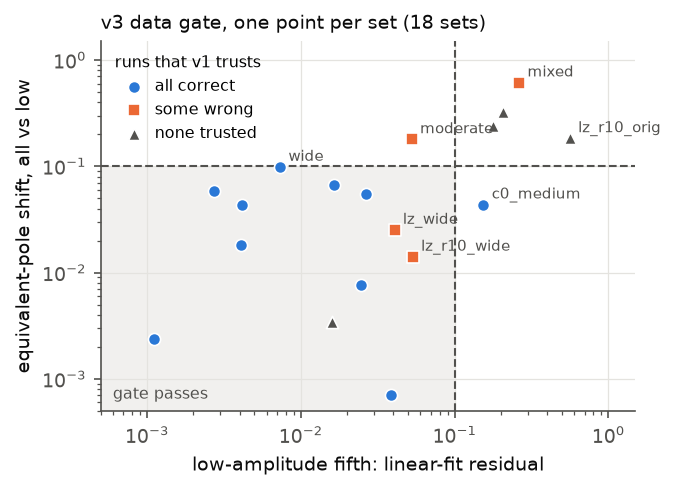

<!-- Project C working paper: E1 (linear audit) and E5 / RQ4 (nonlinear trust rule), merged 2026-11-18 from
experiments/C/e1_audit/paper/e1_workshop.qmd and experiments/C/e5_probe/paper/e5_note.qmd (see git history).
Submission postponed; venue and length open. Sources for every number: experiments/C/e1_audit/README.md,
results/summary.md, results/per_pole.md (E1); experiments/C/theory/README.md (E2 paragraph);
experiments/C/e5_probe/README.md, results/e5_gate.md, results/e5_v4.md and results/e5_*prereg*.md (E5).
Figures: experiments/C/e1_audit/figures.py, experiments/C/e5_probe/figures.py. -->

## Abstract {.unnumbered}

Laplace-type neural operators represent the transient part of a solution by learned poles and residues, and
these poles are often read as the system's natural frequencies and decay rates. We test that reading in two
steps.

**Linear systems with known poles.** We audit LNO, ALNO and LFNO in 900 training runs, both as single
pole–residue layers and as full architectures. We find three things:

1. Under the published protocols the poles cannot move far enough: the learning-rate schedule caps their
   travel.
2. Once they can move, the lightly damped complex poles are found.
3. Fast real poles are not found by any published recipe, although the data identify them.

Models fit equally well with right or wrong poles, so test error does not certify poles.

**Nonlinear systems.** Here the comparable quantity is the small-signal pole, the pole of the linearisation at
the operating point. We build a rule that reads a stored pole as physical only when probes of the trained
operator and a check on the training data agree. It took four versions, each pre-registered before the test that
followed. The tests cover five systems (damped and undamped Duffing, a driven pendulum, forced Lorenz at $\rho = 5$ and
10), 18 data sets and 375 trained models.

The final rule makes no false trust in any of them. On the system it had not seen it trusts 8 of 75 models, all
within 4 %. It requires:

- a causal, shift-invariant small-signal Jacobian whose pole matches a stored pole;
- agreement between two independent probes;
- a good fit relative to the output's variation;
- an equivalent linear pole of the data that stays near its small-amplitude value.

The published LNO configuration never moves its poles. Its small-signal Jacobian is non-causal because of a
channel-index quirk in the original code; with the textbook wiring the LNO fits better, and the rule certifies its
stored poles in 37 of 90 runs, with no false trust.

## Introduction

Neural operators with a Laplace (pole–residue) branch represent a solution operator as a sum of exponentially
decaying or oscillating modes, $\sum_n \beta_n / (s - \mu_n)$, often in parallel with a Fourier (steady-state)
branch [@cao2024lno; @kim2026pilno; @ha2026lfno; @ha2025bestofboth]. The poles $\mu_n$ are trainable. Their
appeal is interpretability: if the learned $\mu_n$ are the system's poles, the model exposes natural frequencies
and decay rates, which neither a Fourier neural operator [@li2021fno] nor a generic network can.

This claim is rarely tested. Benchmarks report test error, and test error does not depend on whether the poles
are physical. Two branches that can take over each other's role, or many poles that jointly approximate one, give
the same output with different poles. We ask two questions:

- **On linear systems with known poles**, do the learned poles match the truth, and how much do they vary across
  seeds? (Sections 2–3)
- **On nonlinear systems**, where "the pole" is the small-signal pole of the linearisation at the operating point,
  when may a stored pole be read as that pole? (Sections 4–7)

A stored pole of a nonlinear model can differ from the small-signal pole for three reasons:

1. it never moved from its initialisation;
2. the model carries the dynamics elsewhere, in its nonlinearity or its steady branch;
3. it is a valid *equivalent* linear pole of the training amplitudes, which have drifted from the small-signal
   regime.

**Contributions.**

1. An audit of LNO v1 [@cao2024lno], ALNO [@kim2026pilno] and LFNO [@ha2026lfno; @ha2025bestofboth] on three
   linear systems with 2, 4 and 6 known poles, under the published protocols and controls (900 runs).
2. A mechanism for the main failure: the learning-rate schedule bounds the total pole travel.
3. A separation of what training fails to find from what the data cannot identify, for fast real poles.
4. A trust rule for stored poles of nonlinear operators. It combines a Jacobian probe, an odd-part LTI probe and
   a gate on the data. It is built in four pre-registered versions, every failure is kept in the record, and the
   final version is tested on a system it had not seen.

## Linear systems: setup {#sec-lin-setup}

**Systems.** We use three systems:

- `p2`: $-0.5 \pm 2i$;
- `p4`: $-0.4 \pm 3i$, $-1$, $-0.2$;
- `p6`: $-0.5 \pm 1.5i$, $-0.3 \pm 4i$, $-1$, $-2$.

The window is $T = 20$ with 1,024 samples, and the outputs are exact. The inputs are non-periodic: steps, ramps, PRBS and smooth random signals, split 200 / 50 / 100 into training, validation and test.

**Models and settings.**

- *Layer setting:* each model is reduced to one single-channel pole–residue layer:
  - tied, the LNO v1 layer, where the steady response is computed from the same poles;
  - ALNO, with an untied steady branch;
  - LFNO, with a Fourier steady branch.

  The learned poles are then directly comparable with the truth. This setting compares poles, not accuracy, so the parameter counts differ by construction (8–56).
- *Deep setting:* the full architectures at the LFNO budget (5,927–5,977 parameters). Here the poles are pooled over layers and channels, and we report the pooled pole closest to each true pole. With 768–1,024 pooled poles this is an **optimistic upper bound** on recovery.

ALNO and LFNO have no public code and were re-implemented from the papers. Their layer arrangement and initialisations are not fully specified, and we document our choices.

**Protocols and controls.**

- *Published protocols:* `common`, the original LNO 1D protocol (ComplexAdam, lr 0.002, halved every 100 epochs, 1,000 epochs), and `lfno_paper` for LFNO.
- *Published-style initialisations:* the original LNO one (`lno`), and `stable`, a log-uniform decay rate with uniform frequency up to $\pi/(4\,\Delta t)$.
- *Controls:*
  - a ten-times pole learning rate;
  - a `band` initialisation within the true frequency range;
  - a `warm` start at the truth plus 20 %.
- *Seeds:* 10 in the layer setting and 5 in the deep setting.

**Metrics.** We fold learned poles to $\operatorname{Im} \ge 0$ and match them to the true poles. The pole error is the mean relative error after matching. A pole is *recovered* if its relative error is below 0.1. The *oracle*, true poles in one tied layer, reproduces the outputs to about $10^{-3}$, the representation floor of the layer.

## Linear systems: results {#sec-lin-results}

| setting | model | protocol / init | p2 | p4 | p6 | test rel. L2 (p6) |
|---|---|---|---|---|---|---|
| layer | tied (LNO v1) | `common`, `stable` | 5.4 ± 4.3 | 14.8 ± 8.3 | 6.4 ± 2.2 | 0.23 |
| layer | tied | + pole lr × 10 | 0.04 ± 0.11 | 1.6 ± 0.3 | 0.83 ± 0.43 | 0.023 |
| layer | tied | warm start | 0.007 ± 0.006 | 0.024 ± 0.036 | 0.042 ± 0.019 | 9.9e-4 |
| deep† | ALNO | `common`, `stable` | 0.12 ± 0.03 | 0.35 ± 0.09 | 0.38 ± 0.01 | 1.6e-2 |
| deep† | ALNO | + pole lr × 10 | 0.05 ± 0.02 | 0.23 ± 0.05 | 0.32 ± 0.03 | 1.7e-2 |
| deep† | LFNO | `common`, `stable` | 0.08 ± 0.02 | 0.37 ± 0.06 | 0.41 ± 0.01 | 2.2e-2 (2/5 diverged) |
| deep† | LFNO | `lfno_paper`, `stable` | 0.20 ± 0.01 | 0.44 ± 0.06 | 0.51 ± 0.01 | 4.3e-2 (3/5 diverged) |
| deep | all | `lno` init | 0.94–0.97 | 0.87–0.94 | 0.95–0.97 | ≈ 1.0 (no training) |

: Pole error (mean relative error after matching; mean ± std over seeds; diverged runs excluded). †Closest pooled pole, an optimistic upper bound. The full grid of models, protocols and initialisations is in the appendix. {#tbl-main tbl-colwidths="[8,12,20,14,14,14,18]"}

### Under the published protocols the poles cannot move far enough {#sec-travel}

Adam moves each parameter by about the learning rate per step, so the schedule bounds the total travel of a pole: $\sum \mathrm{lr} \times \text{steps} = 4.0$ for `common` and 3.6 for `lfno_paper`. The `stable` initialisation starts at $|\mu| \approx 20$, while the true poles have $|\operatorname{Im}\mu| \le 4$.

With the `stable` initialisation:

- 35–92 % of the layer poles end within 10 % of the bound (@fig-travel, left);
- deep-model poles move $\Delta\operatorname{Im} \approx -3.9$ with $\Delta\operatorname{Re} \approx 0$, travelling down in frequency at full speed for the whole run;
- fewer than 0.3 % of pooled deep poles leave the initial decay range.

With the original `lno` initialisation the poles start unstable, and no deep model trains (test error ≈ 1).

{#fig-travel width=95%}

### Once the poles can move, the oscillatory poles are found

A ten-times pole learning rate raises the bound to 40, and no pole saturates it any longer. The tied layer's pole error drops from 5.4 / 14.8 / 6.4 to 0.04 / 1.6 / 0.83 (p2 / p4 / p6). In the deep models the closest pooled poles recover the complex pairs in 89–100 % of runs (@fig-recovery).

The deep test error does not change (ALNO 1.6e-2 → 1.7e-2): the published models are equally accurate whether or not their poles are right. Two further observations:

- With the LFNO protocol about 60 % of LFNO's learned poles end unstable ($\operatorname{Re}\mu > 0$), and 10 of 30 deep LFNO runs diverged.
- A weight decay of 0.01 on the poles pulls real poles towards zero, even from a warm start (−2 moves by +1.7).

{#fig-recovery width=95%}

### Fast real poles are not found, although the data identify them {#sec-fastreal}

Without a warm start the real poles −1 and −2 are recovered in 0–10 % of runs in every setting, including the tied layer with enough travel. Meanwhile the models still fit: the tied layer on p6 reaches a test error of 8e-3 without −2. The learned poles matched to −1 and −2 are lightly damped complex poles near $-0.5 \pm (0.1\text{–}0.9)i$.

Is this a training failure or a limit of the data? Profiles [@raue2009profile] of the layer's error in each real pole's decay rate are flat within a few times its representation floor (@fig-profile): fixing the decay rate of −2 anywhere in [−6, −1] costs at most 2.1e-3, below the test error of good-fit runs. The complex poles, by contrast, have sharp profiles. That floor, however, comes from the layer's band-limited input hold, not from the data. A follow-up study (to appear) shows that the E1 data do identify these poles:


- A training recipe without prior knowledge of the poles recovers −1 / −2 on p6 in 95 / 70 % of runs. It uses real-constrained slots on a log grid of decay rates, a damping bound on complex slots, multi-start and an L-BFGS polish.
- A truth-free certificate built on a first-order-hold refit reports every pole, with no false pole, in 4/4 groups of five runs.
- Under relative output noise the limit is the Cramér–Rao bound: −2 is identified up to a noise level of about 0.03 and lost near 0.1, −1 holds to about 0.1, and the p4 real poles to at least 0.3.

The fast real poles are therefore missed by the published recipes, not hidden by the data.

{#fig-profile width=72%}

## Nonlinear systems: setting {#sec-setting}

**Systems and data.** All sets use the LNO time grid ($T = 20.47$, $\Delta t = 0.01$, 2048 points) and splits of
200 / 50 / 130. The original LNO data use inputs $A \sin 5t$, $A \in [0.05, 10]$. We checked the original data
against our own simulations (relative error $2.4\cdot10^{-4}$ to $1.2\cdot10^{-1}$). The new sets use the four input
families of @sec-lin-setup (step, ramp, pseudo-random binary, smooth random) scaled to a band of peak $|f|$. Each band was
chosen from a scan of the data alone, before any model was trained.

| system | small-signal pole | sets |
|---|---|---|
| damped Duffing $x''+0.5x'+x+x^3=f$ | $-0.25 \pm 0.968i$ | `small`, `mixed`, `medium`, `moderate`, `wide` |
| driven pendulum $x''+0.5x'+\sin x=f$ | $-0.25 \pm 0.968i$ | `pend_orig`, `pend_medium`, `pend_large`, `pend_wide` |
| undamped Duffing $x''+x+x^3=f$ | $\pm i$ | `c0_orig`, `c0_small`, `c0_medium` |
| forced Lorenz, $\rho = 5$, output $x$ | $-0.929 \pm 4.148i$ (and $-11.8$) | `lz_orig`, `lz_small`, `lz_wide` |
| forced Lorenz, $\rho = 10$, output $x$ | $-0.596 \pm 6.174i$ (and $-12.5$) | `lz_r10_orig`, `lz_r10_small`, `lz_r10_wide` |

: The five systems and 18 data sets. Lorenz: $x'=10(y-x)$, $y'=x(\rho-z)-y$, $z'=xy-\tfrac83 z-f$
[@cao2024lno]. Its operating point is the equilibrium $C_+$; the new Lorenz sets start there, and the original
data start from $x(0)=1$. {#tbl-systems tbl-colwidths="[36,30,34]"}

**Models.** We use four variants, five seeds each, all trained with the original LNO protocol (complex Adam,
lr 0.002, weight decay $10^{-4}$, step decay 0.5 every 100 epochs, 1000 epochs):

- the original one-layer LNO for each benchmark [@cao2024lno], with 128–1344 stored poles;
- the same LNO with the pole learning rate ×10;
- the same LNO with the `stable` initialisation (@sec-lin-setup) and the pole learning rate ×10;
- the linear tied pole–residue layer of @sec-lin-setup with 4 slots, the same initialisation and the pole learning rate ×10.

On Lorenz the tied layer has a learned output offset $b(t)$, which does not depend on the input.

**Probes.** Let $G$ be the trained operator.

- **Jacobian probe.** $J = \partial G/\partial f$ at $f = 0$ (2048 × 2048, by automatic differentiation). It is
  *valid* if it is causal (less than 10 % of $\lVert J\rVert$ above the diagonal) and shift-invariant (a Toeplitz
  fit leaves less than 10 % of its causal part). Its pole $\mu_J$ comes from an order-2 matrix pencil on the mean
  subdiagonals. On the true Lorenz impulse responses this pencil is biased by 2.8 % ($\rho=5$) and 1.1 %
  ($\rho=10$).
- **LTI probe.** The odd part $(G(\varepsilon u)-G(-\varepsilon u))/2\varepsilon$ on 16 smooth random inputs,
  $\varepsilon = 0.01$. One complex pair is fitted (first-order hold), giving $\mu_\text{LTI}$.
- **Agreement with a stored pole.** $d = \min_n |\mu_n-\mu_J|/|\mu_J|$.

**Data side.** The *equivalent linear pole* of a set of samples is the best single complex pair fitted to all of
them (on Lorenz, to centred data). A model that fits well and is linear in its stored poles can only learn this
pole. It equals the small-signal pole only when the training amplitudes are small enough.

A trusted run is **correct** if $|\mu_J-\mu_\star|/|\mu_\star| < 0.1$, where $\mu_\star$ is the small-signal pole.

## Nonlinear systems: a trust rule and how it was built {#sec-history}

| rule | conditions | fixed before | motivating failure |
|---|---|---|---|
| v1 | $J$ valid, $d<0.1$, test rel. $L_2<0.5$ | pass 4 | published LNO: stored poles at their initialisation, Jacobian non-causal (passes 1–2) |
| v2 | v1 and data gate: linear fit of all training data leaves $<0.1$ | pass 5 | `mixed`: 2 trusted runs 43 % and 86 % off; they are the data's equivalent pole |
| v3 | v1 and data gate: lowest fifth by amplitude linear ($<0.1$), equivalent-pole shift all vs. low $<0.1$ | pass 7 | v2 abstains on the pendulum although every candidate is correct (softening spring: large residual, small pole shift) |
| v4 | v3 gate, $J$ valid, $d<0.1$, probe agreement $|\mu_\text{LTI}-\mu_J|/|\mu_J|<0.1$, centred fit error $<0.5$ | pass 10 | Lorenz $\rho=5$: a slow Jacobian pole matched by an unmoved stored pole (96 % off) |

: The four versions. Pass numbers refer to `experiments/C/e5_probe/README.md`. The v3 threshold was first 0.05 and
was set to 0.1 before the pass-7 test. {#tbl-rules tbl-colwidths="[6,40,10,44]"}

v1 was defined after a first look at 20 runs, so those runs are development data. Every later version was written
down, with predictions, before the runs that test it. Two predictions failed and are reported as such:

- v3's prediction of no false trust on Lorenz $\rho=5$;
- a tied-layer fit prediction on Lorenz $\rho=10$. The cause was the protocol's weight decay on the output offset
  (@sec-models).

## Nonlinear systems: results {#sec-results}

| rule | trusted | false | missed | prospective sets / runs | prospective trusted / false / missed |
|---|---|---|---|---|---|
| v1 | 66 | 9 | 0 | 18 / 375 | 66 / 9 / 0 |
| v2 | 28 | 0 | 29 | 16 / 335 | 22 / 0 / 29 |
| v3 | 55 | 3 | 5 | 11 / 235 | 29 / 3 / 5 |
| v4 | 52 | **0** | 5 | 3 / 75 | 8 / **0** / 0 |

: Every rule applied to all 18 sets (left), and only to the sets tested after the rule was fixed (right).
Missed: correct runs that v1 trusts and the rule does not. {#tbl-totals tbl-colwidths="[8,12,10,10,28,32]"}

**The data gate.** A run that fits the training data well learns the data's equivalent linear pole. So the data
must show that this pole has not moved far from its small-amplitude value (@fig-gate).

- v1 alone trusts 6 wrong poles on the two hardening Duffing sets (`mixed`, `moderate`), where the equivalent
  pole has moved 18–61 %.
- v2's residual gate removes them, but it also rejects the pendulum sets. There the residual is large while the
  pole hardly moves.
- v3's pole-shift gate keeps both cases right on the oscillators. Its cost is the undamped set `c0_medium`: a
  1.4 % pole error already leaves a 15 % residual over the 20 s window when there is no damping, so the gate
  abstains on 5 correct runs.

{#fig-gate width=68%}

**Probe agreement.** On Lorenz the data gate passes, and v3 still trusts three wrong poles. They show two failure
modes:

- *Slow mode.* An original-initialisation LNO ($\rho=5$ and $\rho=10$, the same seed) has a Jacobian that decays
  at a slow pole near the origin. A stored pole that never moved from its initialisation sits at the same place,
  so $d = 0.02$–$0.07$. The model's odd-part response to small inputs has a very different pole: the two probes
  differ by a factor of about 1900 and 4800.
- *Fast mode.* A tied layer ($\rho=10$) has a spurious Jacobian pole at $-1.5+39.4i$ that matches one of its stored
  poles. Its LTI probe gives $-2.1+3.6i$ ($a=0.91$).

The two probes measure the same small-signal linearisation in different ways, so a physical pole must appear in
both. In all 52 correct trusted runs they agree within 4 %. In the three false ones they disagree by 0.91 to
4800 (@fig-agree). The centred fit criterion decided no case here. It is kept because the plain relative error
cannot detect a bad fit when the output has a large mean: on Lorenz even the mean trajectory scores 0.011–0.11.

{#fig-agree width=68%}

## What the probes say about the models {#sec-models}

- **The published LNO configuration does not learn physical poles.** In every seed, all 256 stored poles of the
  Duffing LNO stay at their initialisation ($|\mu|\approx0.1$), and none is near the small-signal pole. This is
  the travel bound of @sec-travel in a nonlinear model. The model still captures the dynamics: secant (equivalent-linear)
  probes of its response follow the data's amplitude-dependent pole to 0.1–1.5 % up to $A = 7$. The physics
  sits in the nonlinearity and the Fourier branch, not in the poles.
- **A stable initialisation and a 10× pole learning rate put physical poles into the LNO.** On the oscillators and
  on Lorenz $\rho = 10$, most seeds store poles within 10 % of the small-signal pole, and these LNOs fit best. But
  their Jacobians are slightly non-causal (0.05–0.43 of the norm above the diagonal), so v4 certifies only 7 of
  these 90 runs.
- **The non-causality is a wiring quirk of the original code.** For one pole, the exact causal response is the
  periodic (FFT) steady response minus $C e^{\mu t}$, where $C$ is fixed by the whole input. The textbook layer
  attaches each such coefficient to its own pole, so the wrap-around cancels. The original LNO code contracts the
  residue's output channel again with the pole's input channel, so each coefficient multiplies another pole's
  exponential.
  - In all 268 trained LNOs that did not overflow, the pole–residue layer as coded is 12–82 % non-causal. The same
    weights in the textbook wiring give 0.5–2.5 %.
  - Trained with the textbook wiring (90 further runs, pre-registered), the LNO has causal Jacobians in every run
    and a lower median test error on all 18 sets.
  - v4 certifies 37 of these runs, with no false trust. Over all 465 runs, v4 trusts 89 with no false trust.
  - Where its Jacobian pole is right but no stored pole is within 10 % (12 runs, mostly Lorenz $\rho = 5$), the
    rule declines to read the stored poles, as it should.
- **No model stores the fast real Lorenz pole** ($-11.8$ and $-12.5$), as with the fast real poles of @sec-fastreal.
- **Output offsets need care.** On Lorenz the output is $x(t)$ about $C_+ \approx 3.3$ or $4.9$. A learned offset
  with coupled weight decay is pulled towards zero at almost the full learning rate, because its own gradient
  vanishes at the optimum. The tied layer then fits worse than the mean trajectory. With the offset excluded from
  weight decay it fits ($e_c$ 0.02–0.22), and 7 of 10 such runs on the gated $\rho = 10$ sets are trusted, all
  within 2–3 %.

## Discussion

**Test error does not certify poles.** In every linear setting, models with correct and incorrect poles reach
similar test errors. On nonlinear systems the published LNO fits and even follows the amplitude-dependent dynamics
(secant probes within 1.5 %), while its stored poles stay at their initialisation. A model can therefore be
accurate and still have uninterpretable poles.

**What to report.** A claim that learned poles are physical should come with checks.

- On systems with known poles:
  - the pole error after matching;
  - the spread over seeds;
  - the pole travel relative to the learning-rate budget.

  For deep models, a pooled closest-pole match is only an upper bound and should be labelled as such.
- On nonlinear systems, before a stored pole is reported as physical, check that:
  1. the operator's small-signal Jacobian is causal and shift-invariant;
  2. its pole agrees with a stored pole and with an independent odd-part probe;
  3. the fit is good relative to the output's variation;
  4. the training data's equivalent linear pole stays within the claimed accuracy of its small-amplitude value.

  If any check fails, report the probe poles, which describe the operator, and not the stored poles.

**Simple fixes go a long way, but not all the way.** Raising the pole learning rate, or initialising within the
right frequency band, recovers the oscillatory poles on linear systems. The same change (stable initialisation,
pole learning rate × 10) puts physical poles into the nonlinear LNOs. Real poles need a parameterisation that
keeps real slots real. Learned output offsets should be excluded from weight decay.

## Limitations {.unnumbered}

**Linear audit.**

- ALNO and LFNO are re-implementations, and neither paper states its initialisation.
- We use three systems, one data seed, one window and one grid.
- The deep metric is an optimistic bound.
- The layer setting does not match parameter budgets; the deep setting does.
- LNO v1 at the matched 5.9k budget does not train from its original initialisation, and its published 1.8k
  configuration was not run.
- The follow-up recipe was tested on the tied single layer only.

**Nonlinear trust rule.**

- **The rule was refined after failures.** Each version is the answer to a failure of the previous one. The
  prospective record is therefore small for the latest version: v4 was tested on 75 models of one system and
  trusted 8. Its zero false trusts on the earlier sets are partly fit to those sets.
- **One pair.** The probes read one complex pair, the dominant small-signal pole. Higher-order or real poles are
  not certified; the fast Lorenz pole was never learned.
- **Cost.** The rule abstains on undamped poles at moderate amplitude (`c0_medium`). It also needs
  low-amplitude samples in the training data to evaluate the gate.
- **Scope.** The systems are low-order ODEs with a scalar input and output. All models were trained with one
  protocol, and the LNO is the only deep architecture probed.

## References {.unnumbered}

::: {#refs}
:::

## Appendix: full grid of the linear audit {.unnumbered}

<!-- Copied from results/summary.md (2026-11-18); regenerate with e1_audit.py --summarize if the runs change. -->

All models, initialisations and protocols. Deep-setting pole errors use the closest pooled poles (an optimistic upper bound). Per-pole recovery: `results/per_pole.md` in the code release.

mean ± std over seeds. pole error: relative, after folding and Hungarian matching (deep: closest pooled poles). spread: mean over true poles of `seed_spread`. Diverged runs (non-finite weights) are counted under seeds and excluded from the statistics.

```{=latex}
\begingroup\scriptsize\setlength{\tabcolsep}{3pt}
```

### layer {.unnumbered}

| system | model | init | protocol | n | params | seeds | test rel. L2 | pole error | seed spread | unstable | transient frac. |
|---|---|---|---|---|---|---|---|---|---|---|---|
| p2 | alno | band | common | 2 | 40 | 10 | 7.62e-02 ± 5.7e-02 | 0.221 ± 0.281 | 0.580 | 0.05 | 0.06 ± 0.01 |
| p2 | alno | band | common+plr10 | 2 | 40 | 10 | 4.47e-02 ± 7.5e-03 | 0.052 ± 0.040 | 0.083 | 0.00 | 0.06 ± 0.00 |
| p2 | alno | lno | common | 2 | 40 | 10 | 6.41e+03 ± 1.2e+04 | 0.816 ± 0.093 | 0.192 | 0.90 | 0.82 ± 0.30 |
| p2 | alno | stable | common | 2 | 40 | 10 | 1.62e-01 ± 7.9e-02 | 5.545 ± 4.517 | 9.313 | 0.00 | 0.02 ± 0.03 |
| p2 | alno | stable | common+plr10 | 2 | 40 | 10 | 5.54e-02 ± 4.4e-02 | 0.152 ± 0.395 | 0.813 | 0.05 | 0.06 ± 0.01 |
| p2 | alno | warm | common | 2 | 40 | 10 | 4.30e-02 ± 6.4e-04 | 0.057 ± 0.015 | 0.030 | 0.00 | 0.06 ± 0.00 |
| p2 | lfno | band | common | 2 | 40 | 10 | 1.06e-01 ± 8.5e-02 | 0.249 ± 0.264 | 0.544 | 0.00 | 0.10 ± 0.16 |
| p2 | lfno | band | common+plr10 | 2 | 40 | 10 | 4.88e-02 ± 6.9e-03 | 0.053 ± 0.039 | 0.080 | 0.00 | 0.06 ± 0.00 |
| p2 | lfno | band | lfno_paper | 2 | 40 | 10 | 9.90e-02 ± 8.4e-02 | 0.142 ± 0.191 | 0.393 | 0.00 | 0.12 ± 0.16 |
| p2 | lfno | band | lfno_paper+plr10 | 2 | 40 | 10 | 6.57e-02 ± 3.9e-03 | 0.083 ± 0.020 | 0.042 | 0.00 | 0.07 ± 0.00 |
| p2 | lfno | lno | common | 2 | 40 | 10 | 6.41e+03 ± 1.2e+04 | 0.811 ± 0.086 | 0.177 | 0.90 | 0.83 ± 0.29 |
| p2 | lfno | lno | lfno_paper | 2 | 40 | 10 | 3.88e+03 ± 7.0e+03 | 0.813 ± 0.076 | 0.157 | 0.90 | 0.84 ± 0.27 |
| p2 | lfno | stable | common | 2 | 40 | 10 | 1.98e-01 ± 6.5e-02 | 5.782 ± 4.344 | 8.955 | 0.00 | 0.01 ± 0.02 |
| p2 | lfno | stable | common+plr10 | 2 | 40 | 10 | 1.59e-01 ± 9.4e-02 | 1.934 ± 1.755 | 3.619 | 0.00 | 0.03 ± 0.03 |
| p2 | lfno | stable | lfno_paper | 2 | 40 | 10 | 2.63e-01 ± 1.0e-01 | 5.486 ± 4.348 | 8.963 | 0.00 | 0.02 ± 0.02 |
| p2 | lfno | stable | lfno_paper+plr10 | 2 | 40 | 10 | 1.58e-01 ± 1.2e-01 | 0.362 ± 0.480 | 0.989 | 0.05 | 0.05 ± 0.02 |
| p2 | lfno | warm | common | 2 | 40 | 10 | 4.35e-02 ± 3.8e-04 | 0.054 ± 0.015 | 0.030 | 0.00 | 0.06 ± 0.00 |
| p2 | lfno | warm | lfno_paper | 2 | 40 | 10 | 5.90e-02 ± 1.0e-03 | 0.054 ± 0.009 | 0.019 | 0.00 | 0.07 ± 0.00 |
| p2 | tied | band | common | 2 | 8 | 10 | 4.36e-02 ± 5.9e-02 | 0.137 ± 0.175 | 0.361 | 0.00 | 0.06 ± 0.01 |
| p2 | tied | band | common+plr10 | 2 | 8 | 10 | 1.77e-02 ± 2.2e-02 | 0.043 ± 0.049 | 0.100 | 0.00 | 0.06 ± 0.00 |
| p2 | tied | lno | common | 2 | 8 | 10 | 6.41e+03 ± 1.2e+04 | 0.812 ± 0.088 | 0.181 | 0.95 | 0.85 ± 0.29 |
| p2 | tied | stable | common | 2 | 8 | 10 | 2.94e-01 ± 1.9e-01 | 5.382 ± 4.320 | 8.906 | 0.00 | 0.03 ± 0.02 |
| p2 | tied | stable | common+plr10 | 2 | 8 | 10 | 2.08e-02 ± 5.5e-02 | 0.038 ± 0.105 | 0.216 | 0.00 | 0.06 ± 0.01 |
| p2 | tied | warm | common | 2 | 8 | 10 | 1.20e-03 ± 7.2e-04 | 0.007 ± 0.006 | 0.013 | 0.00 | 0.06 ± 0.00 |
| p4 | alno | band | common | 4 | 48 | 10 | 9.75e-02 ± 1.4e-01 | 0.957 ± 0.746 | 0.599 | 0.07 | 0.39 ± 0.03 |
| p4 | alno | band | common+plr10 | 4 | 48 | 10 | 5.07e-02 ± 2.1e-02 | 0.655 ± 0.273 | 0.445 | 0.05 | 0.45 ± 0.11 |
| p4 | alno | lno | common | 4 | 48 | 10 | 4.07e+03 ± 6.3e+03 | 2.116 ± 0.446 | 0.180 | 1.00 | 0.99 ± 0.04 |
| p4 | alno | stable | common | 4 | 48 | 10 | 5.43e-01 ± 2.7e-01 | 13.062 ± 7.069 | 5.603 | 0.00 | 0.17 ± 0.17 |
| p4 | alno | stable | common+plr10 | 4 | 48 | 10 | 5.36e-02 ± 1.7e-02 | 1.158 ± 0.435 | 0.661 | 0.05 | 0.39 ± 0.00 |
| p4 | alno | warm | common | 4 | 48 | 10 | 4.26e-02 ± 1.2e-03 | 0.125 ± 0.125 | 0.095 | 0.00 | 0.41 ± 0.05 |
| p4 | lfno | band | common | 4 | 48 | 10 | 2.07e-01 ± 2.6e-01 | 1.691 ± 1.897 | 0.865 | 0.00 | 0.33 ± 0.12 |
| p4 | lfno | band | common+plr10 | 4 | 48 | 10 | 6.84e-02 ± 4.0e-02 | 0.722 ± 0.263 | 0.356 | 0.00 | 0.40 ± 0.00 |
| p4 | lfno | band | lfno_paper | 4 | 48 | 10 | 6.83e-02 ± 1.1e-02 | 0.619 ± 0.090 | 0.098 | 0.00 | 0.40 ± 0.00 |
| p4 | lfno | band | lfno_paper+plr10 | 4 | 48 | 10 | 9.09e-02 ± 3.2e-02 | 0.681 ± 0.055 | 0.235 | 0.00 | 0.43 ± 0.09 |
| p4 | lfno | lno | common | 4 | 48 | 10 | 4.10e+03 ± 6.4e+03 | 2.114 ± 0.447 | 0.180 | 1.00 | 0.99 ± 0.03 |
| p4 | lfno | lno | lfno_paper | 4 | 48 | 10 | 4.70e+03 ± 8.2e+03 | 2.111 ± 0.433 | 0.183 | 1.00 | 0.98 ± 0.04 |
| p4 | lfno | stable | common | 4 | 48 | 10 | 5.70e-01 ± 2.8e-01 | 14.974 ± 7.731 | 5.653 | 0.00 | 0.14 ± 0.17 |
| p4 | lfno | stable | common+plr10 | 4 | 48 | 10 | 2.68e-01 ± 2.4e-01 | 3.186 ± 2.679 | 1.880 | 0.00 | 0.33 ± 0.13 |
| p4 | lfno | stable | lfno_paper | 4 | 48 | 10 | 5.04e-01 ± 2.8e-01 | 12.048 ± 7.046 | 5.782 | 0.00 | 0.22 ± 0.18 |
| p4 | lfno | stable | lfno_paper+plr10 | 4 | 48 | 10 | 1.48e-01 ± 9.3e-02 | 1.256 ± 0.889 | 1.368 | 0.05 | 0.40 ± 0.00 |
| p4 | lfno | warm | common | 4 | 48 | 10 | 4.30e-02 ± 3.4e-04 | 0.068 ± 0.022 | 0.027 | 0.00 | 0.39 ± 0.00 |
| p4 | lfno | warm | lfno_paper | 4 | 48 | 10 | 5.43e-02 ± 1.9e-03 | 0.240 ± 0.076 | 0.063 | 0.00 | 0.42 ± 0.07 |
| p4 | tied | band | common | 4 | 16 | 10 | 1.45e-01 ± 2.2e-01 | 1.236 ± 1.046 | 0.752 | 0.00 | 0.38 ± 0.05 |
| p4 | tied | band | common+plr10 | 4 | 16 | 10 | 3.74e-02 ± 2.6e-02 | 0.623 ± 0.080 | 0.120 | 0.00 | 0.40 ± 0.00 |
| p4 | tied | lno | common | 4 | 16 | 10 | 3.72e+03 ± 6.1e+03 | 2.215 ± 0.323 | 0.150 | 1.00 | 0.99 ± 0.01 |
| p4 | tied | stable | common | 4 | 16 | 10 | 6.40e-01 ± 3.3e-01 | 14.805 ± 8.259 | 5.751 | 0.00 | 0.17 ± 0.18 |
| p4 | tied | stable | common+plr10 | 4 | 16 | 10 | 6.51e-02 ± 4.6e-02 | 1.575 ± 0.305 | 0.930 | 0.00 | 0.40 ± 0.00 |
| p4 | tied | warm | common | 4 | 16 | 10 | 2.52e-03 ± 2.6e-03 | 0.024 ± 0.036 | 0.036 | 0.00 | 0.39 ± 0.00 |
| p6 | alno | band | common | 6 | 56 | 10 | 5.89e-02 ± 4.3e-03 | 0.444 ± 0.095 | 0.259 | 0.05 | 0.04 ± 0.00 |
| p6 | alno | band | common+plr10 | 6 | 56 | 10 | 5.58e-02 ± 3.2e-03 | 0.360 ± 0.067 | 0.182 | 0.07 | 0.04 ± 0.01 |
| p6 | alno | lno | common | 6 | 56 | 10 | 1.25e+03 ± 1.5e+03 | 1.120 ± 0.088 | 0.171 | 0.98 | 0.98 ± 0.05 |
| p6 | alno | stable | common | 6 | 56 | 10 | 1.36e-01 ± 4.0e-02 | 6.390 ± 2.321 | 4.607 | 0.02 | 0.02 ± 0.01 |
| p6 | alno | stable | common+plr10 | 6 | 56 | 10 | 6.33e-02 ± 6.3e-03 | 1.373 ± 0.316 | 0.782 | 0.13 | 0.04 ± 0.00 |
| p6 | alno | warm | common | 6 | 56 | 10 | 5.56e-02 ± 6.7e-04 | 0.073 ± 0.020 | 0.059 | 0.00 | 0.04 ± 0.00 |
| p6 | lfno | band | common | 6 | 56 | 10 | 6.50e-02 ± 8.9e-03 | 0.459 ± 0.119 | 0.347 | 0.00 | 0.17 ± 0.25 |
| p6 | lfno | band | common+plr10 | 6 | 56 | 10 | 6.18e-02 ± 4.8e-03 | 0.407 ± 0.157 | 0.282 | 0.02 | 0.19 ± 0.25 |
| p6 | lfno | band | lfno_paper | 6 | 56 | 10 | 9.74e-02 ± 7.7e-03 | 0.591 ± 0.066 | 0.260 | 0.00 | 0.22 ± 0.27 |
| p6 | lfno | band | lfno_paper+plr10 | 6 | 56 | 10 | 1.01e-01 ± 1.3e-03 | 0.655 ± 0.049 | 0.212 | 0.02 | 0.45 ± 0.28 |
| p6 | lfno | lno | common | 6 | 56 | 10 | 1.24e+03 ± 1.5e+03 | 1.133 ± 0.078 | 0.152 | 1.00 | 0.96 ± 0.11 |
| p6 | lfno | lno | lfno_paper | 6 | 56 | 10 | 9.19e+02 ± 1.1e+03 | 1.127 ± 0.069 | 0.136 | 1.00 | 0.95 ± 0.12 |
| p6 | lfno | stable | common | 6 | 56 | 10 | 1.74e-01 ± 3.2e-02 | 6.660 ± 2.266 | 4.537 | 0.00 | 0.01 ± 0.01 |
| p6 | lfno | stable | common+plr10 | 6 | 56 | 10 | 1.06e-01 ± 5.5e-02 | 1.358 ± 1.119 | 1.868 | 0.00 | 0.03 ± 0.01 |
| p6 | lfno | stable | lfno_paper | 6 | 56 | 10 | 1.90e-01 ± 4.6e-02 | 6.195 ± 2.332 | 4.725 | 0.00 | 0.02 ± 0.01 |
| p6 | lfno | stable | lfno_paper+plr10 | 6 | 56 | 10 | 1.04e-01 ± 5.2e-02 | 0.618 ± 0.236 | 0.829 | 0.08 | 0.04 ± 0.01 |
| p6 | lfno | warm | common | 6 | 56 | 10 | 5.81e-02 ± 4.3e-03 | 0.064 ± 0.022 | 0.079 | 0.00 | 0.04 ± 0.00 |
| p6 | lfno | warm | lfno_paper | 6 | 56 | 10 | 8.67e-02 ± 1.2e-02 | 0.492 ± 0.106 | 0.406 | 0.02 | 0.09 ± 0.07 |
| p6 | tied | band | common | 6 | 24 | 10 | 1.15e-02 ± 1.5e-02 | 0.374 ± 0.029 | 0.238 | 0.00 | 0.04 ± 0.00 |
| p6 | tied | band | common+plr10 | 6 | 24 | 10 | 8.09e-03 ± 4.2e-03 | 0.318 ± 0.050 | 0.174 | 0.00 | 0.04 ± 0.00 |
| p6 | tied | lno | common | 6 | 24 | 10 | 1.24e+03 ± 1.5e+03 | 1.145 ± 0.070 | 0.139 | 1.00 | 0.96 ± 0.11 |
| p6 | tied | stable | common | 6 | 24 | 10 | 2.29e-01 ± 8.4e-02 | 6.384 ± 2.174 | 4.393 | 0.00 | 0.01 ± 0.01 |
| p6 | tied | stable | common+plr10 | 6 | 24 | 10 | 2.29e-02 ± 1.9e-02 | 0.826 ± 0.425 | 0.973 | 0.00 | 0.04 ± 0.00 |
| p6 | tied | warm | common | 6 | 24 | 10 | 9.90e-04 ± 3.2e-04 | 0.042 ± 0.019 | 0.042 | 0.00 | 0.04 ± 0.00 |

### deep {.unnumbered}

| system | model | init | protocol | n | params | seeds | test rel. L2 | pole error | seed spread | unstable | transient frac. |
|---|---|---|---|---|---|---|---|---|---|---|---|
| p2 | alno | lno | common | – | 5977 | 5 | 9.93e-01 ± 3.8e-03 | 0.941 ± 0.010 | 0.020 | 0.89 | – |
| p2 | alno | lno | common+plr10 | – | 5977 | 5 | 7.57e-01 ± 8.1e-02 | 0.622 ± 0.144 | 0.298 | 0.57 | – |
| p2 | alno | stable | common | – | 5977 | 5 | 1.51e-02 ± 1.6e-03 | 0.119 ± 0.025 | 0.052 | 0.02 | – |
| p2 | alno | stable | common+plr10 | – | 5977 | 5 | 1.59e-02 ± 8.7e-04 | 0.051 ± 0.015 | 0.031 | 0.03 | – |
| p2 | lfno | lno | common | – | 5977 | 5 | 1.02e+00 ± 9.7e-02 | 0.960 ± 0.001 | 0.003 | 0.91 | – |
| p2 | lfno | lno | lfno_paper | – | 5977 | 5 | 1.64e+00 ± 1.3e+00 | 0.958 ± 0.002 | 0.004 | 0.84 | – |
| p2 | lfno | stable | common | – | 5977 | 5 (2 div.) | 2.96e-02 ± 1.7e-02 | 0.078 ± 0.022 | 0.045 | 0.04 | – |
| p2 | lfno | stable | common+plr10 | – | 5977 | 5 (2 div.) | 2.59e-01 ± 3.4e-01 | 0.027 ± 0.009 | 0.019 | 0.12 | – |
| p2 | lfno | stable | lfno_paper | – | 5977 | 5 (2 div.) | 3.66e-02 ± 4.7e-03 | 0.203 ± 0.012 | 0.025 | 0.59 | – |
| p2 | lfno | stable | lfno_paper+plr10 | – | 5977 | 5 (1 div.) | 8.10e-02 ± 9.2e-03 | 0.165 ± 0.030 | 0.062 | 0.45 | – |
| p2 | lno_v1 | lno | common | – | 5927 | 5 | 8.79e-01 ± 2.3e-01 | 0.965 ± 0.005 | 0.010 | 0.70 | – |
| p2 | lno_v1 | lno | common+plr10 | – | 5927 | 5 | 4.93e-01 ± 3.3e-01 | 0.531 ± 0.133 | 0.274 | 0.42 | – |
| p4 | alno | lno | common | – | 5977 | 5 | 9.95e-01 ± 8.7e-03 | 0.874 ± 0.016 | 0.010 | 0.90 | – |
| p4 | alno | lno | common+plr10 | – | 5977 | 5 | 7.13e-01 ± 1.1e-01 | 0.419 ± 0.104 | 0.178 | 0.54 | – |
| p4 | alno | stable | common | – | 5977 | 5 | 1.66e-02 ± 1.2e-03 | 0.353 ± 0.088 | 0.050 | 0.02 | – |
| p4 | alno | stable | common+plr10 | – | 5977 | 5 | 1.80e-02 ± 7.6e-04 | 0.228 ± 0.052 | 0.052 | 0.04 | – |
| p4 | lfno | lno | common | – | 5977 | 5 | 9.59e-01 ± 3.9e-02 | 0.938 ± 0.015 | 0.006 | 0.91 | – |
| p4 | lfno | lno | lfno_paper | – | 5977 | 5 | 9.65e-01 ± 4.1e-02 | 0.931 ± 0.020 | 0.009 | 0.84 | – |
| p4 | lfno | stable | common | – | 5977 | 5 (1 div.) | 3.26e-02 ± 2.2e-02 | 0.365 ± 0.060 | 0.042 | 0.02 | – |
| p4 | lfno | stable | common+plr10 | – | 5977 | 5 | 8.03e-02 ± 1.2e-01 | 0.249 ± 0.036 | 0.041 | 0.10 | – |
| p4 | lfno | stable | lfno_paper | – | 5977 | 5 | 8.72e-02 ± 9.0e-02 | 0.437 ± 0.062 | 0.028 | 0.52 | – |
| p4 | lfno | stable | lfno_paper+plr10 | – | 5977 | 5 | 2.94e-01 ± 3.4e-01 | 0.312 ± 0.137 | 0.142 | 0.47 | – |
| p4 | lno_v1 | lno | common | – | 5927 | 5 | 9.88e-01 ± 1.7e-02 | 0.901 ± 0.017 | 0.011 | 0.75 | – |
| p4 | lno_v1 | lno | common+plr10 | – | 5927 | 5 | 8.19e-01 ± 3.2e-01 | 0.386 ± 0.053 | 0.124 | 0.50 | – |
| p6 | alno | lno | common | – | 5977 | 5 | 9.94e-01 ± 8.7e-03 | 0.953 ± 0.002 | 0.007 | 0.88 | – |
| p6 | alno | lno | common+plr10 | – | 5977 | 5 | 6.58e-01 ± 1.6e-01 | 0.614 ± 0.108 | 0.196 | 0.53 | – |
| p6 | alno | stable | common | – | 5977 | 5 | 1.64e-02 ± 1.4e-03 | 0.384 ± 0.013 | 0.038 | 0.02 | – |
| p6 | alno | stable | common+plr10 | – | 5977 | 5 | 1.69e-02 ± 2.1e-03 | 0.324 ± 0.032 | 0.064 | 0.04 | – |
| p6 | lfno | lno | common | – | 5977 | 5 | 9.87e-01 ± 1.5e-01 | 0.972 ± 0.002 | 0.003 | 0.91 | – |
| p6 | lfno | lno | lfno_paper | – | 5977 | 5 | 9.90e-01 ± 2.7e-02 | 0.969 ± 0.004 | 0.008 | 0.84 | – |
| p6 | lfno | stable | common | – | 5977 | 5 (2 div.) | 2.22e-02 ± 3.6e-03 | 0.406 ± 0.010 | 0.027 | 0.03 | – |
| p6 | lfno | stable | common+plr10 | – | 5977 | 5 (1 div.) | 3.75e-02 ± 2.8e-02 | 0.321 ± 0.039 | 0.066 | 0.09 | – |
| p6 | lfno | stable | lfno_paper | – | 5977 | 5 (3 div.) | 4.27e-02 ± 1.1e-03 | 0.514 ± 0.010 | 0.022 | 0.63 | – |
| p6 | lfno | stable | lfno_paper+plr10 | – | 5977 | 5 (1 div.) | 8.63e-01 ± 1.4e+00 | 0.403 ± 0.155 | 0.242 | 0.45 | – |
| p6 | lno_v1 | lno | common | – | 5927 | 5 | 9.55e-01 ± 6.5e-02 | 0.961 ± 0.004 | 0.010 | 0.67 | – |
| p6 | lno_v1 | lno | common+plr10 | – | 5927 | 5 | 6.05e-01 ± 4.2e-01 | 0.472 ± 0.130 | 0.262 | 0.35 | – |

```{=latex}
\endgroup
```

Oracle (true poles in one layer), test rel. L2: p2 8.4e-04, p4 9.2e-04, p6 6.6e-04
