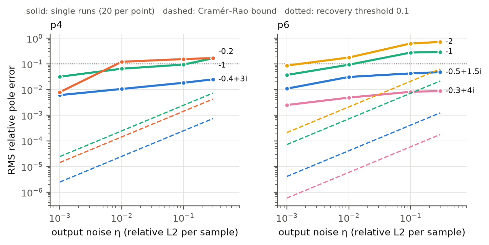

# (C) Identifiability theory: E2, data richness

Plan: `docs/proposal_C_identifiability.qmd`, RQ2 / H2 / E2. Builds on the E1 audit
(`../e1_audit/`, especially `identifiability.py` and `E1_report.md`).

Question: does richer data (more input frequencies, a longer window, other input
families) make the poles practically identifiable, and does training then recover them?

## Scripts

| script | what | output |
|---|---|---|
| `e2_richness.py` | phase 1: local identifiability of the tied layer at the truth, over 46 data configurations (p4, p6); `--hold foh`: the same with the first-order-hold layer, floor and curvature measure η* (per sample, not the noise limit; see E4 eighth pass) | `results/e2_richness{,_foh}.md` / `.json` |
| `e2_grid.py` | phase 1b: the phase-1 analysis over the time step dt = 20/N, N = 256–8192 | `results/e2_grid.md` / `.json` |
| `e2_select.py` | best of 5 by validation loss on independent seeds 10–59 | `results/e2_select.md` / `.json` |
| `e2_rescue.py` | truth-free single-slot restarts of polished runs; `--rule noise`: noise-aware acceptance (E4); `--start reset/release`: partial tie with R_res reset / released from the tied run (E3), also under noise with `--rule noise` | `results/e2_rescue{,_na,_rr,_rel,_na_rel}/*.json`, `results/e2_rescue{,_na,_rr,_rel,_na_rel}.md` |
| `e2_floor.py` | floor certificate without the truth: estimated floor + consensus poles; ratio and χ² (noise) rules | `results/e2_floor.md` / `.json` |
| `e2_polish.py` | L-BFGS-B polish of saved Adam checkpoints (paired before/after), floor-certificate table | `results/e2_polish/*.json`, `results/e2_polish.md` |
| `e4_power.py` | E4, input noise: power of the calibrated order test; the `foh_eivo` report minus one true pole, refitted and tested (χ², pooled κ_g, calibrated κ_o) | `results/e4_power/*.json`, `results/e4_power.md` |
| `e4_profile.py` | E4: minimal-form refit of the certified report, order test, per-pole profile intervals (VarPro); `--hold foh`: refits with the data generator's first-order-hold input, with backward order reduction per run; `--hold band_red`: band-limited refits with the same reduction (control); noise-free conditions use σ² = float32 rounding of the outputs, Newton-finished fits and bootstrap intervals; E1 data under output noise (eighth pass); EIV bootstrap per group and `--hold foh_eiv` (EIV-weighted refits) for input noise (tenth pass); `--hold foh_eivb` (bootstrap-calibrated reduction) and `EIVML` (eleventh pass); `--hold foh_eivc` (calibrated certificate between runs, twelfth pass); `--hold foh_eivo` (bootstrap-calibrated order test, thirteenth pass) | `results/e4_profile{,_foh,_band_red}/*.json`, `results/e4_profile{,_foh,_band_red}.md` |
| `e4_bias.py` | E4: the noise-free pole bias, float32 rounding of inputs vs outputs (exact vs stored data, Monte Carlo, truth-free bootstrap) | `results/e4_bias.md` / `.json` |
| `e4_eiv.py` | E4: input noise (errors-in-variables) under output noise: Monte-Carlo coverage of the E4, residual-σ² and truth-free EIV-bootstrap intervals (minimal FOH refit) | `results/e4_eiv/*.json`, `results/e4_eiv.md` |
| `e2_noise.py` | E4: pole error under output noise vs the Cramér–Rao bound of the minimal-form layer, both restart rules | `results/e2_noise.md` / `.json` |
| `e2_figures.py` | figures: recovery by recipe stage; noise vs CRB | `results/figures/fig_e2_stages.png`, `fig_e4_noise.png` |
| `e3_deep.py` | E3 deep first pass: bounded slots in full ALNO / LFNO stacks | `results/e3_deep/*.json`, `results/e3_deep.md` |
| `e2_train.py` | phase 2: train the E1 tied layer on selected configurations, 10 seeds; `--variant` controls (warm, no spare slot, real-constrained slots); E3 steady branches and partial ties (`*_alno`, `*_lfno`, `*_pt*` conditions); tied layer with the first-order-hold response (`*_foh` conditions, `FOHPoleResidue`) | `results/e2_train/*.json`, `results/e2_train.md` |

```
python experiments/C/theory/e2_richness.py                  # < 1 min (CPU)
python experiments/C/theory/e2_train.py --cond <name> --seeds 0 1 2 3 4   # ≈ 105 s per run on the 4090
python experiments/C/theory/e2_train.py --summarize
```
Phase 2 was run as 16 parallel processes (8 conditions × 2 seed halves), ≈ 9 min.

## Phase 1: local identifiability vs data

Setup: the float64 tied layer in minimal form from `e1_audit/identifiability.py`
(one slot per conjugate pair, **real poles constrained real**), at the true parameters;
dt = 20/1024 fixed, T changes n_t; 200 samples, data seed 0. Per pole: ratio =
profiled error of a 10 % change in Re μ (others re-fitted, linearised) / representation
floor; ratio ≥ 10 = practically identifiable. The Jacobian is computed in forward mode
(few parameters, many outputs); this needed `.conj()` → `torch.conj_physical` in
`identifiability.py` (same values; the view form fails under forward AD). The E1
numbers are reproduced (p6, E1 data: ratio 0.6 / 0.19 for −1 / −2).

Results (`results/e2_richness.md`):

- **p4: richer data make all poles identifiable.** E1 data (T = 20): 7.0 / 4.6 / 9.5
  (pair, −1, −0.2). Multisine with K ≥ 6 frequencies: 11–24 / 10–15 / 18–26;
  E1 data at T = 40: 18 / 11 / 30; multisine16 at T = 80: 46 / 30 / 65. PRBS alone:
  19.5 / 9.7 / 13. Ramps alone: nothing (≤ 1.5). Short windows (T ≤ 10): real poles
  not identifiable.
- **p6: the fast real poles −1, −2 stay non-identifiable for every data change tried**
  (max ratio 1.8 / 0.6, multisine16 at T = 80). The complex pairs become identifiable
  with rich data (±4i from K ≥ 6; both at multisine16, T ≥ 40).
- The floor (5e-4 to 2e-3) is the layer's DFT discretisation error and does not fall
  with richer data; for p6 it, not the data, is what hides −1 and −2. Grid resolution
  (dt, number of modes) is the untested variable.

## Phase 2: training on the phase-1 configurations

Setup: E1 `Layer1("tied")`, n_poles = 4 (p4) / 6 (p6) complex slots, `band` init with
its T = 20 ranges for every T (same initial poles in rad/s), `common` + pole lr × 10,
1000 epochs. Train = the 200 analysed samples (seed 0), validation 50 (seed 1), test
100 (seed 2), same family. 8 conditions × 10 seeds = 80 runs, none diverged.

Results (`results/e2_train.md`; ratio / recovered fraction / pole error):

| condition | test rel. L2 | pair −0.4+3i | −1 | −0.2 |
|---|---|---|---|---|
| p4, E1 data, T = 20 | 4.5e-2 ± 2.3e-2 | 7.0 / 70 % / 0.09 | 4.6 / 0 % / 0.84 | 9.5 / 0 % / 0.97 |
| p4, ramps | 1.1e-2 ± 3.3e-3 | 0.3 / 0 % / 0.28 | 0.4 / 0 % / 0.97 | 1.5 / 0 % / 1.26 |
| p4, PRBS | 5.6e-3 ± 3.9e-3 | 19.5 / 100 % / 0.00 | 9.7 / 0 % / 0.62 | 13.0 / 0 % / 0.64 |
| p4, multisine16, T = 20 | 4.1e-3 ± 1.6e-3 | 24.1 / 100 % / 0.00 | 13.9 / 0 % / 0.61 | 23.8 / 0 % / 0.60 |
| p4, E1 data, T = 40 | 3.1e-2 ± 2.2e-2 | 18.2 / 70 % / 0.07 | 11.3 / 0 % / 0.76 | 30.0 / 0 % / 0.67 |
| p4, multisine16, T = 40 | 7.4e-3 ± 8.1e-3 | 34.7 / 100 % / 0.01 | 21.9 / 0 % / 0.58 | 44.7 / 0 % / 0.48 |

p6: E1 data: pairs 60 % / 100 %, −1 / −2 0 %; multisine16 at T = 80: pairs 80 % / 100 %,
−1 10 %, −2 0 %; test error 9.4e-3 → 1.9e-3.

Findings:

1. **Where the data identify a complex pair, training finds it**: p4's pair goes from
   70 % to 100 % recovered (error 0.09 → 0.00) with PRBS or multisine; test error falls
   up to 10×.
2. **Predicted-identifiable real poles are still not recovered (0 % in every p4
   condition)**, although their error falls (0.84 / 0.97 → 0.58 / 0.48). The learned slots
   that stand in for −1 and −0.2 stay complex: e.g. −0.82 + 0.61i and −0.23 + 0.13i
   (multisine16, T = 20/40). Most of the pole error is the spurious Im part. Test error
   stays 4–10× above the oracle, so training ends in a local minimum, not at the truth.
3. The mismatch is in the parameterisation: phase 1 analyses the minimal form in which a
   real pole has no Im parameter; the trained layer gives every slot a free Im μ (and p4
   has one spare slot, 4 slots for 3 folded poles). A real decay can be approximated by a
   slowly oscillating pair, and at Im = 0 the loss is flat in Im to first order (E1),
   so nothing pulls the slot onto the real axis.
4. p6 behaves as phase 1 predicts: pairs found, −1 / −2 not.

So for p4, data richness is necessary but not sufficient: it removes the data
limitation, and what remains is an optimisation / parameterisation limitation of
complex slots for real poles. This qualifies E1's part (iii) ("the data cannot identify
them") as stated for p6 only.

## Phase 2 controls: optimisation or parameterisation?

`e2_train.py --variant` (100 runs, 10 seeds each, none diverged): `warm` (E1 warm init),
`free_min` (one complex slot per folded pole, no spare), `real_spare` (as base, two slots
constrained real), `real_min` (the minimal form of phase 1: one complex + real-constrained
slots). Real constraint = parametrisation of `pr.mu` with Im × 0/1 mask (pole lr × 10 still
applied). Recovered fraction / pole error per true pole:

| data | variant | slots | test rel. L2 | pair | −1 | −0.2 |
|---|---|---|---|---|---|---|
| p4 multisine16 | base | 4 | 4.1e-3 ± 1.6e-3 | 100 % / 0.00 | 0 % / 0.61 | 0 % / 0.60 |
| p4 multisine16 | **warm** | 4 | **5.7e-4 ± 7e-5** (oracle 5.9e-4) | 100 % / 0.00 | **100 % / 0.01** | **100 % / 0.01** |
| p4 multisine16 | free_min | 3 | 2.0e-2 ± 1.9e-2 | 90 % / 0.02 | 0 % / 1.26 | 0 % / 0.69 |
| p4 multisine16 | real_spare | 4 | 1.2e-2 ± 2.2e-2 | 100 % / 0.01 | 20 % / 0.18 | 20 % / 0.25 |
| p4 multisine16 | real_min | 3 | 2.9e-1 ± 9.4e-2 | 10 % / 1.09 | 10 % / 1.30 | 50 % / 0.18 |
| p4 E1 data | warm | 4 | 2.4e-3 ± 2.4e-3 | 100 % / 0.01 | 80 % / 0.05 | 80 % / 0.04 |
| p6 multisine16 T = 80 | warm | 6 | 4.3e-4 ± 2.4e-4 (oracle 4.0e-4) | 100 % / 100 % | 100 % / 0.02 | −2: 70 % / 0.08 |
| p6 multisine16 T = 80 | real_min | 4 | 4.1e-2 ± 9.0e-2 | 90 % / 90 % | 30 % / 0.17 | −2: 0 % / 0.53 |

(p4 E1-data rows for free_min / real_spare / real_min: all worse than base; `results/e2_train.md`.)

Findings:

1. **The truth is a stable, reachable-from-nearby minimum where phase 1 says so.**
   Warm start on multisine16: all p4 poles recovered in 10/10 seeds, test error at the
   oracle. On E1 data (ratios < 10) the warm start drifts away in 2/10 seeds. p6 even
   recovers −1 (100 %) and −2 (70 %) from a warm start although their ratios are < 2:
   locally stable but flat.
2. **The failure from the band init is global: slots get the wrong assignment.** Typical
   minima: the slow real pole −0.2 is taken by a complex slot (−0.25 + 0.05i) and the
   remaining real slots coalesce (−1.15, −1.13: two slots on one decay). In `real_min`
   the only complex slot goes to −0.2 in every seed and the ±3i pair is left unrepresented
   (test 0.3); the inits differ, the wrong minimum is the same.
3. **Real constraint helps, removing the spare slot hurts.** `real_spare` lowers the
   real-pole error 0.6 → 0.2 (20 % recovered; one seed reaches the oracle);
   the minimal forms (`free_min`, `real_min`) are worse than base: the spare slot is
   what lets training escape wrong assignments.

Revised E2 message: data richness makes the poles locally identifiable (phase 1, confirmed
by the warm start), but from a generic init the tied layer's landscape has wrong-assignment
and pole-coalescence minima, so recovery is an optimisation problem, not a data problem,
for p4. Candidate remedies for E3/E4: inits on the real axis plus complex slots, spare
slots with pruning, multi-start.

## Remedies (first round): mixed init with real-constrained slots, multi-start

`e2_train.py --variant` (160 runs, 10 seeds each, none diverged):
`wide` (pairs + 1 + 2 × real slots, all band init, all free: slot-count control, same
parameter count as `mixed`), `mixed` (same slots; 2 × real slots started on a stratified
log grid of Re in [−5, −0.05] and **constrained real**, the rest band init), `mixed_off`
(grid shifted by half a log step: 0.11 / 0.50 / 2.3 / 10.7, a control because the
unshifted grid 0.05 / 0.23 / 1.08 / 5 lies near p4's −0.2 and −1), `*_ms` (multi-start:
8 inits × 100 epochs, best on validation continues with the full 1000-epoch protocol;
≈ 1.8 × the compute).

Why constrained: a slot started on the real axis but left free leaves it within a few
epochs, because d/d(Im μ) = −t Im(β) e^{Re μ t} ≠ 0 for a complex residue and Adam turns
any small gradient into a step of ≈ lr. (E1's "zero first-order sensitivity to Im μ"
holds only for a real residue.)

Recovered fraction / pole error (multisine16 data):

| system | variant | slots | test rel. L2 | −1 | −0.2 or −2 |
|---|---|---|---|---|---|
| p4 | base | 4 | 4.1e-3 ± 1.6e-3 | 0 % / 0.61 | −0.2: 0 % / 0.60 |
| p4 | wide | 6 | 3.1e-3 ± 1.3e-3 | 0 % / 0.68 | 0 % / 0.76 |
| p4 | base_ms | 4 | 3.8e-3 ± 1.9e-3 | 0 % / 0.56 | 0 % / 0.57 |
| p4 | mixed | 6 | 4.2e-3 ± 3.5e-3 | 40 % / 0.21 | 0 % / 0.24 |
| p4 | mixed_ms | 6 | 1.1e-3 ± 9.1e-4 | 60 % / 0.11 | 80 % / 0.06 |
| p4 | mixed_off | 6 | 3.3e-3 ± 1.8e-3 | 40 % / 0.18 | 20 % / 0.23 |
| p4 | **mixed_off_ms** | 6 | **1.4e-3 ± 1.2e-3** (oracle 5.9e-4) | **60 % / 0.11** | **70 % / 0.09** |
| p6 T = 80 | base | 6 | 1.9e-3 ± 1.0e-3 | 10 % / 0.31 | −2: 0 % / 0.79 |
| p6 T = 80 | wide | 7 | 1.8e-3 ± 1.1e-3 | 0 % / 0.41 | 0 % / 0.79 |
| p6 T = 80 | base_ms | 6 | 6.2e-4 ± 1.6e-4 | 30 % / 0.24 | 0 % / 0.68 |
| p6 T = 80 | mixed | 7 | 2.6e-3 ± 2.6e-3 | 40 % / 0.15 | 40 % / 0.18 |
| p6 T = 80 | mixed_off | 7 | 2.9e-3 ± 2.7e-3 | 60 % / 0.12 | 60 % / 0.12 |
| p6 T = 80 | **mixed_off_ms** | 7 | **5.6e-4 ± 1.9e-4** (oracle 4.0e-4) | **50 % / 0.11** | **40 % / 0.14** |

Complex pairs: 90–100 % in all these rows. E1 data (p4): no remedy helps (real poles
≤ 20 %, `mixed` loses the pair); the data limit applies there.

Findings:

1. **Real-constrained, stratified real slots are the active ingredient.** More slots
   alone (`wide`, same parameter count as `mixed`) or multi-start alone (`base_ms`) recover
   no real pole. `mixed` gives 40–60 %; with multi-start p4 reaches 60 / 70 % and test error
   within 2–3 × of the oracle.
2. **Not an artefact of the grid.** With the grid shifted away from the true poles
   (`mixed_off`) the results are the same within seed noise. In p6 the slot that ends at
   −2 travels there from −4 to −6.
3. **p6's −2 is recovered in 40–60 % of runs from a generic init**, although its
   phase-1 ratio is 0.6: phase 1 (ratio of a 10 % change) is conservative; with the
   real constraint the remaining minima are shallow but the truth is still the best one.
4. Remaining failure: real slots coalescing (e.g. three slots at −1.17) instead of one
   moving to −0.2 or −2. Candidates: repulsion / minimum-separation penalty, prune-and-split.

## Remedies (second round): against coalescing real slots

Variants on top of `mixed_off` (shifted grid), with and without multi-start; 80 runs,
10 seeds, none diverged. `*_rep`: repulsion between real slots in log|Re μ|,
λ Σ exp(−Δ²/2σ²), σ = 0.15, λ = 1e-2 annealed linearly to 0 at epoch 600. `*_split`: at
epochs 150 and 300, real slots within 10 % are merged (residues added) and the freed slot
is moved, residue 0, to the grid point farthest from the other real slots (0–3 splits per
run). `e1_audit.train` got optional `penalty` / `hook` arguments for this (unused by E1).

| system | variant | test rel. L2 | −1 | −0.2 or −2 | slots coalesced at end (pairs, 10 seeds) |
|---|---|---|---|---|---|
| p4 | mixed_off_ms | 1.4e-3 ± 1.2e-3 | 60 % / 0.11 | 70 % / 0.09 | 11 |
| p4 | mixed_off_rep | 5.6e-2 ± 1.0e-1 | 60 % / 0.12 | 0 % / 0.42 | – |
| p4 | mixed_off_rep_ms | 2.0e-3 ± 1.3e-3 | 60 % / 0.11 | 40 % / 0.17 | 0 |
| p4 | mixed_off_split | 2.8e-3 ± 1.8e-3 | 40 % / 0.14 | 10 % / 0.33 | – |
| p4 | mixed_off_split_ms | 9.6e-4 ± 4.6e-4 | 40 % / 0.16 | 70 % / 0.15 | 2 |
| p6 | mixed_off_ms | 5.6e-4 ± 1.9e-4 | 50 % / 0.11 | 40 % / 0.14 | 9 |
| p6 | mixed_off_rep | 2.6e-3 ± 2.5e-3 | 70 % / 0.09 | 50 % / 0.10 | – |
| p6 | mixed_off_rep_ms | 8.3e-4 ± 3.1e-4 | 60 % / 0.09 | 50 % / 0.13 | 2 |
| p6 | mixed_off_split | 2.6e-3 ± 2.4e-3 | 20 % / 0.20 | 70 % / 0.12 | – |
| p6 | mixed_off_split_ms | 5.8e-4 ± 2.2e-4 | 30 % / 0.14 | 40 % / 0.15 | 2 |

Findings:

1. **Both remedies remove the coalescence** (11 / 9 coalesced pairs over 10 seeds →
   0–2), **but recovery does not improve**: all rows are within seed noise of
   `mixed_off_ms` (binomial s.e. ≈ 15 % at 10 seeds). Two p4 `rep` seeds (2, 5) end
   in a poor minimum (test 0.24 / 0.28, the ±3i pair lost; no divergence), hence the
   large mean; the other eight reach 2.7e-3 to 7.9e-3.
2. **The failure moves from coalescence to bracketing.** Failed runs now have the real
   slots spread out, with two slots on either side of a true pole, e.g. p4:
   −0.05 / −0.31 around −0.2 and −1.1 / −1.58 around −1; p6: −0.72 / −2.06 around −1 / −2.
   With 2 × as many real slots as real poles, the spare slots do not die out but share
   the decay with a neighbour. Test error stays near the oracle (9.6e-4 / 5.8e-4 with
   split + multi-start): these are good-fit, wrong-pole solutions.
3. Hence the redundant real slots are the remaining problem: a remedy needs to remove
   them (residue sparsity / pruning) or use fewer of them, not to separate them.

## Remedies (third round): removing redundant slots; what limits recovery

Variants (120 runs, 10 seeds, none diverged): `mixed_off_l1(_ms)` / `mixed_off_l1s_ms`
(L1 on each slot's impulse-response norm |β| ‖e^{μt}‖, λ = 1e-3 / 1e-2 to epoch 200, 0 at
300; slots with < 2 % of the output pruned at epoch 300, re-fit to 1000), `mixed_off_prune_ms`
(pruning without the penalty), `few(_ms)` (n_real + 1 real slots, grid with a random
log offset per seed). Pole metrics use the remaining slots.

Recovered (−1 / −0.2 or −2), test rel. L2:

| variant | p4 | p4 test | p6 | p6 test | pruned per run |
|---|---|---|---|---|---|
| mixed_off_ms (reference) | 60 / 70 % | 1.4e-3 | 50 / 40 % | 5.6e-4 | – |
| mixed_off_l1 | 40 / 10 % | 3.4e-3 | 50 / 70 % | 2.8e-3 | 0–1 |
| mixed_off_l1_ms | 40 / 70 % | 1.1e-3 | 60 / 40 % | 5.5e-4 | 0–2 |
| mixed_off_l1s_ms | 50 / 90 % | 9.7e-4 | 30 / 10 % | 1.0e-3 | 0–2 |
| mixed_off_prune_ms | 60 / 70 % | 1.4e-3 | 50 / 40 % | 5.6e-4 | 0–1 |
| few | 40 / 30 % | 3.5e-3 | 30 / 0 % | 3.6e-2 | – |
| few_ms | 60 / 40 % | 1.6e-3 | 50 / 20 % | 7.2e-4 | – |

No variant is better than the reference beyond seed noise; pruning rarely fires
(spare slots keep > 2 % of the output even under L1); fewer real slots hurt p6's −2.

**What limits recovery: fit quality of the failed runs** (all `mixed_off*_ms` runs pooled):

| system | runs with all poles recovered | runs missing a real pole |
|---|---|---|
| p4 | 24 runs, test median 6.0e-4 = 1.0 × oracle | 36 runs, 1.5e-3 = 2.6 × oracle |
| p6 | 8 runs, 5.8e-4 = 1.5 × oracle | 52 runs, 5.9e-4 = 1.5 × oracle |

- **p4: the wrong-pole solutions fit worse**, so they are local minima that the loss
  can tell apart. Selecting the lowest validation loss among k independent runs
  (bootstrap from the 10 seeds, 2,000 draws): `mixed_off_ms` all poles recovered in
  50 % (k = 1), 84 % (k = 3), 95 % (k = 5); `mixed_off_l1s_ms` 50 / 88 / 98 %;
  `mixed_off` (no multi-start) 24 / 45 / 61 %.
- **p6: the wrong-pole solutions fit as well or better** on these 10 seeds; validation
  selection made recovery worse (10 → 0 %). *Not confirmed by independent runs (next
  section): this was a 10-seed artefact.*

(The E2 conclusion drawn here from 10 seeds is revised in the next section.)

## Best of 5 by validation loss: independent check

`e2_select.py` → `results/e2_select.md` / `.json`. `mixed_off_ms`, new seeds 10–59 (multi-start
candidates also new), 10 disjoint groups of 5 consecutive seeds per system; per group the
lowest final validation loss is selected. 100 runs, none diverged.

| system | single run: all poles recovered | best of 5: all recovered | per real pole, single → selected | Spearman(val loss, max pole error) |
|---|---|---|---|---|
| p4 | 38 % (19/50) | **80 % (8/10)** | −1 44 → 80 %, −0.2 58 → 100 % | +0.84 (seeds 0–9: +0.79) |
| p6 | 32 % (16/50) | **70 % (7/10)** | −1 70 → 100 %, −2 32 → 70 % | +0.24 (seeds 0–9: +0.14) |

Complex pairs: 100 % single and selected in both systems.

- **p4: confirmed, but lower than the bootstrap estimate (95 %).** In every group with at
  least one good run (8/10) the selection picked a good one. The two misses are groups
  with no good run; their selected runs have −1 errors of 0.136 / 0.111 at oracle-level
  test error (5.6–5.7e-4), with two real slots bracketing −1 (−1.14 / −0.79).
- **p6: the 10-seed conclusion does not hold.** On seeds 0–9 1/10 runs recovered all
  poles and selection picked a wrong one; on seeds 10–59 16/50 did and selection
  recovers 7/10 groups. Validation loss carries less information about the poles than in
  p4 (Spearman 0.24 vs 0.84): misses (−2 errors 0.12–0.41) reach test errors of
  3.3–4.5e-4, overlapping the good runs (3.1–4.2e-4).
- With 10 groups the rates have wide intervals (8/10: about 44–97 %; 7/10: 35–93 %,
  Clopper–Pearson 95 %).

**E2 conclusion (revised).** Rich data make all poles locally identifiable for p4, and
the truth is a stable minimum (warm start). From generic inits, recovery is limited by
optimisation: mixed real-constrained init + multi-start + best of 5 by validation loss
recovers all p4 poles in 8/10 groups and all p6 poles in 7/10, from 0 % with the E1 recipe.
p6's −1, −2 remain the harder case: phase-1 ratios < 2, weak link between loss and pole
error, misses near the floor. Their identifiability is weak but not absent: we did not
show they cannot be recovered.

## Without the true number of real poles: fixed split and learned gate

The recipe above sizes the slots from the truth (pairs + 1 complex, 2 × real constrained).
Two prior-free variants, both with 8 slots for p4 and p6 (`e2_train.py`): `fixed8` (4 band
complex + 4 real-constrained on a randomly offset log grid) and `gate8` (no constraint;
Im μ = sigmoid(a) Im μ̃ with a learned gate logit per slot, a = −5 on the grid slots, +3 on
the band slots, pole lr). 100 runs (`_ms`: 20 seeds = 4 groups of 5; `gate8`: 10 seeds).
Reference `mixed_off_ms` on seeds 10–29 (same group structure).

| system | variant | test (median) | −1 | −0.2 or −2 | all poles | best of 5 | Spearman(val, error) |
|---|---|---|---|---|---|---|---|
| p4 | mixed_off_ms (truth-sized) | 1.3e-3 | 25 % | 65 % | 25 % | 2/4 | +0.87 |
| p4 | fixed8_ms | 1.5e-3 | 40 % | 25 % | 5 % | 1/4 | +0.13 |
| p4 | gate8_ms | 9.4e-4 | 0 % | 0 % | 0 % | 0/4 | +0.08 |
| p4 | gate8 | 1.4e-3 | 10 % | 0 % | 0 % | – | +0.05 |
| p6 | mixed_off_ms (truth-sized) | 5.6e-4 | 75 % | 30 % | 30 % | 3/4 | +0.40 |
| p6 | fixed8_ms | 8.4e-4 | 45 % | 15 % | 15 % | 1/4 | +0.31 |
| p6 | gate8_ms | 1.1e-3 | 10 % | 10 % | 0 % | 0/4 | +0.30 |
| p6 | gate8 | 3.2e-3 | 0 % | 0 % | 0 % | – | +0.60 |

Complex pairs 80–100 % everywhere.

- **The learned gate does not work.** Gates end partly open (0.06–0.2, 0.7–1.5 of 4
  closed per run) while Im μ̃ grows: only the product g · Im μ̃ matters, so the gate does
  not decide real vs complex, and the slots end like the base model (−0.24 + 0.11i for −0.2).
- **A fixed 4 + 4 split is worse than the truth-sized one.** The three spare complex slots
  take the slow real decays at low frequency (−0.42 + 0.17i, −0.36 + 0.18i): the
  wrong-assignment failure again. Validation loss also stops telling right from wrong
  poles in p4 (Spearman 0.13), so best-of-5 selection no longer helps.
- So the recipe's success depends on the slot sizing prior. A prior-free candidate that
  targets the mechanism: bound complex slots away from the real axis (|Im μ| ≥ ω_min,
  e.g. one period in the window, 2π/T), so slow decays can only be taken by real slots.

## Phase 1b: grid resolution

`e2_grid.py` → `results/e2_grid.md` / `.json`: the phase-1 analysis with dt = 20/N,
N = 256 … 8192, at fixed T (outputs exact, so only the layer's discretisation changes).

- The floor falls ∝ dt (first-order discretisation error): p6 multisine16 T = 80: 5.5e-3
  (N = 256) → 4.2e-4 (1024) → 3.1e-5 (8192). The profiled error of a 10 % pole change
  is set by the data and nearly constant, so ratios grow ∝ 1/dt.
- p6 −1 / −2 ratios, N = 1024 → 4096 → 8192: E1 data T = 20: 0.6 / 0.2 → 3.0 / 1.0 → 6.3 / 2.0;
  multisine16 T = 20: 1.0 / 0.4 → 4.7 / 1.7 → 9.6 / 3.4; multisine16 T = 80: 1.8 / 0.6 →
  **11.6** / 4.0 → **24.3** / 8.3. −1 becomes practically identifiable with rich data on
  a fine grid; −2 stays just below the threshold even at N = 8192, T = 80.
- p4: ratios double per halving of dt (E1 data: all ≥ 10 from N = 2048 except −1 at 9.5).
- Interpretation: "practically identifiable" is relative to the error level the model
  cannot remove (here the discretisation floor; with real data also noise). With exact
  data and an exact model every pole is identifiable; the ratio asks whether a 10 % pole
  change is visible above that level. Not tested: training on the fine grids
  (N = 4096 at T = 80 is n_t = 16,384, ≈ 4 × the run time).

## Prior-free sizing, second try: complex slots bounded away from the real axis

`bound8` (`e2_train.py`): as `fixed8` (8 slots: 4 real-constrained on a random-offset log
grid, 4 complex), with the complex slots parameterised as |Im μ| = 2π/T + |Im μ̃| (at
least one period in the window; 0.31 rad/s at T = 20, 0.079 at T = 80). 60 runs (`_ms` 20
seeds = 4 groups, plain 10). References on the same group structure.

| system | variant | test (median) | −1 | −0.2 or −2 | all poles | best of 5 | Spearman(val, error) |
|---|---|---|---|---|---|---|---|
| p4 | mixed_off_ms (truth-sized, seeds 10–29) | 1.3e-3 | 25 % | 65 % | 5/20 | 2/4 | +0.87 |
| p4 | fixed8_ms | 1.5e-3 | 40 % | 25 % | 1/20 | 1/4 | +0.13 |
| p4 | **bound8_ms** | 2.2e-3 | 30 % | 60 % | 4/20 | **3/4** | +0.69 |
| p4 | bound8 | 6.8e-3 | 40 % | 10 % | 0/10 | – | +0.84 |
| p6 | mixed_off_ms (truth-sized, seeds 10–29) | 5.6e-4 | 75 % | 30 % | 6/20 | 3/4 | +0.40 |
| p6 | fixed8_ms | 8.4e-4 | 45 % | 15 % | 3/20 | 1/4 | +0.31 |
| p6 | bound8_ms | 6.9e-4 | 50 % | 10 % | 2/20 | 0/4 | +0.10 |
| p6 | bound8 | 2.5e-3 | 80 % | 0 % | 0/10 | – | +0.32 |

- **p4: the bound restores the truth-sized result without the prior** (4/20 vs 5/20 single,
  3/4 vs 2/4 best of 5) and brings back the link between validation loss and pole error
  (Spearman 0.69 vs 0.13). Complex slots still sit at the bound with strong damping
  (−0.75 + 0.31i) in some runs.
- **p6: no gain.** The fast decay −2 is taken by strongly damped complex slots
  (−1.10 + 1.93i, −2.21 + 1.38i, |Re| ≈ |Im|), while the real slots coalesce near −0.9.
  A bound on |Im| alone does not stop a heavily damped oscillation from mimicking a fast
  decay; the bound is also 4× lower at T = 80.
- Candidate next: bound the damping of complex slots as well (|Re μ| ≤ c |Im μ|, a
  minimum quality factor), so that fast decays can only be real.

## Training on a finer grid (p6)

`p6_ms16_T80_N4096` (multisine16, T = 80, dt = 20/4096, n_t = 16,384), `mixed_off_ms`,
seeds 10–29 (20 runs, ≈ 6 min each), compared with the same seeds at dt = 20/1024.

| dt | −1 | −2 | all poles | best of 5 | test (median) | oracle (floor) |
|---|---|---|---|---|---|---|
| 20/1024 | 75 % | 30 % | 6/20 | 3/4 | 5.6e-4 | 4.0e-4 |
| 20/4096 | 85 % | 35 % | 7/20 | 4/4 | 4.2e-4 | 5.6e-5 |

- Direction as phase 1b predicts (−1 ratio 11.6: slightly better; −2 ratio 4.0: unchanged),
  but the differences are within seed noise.
- **Training does not reach the lower floor**: test error stays at 4.2e-4, 7.5 × the
  fine-grid oracle and near the coarse floor. The finer grid makes −1 distinguishable in
  principle; the training protocol (1000 epochs, StepLR) does not converge to that
  precision, so the gain is not realised.

## Prior-free sizing, third try: damping-bounded complex slots

`damp8` (`e2_train.py`): as `bound8`, and the complex slots are lightly damped,
Re μ = −c |Im μ| σ(a) (a learned), so |Re μ| < c |Im μ|; c = 0.5 (damping ratio < 0.45),
`damp8w`: c = 1. The true complex poles have |Re|/|Im| ≤ 0.33; the p6 absorbers seen with
`bound8` had 0.57 and 1.6. Still no use of the true pole count. `_ms`, seeds 10–29
(4 groups), 80 runs. Adam only (before the polish below):

| system | variant | all poles | best of 5 | −1 | −0.2 or −2 |
|---|---|---|---|---|---|
| p4 | mixed_off_ms (truth-sized, seeds 10–59) | 38 % | 8/10 | 44 % | 58 % |
| p4 | bound8_ms (seeds 0–19) | 20 % | 3/4 | 30 % | 60 % |
| p4 | **damp8_ms** | **65 %** | **4/4** | 70 % | 75 % |
| p4 | damp8w_ms | 35 % | 4/4 | 45 % | 50 % |
| p6 | mixed_off_ms (truth-sized, seeds 10–59) | 32 % | 7/10 | 70 % | 32 % |
| p6 | bound8_ms (seeds 0–19) | 10 % | 0/4 | 50 % | 10 % |
| p6 | damp8_ms | 15 % | 1/4 | 55 % | 20 % |
| p6 | damp8w_ms | 5 % | 1/4 | 55 % | 5 % |

- **p4: the damping bound beats the truth-sized recipe** (65 % vs 38 % single). c = 1 is
  too loose (35 %).
- **p6 (dt = 20/1024): the absorbers are gone, but −2 is still missed.** No complex slot
  holds −2 any more. The failures are either near misses (−2 at −2.2 to −2.6, error
  0.1–0.3) at the floor, or local minima where the real slots coalesce near −0.8 (test
  ≈ 2e-3). The near misses reach the floor (see the certificate table below), so at this
  dt the data do not pin −2 (phase 1: ratio 0.6). With 8 slots the polished test error
  is *below* the oracle (3.0e-4 vs 4.0e-4): the extra slots fit the discretisation error
  of the truth.

## L-BFGS polish after Adam

`e2_polish.py`: every saved Adam checkpoint is polished with L-BFGS-B (scipy, full
training batch, data loss only, ≤ 3000 iterations, restarted after a line-search stall;
seconds per run). Before and after are the same run (`results/e2_polish.md`, 280 runs).

| condition | variant | test, Adam → polish | oracle | all poles | best of 5 |
|---|---|---|---|---|---|
| p4 | mixed_off_ms | 1.5e-3 → 7.3e-4 | 5.9e-4 | 38 % → 74 % | 8/10 → 9/10 |
| p4 | damp8_ms | 1.7e-3 → 7.4e-4 | 5.9e-4 | 65 % → **85 %** | 4/4 → 4/4 |
| p6, dt 20/1024 | mixed_off_ms | 6.0e-4 → 4.7e-4 | 4.0e-4 | 32 % → 38 % | 7/10 → 6/10 |
| p6, dt 20/1024 | damp8_ms | 1.6e-3 → 6.9e-4 | 4.0e-4 | 15 % → 35 % | 1/4 → 2/4 |
| p6, dt 20/4096 | mixed_off_ms | 4.4e-4 → 3.0e-4 | 5.6e-5 | 35 % → 45 % | 4/4 → 4/4 |
| p6, dt 20/4096 | **damp8_ms** (prior-free) | 1.6e-3 → 5.6e-4 | 5.6e-5 | 15 % → **50 %** | 1/4 → **3/4** |

Does reaching the floor certify the poles? All polished p6 runs (seeds 10–29, all
variants), binned by final training loss / oracle error:

| grid | train/oracle < 1.5 | 1.5–3 | ≥ 3 |
|---|---|---|---|
| dt = 20/1024 | 20/53 all recovered | 0/11 | 0/6 |
| dt = 20/4096 | **8/8** | 5/6 | 6/26 |

- **Adam was the bottleneck at the end of training**: the polish halves the p4 test error
  to near the oracle and doubles the p4 recovery (38 → 74 %, truth-sized; 65 → 85 %,
  prior-free). The Adam-stage pole errors of 0.1–0.2 were partly unconverged runs, not
  wrong basins.
- **Fine grid + polish confirms phase 1b.** At dt = 20/4096 every run that reaches the
  floor recovers all four p6 poles (8/8), and the floor is reached only near the truth.
  At dt = 20/1024 most runs reach the oracle level (53/70) but only 20 of them recover the poles.
  *Corrected by the restarts below:* the oracle is not the floor of the 8-slot model there.
  Restarted runs go down to 0.7 × the oracle, and at that level `damp8` recovers −2 in
  85 % of runs. The coarse grid biases −2 (median error 0.054, against 0.024 at
  dt = 20/4096) rather than hiding it.
- The remaining fine-grid failures are local minima (train/oracle 3–12): a damped spare
  complex slot holding −2 (truth-sized `mixed_off`, which has no damping bound), or
  coalesced real slots. A run's distance to the floor flags them without the truth.
- **Prior-free p6 now matches truth-sized p6** on the fine grid after the polish (50 % vs
  45 % single, 3/4 vs 4/4 best of 5; 4 groups, within noise). Full prior-free recipe:
  8 slots (4 real on a random log grid, 4 complex with |Im μ| ≥ 2π/T and |Re μ| < 0.5 |Im μ|),
  multi-start, Adam, L-BFGS polish, a dt fine enough for the poles to be identifiable, and
  the floor ratio as a check.

## Truth-free restarts after the polish

`e2_rescue.py`: each polished run gets up to 3 rounds of single-slot moves. One slot is
moved, with residue 0, to a grid point: real slots to Re ∈ −geomspace(0.05, 5, 8),
complex slots to Im ∈ geomspace(0.3, 5, 8) with Re = −0.1 Im. Each candidate gets a
300-iteration L-BFGS screen. The best candidate is accepted if training loss falls by
≥ 1 %, then fully polished. Every run gets the same treatment and only the training loss
is used. 120 runs (seeds 10–29), 5–7 min each with 12 processes in parallel.
Before = after the polish.

| condition | variant | train/oracle | test (median) | all poles | best of 5 | −1 | −2 (or −0.2) |
|---|---|---|---|---|---|---|---|
| p4 | mixed_off_ms | 0.90 → 0.86 | 5.7e-4 → 5.5e-4 | 65 → **95 %** | 3/4 → 4/4 | 65 → 95 % | 95 → 100 % |
| p4 | damp8_ms | 1.11 → 0.86 | 6.9e-4 → 5.4e-4 | 85 → 90 % | 4/4 → 4/4 | 90 → 100 % | 90 → 90 % |
| p6, dt 20/1024 | mixed_off_ms | 1.08 → 0.73 | 4.3e-4 → 2.9e-4 | 40 → 35 % | 2/4 → 0/4 | 80 → 95 % | 40 → 40 % |
| p6, dt 20/1024 | damp8_ms | 0.93 → 0.72 | 3.7e-4 → 2.9e-4 | 35 → **80 %** | 2/4 → 4/4 | 60 → 90 % | 45 → 85 % |
| p6, dt 20/4096 | mixed_off_ms | 5.03 → 0.92 | 2.8e-4 → 5.2e-5 | 45 → 80 % | 4/4 → 3/4 | 90 → 100 % | 45 → 80 % |
| p6, dt 20/4096 | **damp8_ms** | 3.50 → 0.93 | 2.0e-4 → 5.2e-5 | 50 → **90 %** | 3/4 → **4/4** | 65 → 90 % | 50 → **100 %** |

- **The restarts remove almost all local minima.** On the fine grid, training loss falls
  from 3.5–5 × to 0.93 × the oracle (median), and test error reaches the oracle
  (5.2e-5 vs 5.6e-5). With the damping bound, prior-free p6 now recovers every pole in
  90 % of single runs and −2 in all 20.
- **The damping bound matters most once the optimiser is good.** Without it
  (`mixed_off_ms`, the truth-sized recipe) the restarts lower the loss further on the
  coarse grid, but a damped spare complex slot (−2.40 + 0.73i, −1.27 + 0.31i) takes part
  of −2 (35 % all poles). With it, the fast decay can only be real (80 %).
- **On the coarse grid every restarted run ends at the same level** (0.67–0.77 × the
  oracle). The extra slots fit the discretisation error of the truth (e.g. a slot at
  −0.50 + 5.0i, at the band edge), so the minimum is below the oracle and shifted from it.
  −2 is biased (median error 0.054 vs 0.024 on the fine grid) rather than unidentifiable.
  The phase-1 ratio (0.6) measures this bias relative to a 10 % shift; it does not mean
  the minimum is far from the truth.
- Cost: 64 candidates × up to 3 rounds per run, 5–7 min with 12 processes on the 4090,
  about as much as the Adam phase.

## Floor certificate without the truth

`e2_floor.py`, applied to groups of 5 runs (seeds 10–29). The floor estimate is the
lowest training loss in the group, and runs within 1.5 × of it count as certified.
Effective poles are the folded learned poles, with slots below 2 % of the summed
impulse-response norm dropped and slots within 10 % merged. The consensus is the set of
effective poles found, within 10 %, in ≥ 2/3 of the certified runs (≥ 2 runs needed). The
truth is used only to score the consensus: per true pole, how many groups contain it, and
how many consensus poles match no true pole ("false").

| stage | condition | variant | estimate / oracle | certified: all recovered | complex pairs | −1 | −2 | false |
|---|---|---|---|---|---|---|---|---|
| polish | p6, dt 20/1024 | damp8_ms | 0.76 | 6/15 | 4/4, 4/4 | 4/4 | 3/4 | 1 |
| polish | p6, dt 20/4096 | mixed_off_ms | 1.11 | 4/4 | 0/4, 0/4 | 0/4 | 0/4 | 0 |
| polish | p6, dt 20/4096 | damp8_ms | 1.68 | 6/8 | 3/4, 3/4 | 3/4 | 2/4 | 1 |
| restart | p4 | mixed_off_ms | 0.86 | 19/20 | 4/4 | 4/4 | 4/4 (−0.2) | 0 |
| restart | p4 | damp8_ms | 0.85 | 18/20 | 4/4 | 4/4 | 3/4 (−0.2) | 0 |
| restart | p6, dt 20/1024 | mixed_off_ms | 0.69 | 7/20 | 4/4, 4/4 | 4/4 | 1/4 | 0 |
| restart | p6, dt 20/1024 | damp8_ms | 0.67 | 16/20 | 4/4, 4/4 | 4/4 | 3/4 | 2 |
| restart | p6, dt 20/4096 | mixed_off_ms | 0.91 | 16/20 | 4/4, 4/4 | 4/4 | 4/4 | 1 |
| restart | p6, dt 20/4096 | **damp8_ms** | 0.91 | 18/20 | 4/4, 4/4 | 4/4 | **4/4** | **0** |

(full table: `results/e2_floor.md`)

- **After the polish alone the certificate cannot be applied on the fine grid.** In a group
  of 5, typically only the lowest-loss run is near the floor, so there is no consensus
  (truth-sized: 0/4 groups). The estimate is also off (1.1–1.7 × the oracle).
- **After the restarts it works without the truth.** All runs of a group reach the
  same floor, the estimate is within 10 % of the oracle (0.91), and on the fine grid every
  group's consensus contains all four p6 poles with no false pole (`damp8_ms`). The
  consensus is the reported model: the poles that independent runs at the floor share.
- On the coarse grid the estimate falls below the oracle (0.67–0.69). The consensus misses
  −2 in one of four groups (`damp8_ms`) and adds false poles (pooled: −1.08 next to −0.98).
  A truth-free way to choose the grid is to shrink dt until the consensus stops changing.
  Here it changes from 20/1024 to 20/4096: −2 is found in every group and the false poles
  vanish. A third grid would be needed to show that it has settled.
- Tolerances (1.5 ×, 10 %, 2 %, 2/3) were set once and not tuned. The p4 and p6 results
  come from the same settings.

**Prior-free recipe, final form:** 8 slots (4 real on a random log grid, 4 complex with
|Im μ| ≥ 2π/T and |Re μ| < 0.5 |Im μ|) → multi-start → Adam → L-BFGS polish →
single-slot restarts → in groups of 5, floor estimate and consensus poles → refine dt
until the consensus is stable (checked here on two grids only). On rich data this recovers all poles of p4 and p6, with no
use of the true poles.

## E3, layer setting: the recipe with a steady branch (ALNO / LFNO)

Same recipe (`damp8_ms` → polish → restarts, seeds 10–29), but the tied layer gets the
steady branch of ALNO (FFT branch, its own spectral weights) or LFNO (R per mode). Modes:
64 on p4 (dt = 20/1024) and 256 on p6 (dt = 20/4096), i.e. a steady band of about 20 rad/s,
twice the multisine band. Oracle = true poles and residues, with the steady weights set to
the tied layer's steady coefficients (ALNO) or R = 1 (LFNO). The oracle error is set by the
mode truncation: 1.7e-3 (p4) and 9.8e-4 (p6), against 5.9e-4 and 5.6e-5 for the tied layer.

| condition | model | train/oracle (median) | test (median) | all poles (single) | per pole | runs at floor (< 1.5 ×): all recovered |
|---|---|---|---|---|---|---|
| p4 | tied | 0.86 | 5.4e-4 | 90 % | −0.4+3i 100, −1 100, −0.2 90 | 18/20 |
| p4 | ALNO | 0.90 | 1.6e-3 | 75 % | 100, 80, 95 | 15/20 |
| p4 | LFNO | 0.98 | 1.8e-3 | 65 % | 100, 70, 65 | 11/15 |
| p6 fine | tied | 0.93 | 5.2e-5 | 90 % | −0.5+1.5i 100, −0.3+4i 100, −1 90, −2 100 | 18/20 |
| p6 fine | ALNO | 2.60 | 2.5e-3 | 15 % | 100, 100, 35, 15 | 0/3 |
| p6 fine | LFNO | 6.74 | 6.4e-3 | 15 % | 100, 100, 85, 15 | 1/4 |

(full tables: `results/e2_rescue.md`, `results/e2_floor.md`)

- **The steady branch costs the real poles, not the complex ones.** The complex pairs are
  recovered in every run with either branch. On p4 the real poles drop from 90–100 % to
  65–95 %; on p6 −2 drops from 100 % to 15 %.
- **On p4 the failures sit at the floor (H1, weak form).** All 20 ALNO runs are within
  1.5 × of the oracle and 5 of them still miss a real pole. Loss alone cannot tell
  these runs from the correct ones: the truncation error (1.7e-3) is larger than what a
  shifted slow decay costs.
- **On p6 it is both optimisation and identifiability.** Most runs stay 2–7 × above the
  oracle (restarts move 1/20 ALNO runs, 16/20 LFNO runs, but do not close the gap). The few
  runs at the floor also miss −1 / −2: ALNO seed 10 is at 1.07 × the oracle with its four
  real slots at −0.55 to −0.69 instead of −1 and −2.
- **The certificate does not report wrong poles here, but reports little.** On p6 the
  consensus never contains −1 or −2 (0/4 groups, both models), because few runs are
  certified. On p4 ALNO it contains −1 in 3/4 groups and −0.2 in 4/4, with no false pole.
- Reading: the steady branch's truncation error sets a floor above which slow real
  decays are traded with the steady part. This is H1 in the layer setting. Remedies to
  test: a partial tie (R = K + R_res with a small R_res), more modes, or a weight on
  the transient branch. The partial tie is tested in the next section.

## E3, layer setting: partial tie (H3)

`PartialTie` in `e2_train.py`. The steady branch is the tied layer's steady part K(x)
(set by the poles, over the full band) plus a bounded untied residual on the lowest modes
(64 on p4, 256 on p6), |R_res| < δ per mode (δ z / (1 + |z|)), starting at 0:

- `alno_pt`: steady = irfft(K(x) + R_res x̂)
- `lfno_pt`: steady = irfft((1 + R_res) K(x)), i.e. LFNO's R = 1 + R_res

The truth has R_res = 0, so the oracle is the tied layer's (5.9e-4 on p4, 5.6e-5 on p6),
and δ = 0 is the tied layer. Same recipe as above (`damp8_ms` → polish → restarts, seeds
10–29). δ = 0.3 on p4; δ = 0.03 and 0.3 on p6 fine.

| condition | model | train/oracle (median) | test (median) | all poles (single) | per pole | certified: all recovered |
|---|---|---|---|---|---|---|
| p4 | tied | 0.86 | 5.4e-4 | 90 % | −0.4+3i 100, −1 100, −0.2 90 | 18/20 |
| p4 | ALNO untied | 0.90 * | 1.6e-3 | 75 % | 100, 80, 95 | 15/20 |
| p4 | ALNO pt, δ = 0.3 | 0.75 | 4.7e-4 | 95 % | 100, 95, 100 | 19/20 |
| p4 | LFNO untied | 0.98 * | 1.8e-3 | 65 % | 100, 70, 65 | 11/15 |
| p4 | LFNO pt, δ = 0.3 | 0.80 | 5.0e-4 | 85 % | 100, 90, 95 | 17/20 |
| p6 fine | tied | 0.93 | 5.2e-5 | 90 % | −0.5+1.5i 100, −0.3+4i 100, −1 90, −2 100 | 18/20 |
| p6 fine | ALNO untied | 2.60 * | 2.5e-3 | 15 % | 100, 100, 35, 15 | 0/3 |
| p6 fine | ALNO pt, δ = 0.03 | 3.21 | 1.8e-4 | 10 % | 100, 100, 75, 10 | 1/11 |
| p6 fine | ALNO pt, δ = 0.3 | 1.22 | 7.2e-5 | 30 % | 100, 100, 80, 30 | 6/15 |
| p6 fine | LFNO untied | 6.74 * | 6.4e-3 | 15 % | 100, 100, 85, 15 | 1/4 |
| p6 fine | LFNO pt, δ = 0.03 | 3.04 | 1.7e-4 | 20 % | 100, 100, 85, 20 | 1/10 |
| p6 fine | LFNO pt, δ = 0.3 | 2.99 | 1.7e-4 | 15 % | 100, 100, 60, 15 | 3/7 |

\* against the untied oracle (1.7e-3 on p4, 9.8e-4 on p6); the partial-tie rows are
against the tied oracle. (full tables: `results/e2_rescue.md`, `results/e2_floor.md`)

- **The partial tie removes the truncation floor.** Test errors drop to the tied layer's
  level: 4.7–5.0e-4 on p4 (untied 1.6–1.8e-3) and 0.7–1.8e-4 on p6 (untied 2.5–6.4e-3).
- **On p4 it restores recovery (H3 holds in the weak setting).** ALNO 75 → 95 %, LFNO
  65 → 85 %, against 90 % for the tied layer. The runs are at the floor (0.75–0.80 × the
  tied oracle) and the certificate identifies all three poles in 4/4 groups with no false
  pole.
- **On p6 it does not: the runs stop above the floor.** All poles 10–30 %, against 15 %
  untied and 90 % tied. The complex pairs are found in every run, −1 in 60–85 %, −2 in
  10–30 %. The runs stay 1.2–3.2 × above the tied oracle. Restarts move 13–18 of 20 runs but
  close little of the gap (ALNO δ = 0.3: 3.12 → 1.22; LFNO δ = 0.03: 3.06 → 3.04). The tied
  layer on the same data goes 3.50 → 0.93.
- **δ = 0.3 is better than δ = 0.03 for ALNO** (30 vs 10 %, 1.22 vs 3.21 × the oracle).
  A small residual does not make the problem easier. Reading: the obstacle on p6 is
  optimisation, and the residual changes the landscape that the restarts search, more than
  it changes what is identifiable. The certified-and-recovered counts are small (1–6 runs),
  so the δ comparison is weak.

## E3, layer setting: partial tie, second pass (release vs reset)

`e2_rescue.py --start {reset,release}`. Two ways past the p6 partial-tie gap above (same
data and seeds 10–29, ratio rule):

- `reset`: the restarts of the section above, but every candidate move also sets R_res to 0,
  plus one candidate that only resets R_res. Tests whether R_res holds the runs above the floor.
- `release` (two-stage): start from the tied run after its restarts (R_res = 0), release δ,
  polish all parameters (L-BFGS), then the restarts. Tests whether the tied solution is a
  minimum of the partial-tie problem.

Reset was stopped when release finished (101 of 120 runs: all p6 runs, 12 / 9 on p4).

| condition | start | runs moved | train/oracle (median) | test (median) | all poles (single) | −1 / −2 recovered | certified: all recovered | consensus −1 / −2 | false |
|---|---|---|---|---|---|---|---|---|---|
| p4 ALNO δ = 0.3 | reset | 7/12 | 0.75 → 0.75 | 4.7e-4 | 100 → 100 % | (−1 100, −0.2 100) | 10/10 | 2/2, 2/2 | 0 |
| p4 ALNO δ = 0.3 | release | 0/20 | 0.73 | 4.7e-4 | 90 % | (−1 100, −0.2 90) | 18/20 | 4/4, 3/4 | 0 |
| p4 LFNO δ = 0.3 | reset | 9/9 | 0.80 → 0.74 | 4.7e-4 | 89 → 100 % | (−1 100, −0.2 100) | 5/5 | 1/1, 1/1 | 0 |
| p4 LFNO δ = 0.3 | release | 2/20 | 0.74 | 4.7e-4 | 90 % | (−1 100, −0.2 90) | 18/20 | 4/4, 3/4 | 0 |
| p6 ALNO δ = 0.03 | reset | 20/20 | 4.76 → 1.55 | 8.7e-5 | 5 → 10 % | 75 / 15 | 2/13 | 3/4, 0/4 | 4 |
| p6 ALNO δ = 0.03 | release | 11/20 | 0.93 → 0.91 | 5.2e-5 | 90 % | 90 / 100 | 18/20 | 4/4, 4/4 | 0 |
| p6 ALNO δ = 0.3 | reset | 20/20 | 3.12 → 1.25 | 7.3e-5 | 10 → 15 % | 95 / 15 | 3/12 | 4/4, 2/4 | 2 |
| p6 ALNO δ = 0.3 | release | 15/20 | 0.88 → 0.85 | 4.9e-5 | 90 % | 90 / 100 | 18/20 | 4/4, 4/4 | 0 |
| p6 LFNO δ = 0.03 | reset | 19/20 | 3.06 → 1.66 | 9.3e-5 | 20 → 30 % | 75 / 35 | 6/9 | 3/4, 2/4 | 0 |
| p6 LFNO δ = 0.03 | release | 5/20 | 0.93 → 0.92 | 5.2e-5 | 90 % | 90 / 100 | 18/20 | 4/4, 4/4 | 0 |
| p6 LFNO δ = 0.3 | reset | 20/20 | 4.77 → 1.50 | 8.7e-5 | 10 → 15 % | 80 / 15 | 3/12 | 4/4, 0/4 | 2 |
| p6 LFNO δ = 0.3 | release | 14/20 | 0.87 → 0.85 | 4.9e-5 | 90 % | 90 / 100 | 18/20 | 4/4, 4/4 | 0 |

Release: before = after the release polish (the tied run's score is 0.93 on p6, 0.86 on p4).
Train/oracle against the tied oracle. On p4 the columns in parentheses are −1 / −0.2.
(full tables: `results/e2_rescue_rr.md`, `results/e2_rescue_rel.md`, `results/e2_floor.md`)

- **Release reaches the floor on p6; reset does not.** All poles 90 % in all four p6
  conditions (from 10–30 %), −2 in 20/20, train/oracle 0.83–0.92, and the certificate
  reports all four poles in 4/4 groups with no false pole. Reset leaves the runs at
  1.25–1.66 × the oracle with 10–30 %, about what the plain restarts gave.
- **The tied solution is a minimum of the partial-tie problem.** After the release the
  polish lowers the loss a little (0.93 → 0.83–0.92 × the oracle: R_res fits part of the
  finite-data residual), but the poles do not move: the release runs fail on the same 2
  seeds as the tied runs (p6: 18 and 26; p4: 23 and 24), and the consensus poles are the tied ones. Adam from scratch with
  R_res free does not reach this minimum, and resetting R_res during the restarts does not
  either. The obstacle on p6 is the path, not the residual's value.
- **A practical recipe for the partial tie is therefore two-stage:** train tied (δ = 0),
  then release δ and polish. It costs one extra polish and needs no truth.
- On p4 both work (reset 100 %, release 90 %, the tied level); the reset counts are small
  (9–12 runs).

## E3, layer setting: two-stage partial tie under noise

`e2_rescue.py --start release --rule noise` on p6 fine (δ = 0.3, ALNO and LFNO forms, η =
1e-2 and 0.1, seeds 10–29): the noise-aware tied run after its restarts → release δ →
polish → noise-aware restarts. Reference: the noise-aware tied runs of the E4 second pass.

| η | form | all poles (single run) | −1 / −2 | test rel. L2 (median) | best of 5: all | certified: consensus −1 / −2 | false |
|---|---|---|---|---|---|---|---|
| 1e-2 | tied | 100 % | 100 / 100 % | 6.1–6.3e-5 | 4/4 | 4/4, 4/4 | 0 |
| 1e-2 | ALNO release | 100 % | 100 / 100 % | 1.0e-4 | 4/4 | 4/4, 4/4 | 0 |
| 1e-2 | LFNO release | 100 % | 100 / 100 % | 8.0e-5 | 4/4 | 4/4, 4/4 | 0 |
| 0.1 | tied | 45 % | 100 / 45 % | 2.5–2.7e-4 | 3/4 | 4/4, 0/4 | 1 |
| 0.1 | ALNO release | 25 % | 85 / 30 % | 8.8e-4 | 0/4 | 3/4, 0/4 | 3 |
| 0.1 | LFNO release | 25 % | 90 / 35 % | 6.3e-4 | 0/4 | 4/4, 0/4 | 1 |

(full tables: `results/e2_rescue_na_rel.md`, `results/e2_floor.md`, stage `rescue_na_rel`)

- **At η = 1e-2 the release keeps the tied result**: all poles in 20/20 runs, the
  certificate certifies all 20 and reports the four poles in 4/4 groups, no false pole.
- **At η = 0.1 the release costs accuracy.** R_res fits part of the noise: the test error rises 2.5–3.5 ×, −2 drops from 45 to 30–35 %, −1 from
  100 to 85–90 %, best of 5 from 3/4 to 0/4 groups, and the certified consensus loses −2 in
  every group (as the tied one does), with 1–3 false poles (tied: 1). The release is a remedy for the truncation floor; when
  the noise dominates it, the tied form (or a smaller δ) is the better estimator.

## E4: pole error under output noise vs the Cramér–Rao bound

`e2_noise.py`. Gaussian noise on the training and validation outputs, per sample with
relative L2 norm η; the test set stays clean. One noise draw per group of 5 seeds. CRB:
trace bound for the minimal-form tied layer at the truth (Fisher information from the
Jacobian of the normalised residual), as a relative error.



| system | η | all poles (single) | complex poles | real poles recovered | certified runs | consensus: real poles found | false |
|---|---|---|---|---|---|---|---|
| p4 | 0 | 90 % | 100 % | −1 100, −0.2 90 | 20/20 | 4/4, 3/4 | 0 |
| p4 | 1e-3 | 100 % | 100 % | 100, 100 | 20/20 | 4/4, 4/4 | 0 |
| p4 | 1e-2 | 70 % | 100 % | 90, 80 | 20/20 | 4/4, 4/4 | 2 |
| p4 | 1e-1 | 45 % | 100 % | 60, 80 | 20/20 | 2/4, 3/4 | 2 |
| p4 | 3e-1 | 45 % | 100 % | 70, 60 | 20/20 | 2/4, 3/4 | 2 |
| p6 fine | 0 | 90 % | 100 % | −1 90, −2 100 | 20/20 | 4/4, 4/4 | 0 |
| p6 fine | 1e-3 | 85 % | 100 % | 100, 85 | 20/20 | 4/4, 2/4 | 0 |
| p6 fine | 1e-2 | 70 % | 100 % | 85, 70 | 20/20 | 4/4, 3/4 | 1 |
| p6 fine | 1e-1 | 5 % | 100 % | 20, 5 | 20/20 | 0/4, 0/4 | 5 |
| p6 fine | 3e-1 | 0 % | 100 % | 10, 0 | 20/20 | 0/4, 0/4 | 5 |

(errors per pole with the CRB: `results/e2_noise.md`)

- **Errors are 10–2400 × the CRB.** The bound is far below the errors at every η. At
  η ≤ 1e-3 the error equals the noise-free error (the bias of the 8-slot fit), so it
  does not grow with η. The gap is smallest for −2 at η = 0.3 (0.72 vs 0.064).
- **The information is there; the fit does not use it.** At η = 0.1 the CRB of −2 is 2 %,
  but only 1 of 20 runs is within 10 %. At η ≥ 0.1 the p6 consensus merges −1 and −2 into
  one decay at about −0.68 (4/4 groups).
- **The complex poles are robust:** 100 % at every η up to 0.3, with errors ≤ 5 %.
- **The truth-free steps break down under noise.**
  - Certificate: every run is certified at every η > 0, because the training loss of every
    run is at the noise level. The 1.5 × threshold then separates nothing, and false poles
    enter the consensus (5 on p6 at η ≥ 0.1).
  - Restarts: they accept a move only if it lowers the loss by ≥ 1 %. With the loss at
    the noise level no move qualifies (0/20 runs moved at η ≥ 0.1).
  - Both need thresholds on the excess loss over the noise level, not on the ratio
    (second pass below).
- Caveats:
  - The CRB is for the minimal form with known order and an unbiased estimator. The
    8-slot model has spare slots and a relative-L2 loss, so the bound is optimistic for it.
  - There are 4 noise draws per η.

## E4, second pass: noise-aware restarts and certificate

`e2_rescue.py --rule noise`, `e2_floor.py` (rule `noise`). Everything uses the training
outputs only.

- The noise variance per normalised output sample, σ̂², comes from 6th-order differences of
  the training outputs. The band-limited signal cancels and white noise does not. η̂ is
  within 1 % of η at every η (and ≈ 1e-8 without noise).
- S is the sum of squared normalised residuals. A run is in the noise regime if
  S ≤ 2 n_s n_t σ̂².
- Restarts: in the noise regime the screen minimises S and accepts a move if S falls by
  ≥ χ²₄(0.99) σ̂² = 13.3 σ̂² (likelihood-ratio test for the 4 real parameters of one slot).
  Otherwise the 1 % ratio rule applies.
- Certificate: in the noise regime a run is certified if S − S_min ≤ χ²_p(0.99) σ̂², with p
  the number of real parameters of the layer and S_min the lowest S in the group.

| system | η | runs moved: ratio / noise | all poles (single): ratio → noise | real poles recovered (noise rule) | certified: all recovered (noise) | consensus real poles (noise) | false |
|---|---|---|---|---|---|---|---|
| p4 | 1e-3 | 16 / 20 | 100 → 100 % | −1 100, −0.2 100 | 5/5 | 1/4, 1/4 | 0 |
| p4 | 1e-2 | 2 / 16 | 70 → 100 % | 100, 100 | 20/20 | 4/4, 4/4 | 0 |
| p4 | 1e-1 | 0 / 14 | 45 → 65 % | 75, 90 | 13/20 | 2/4, 4/4 | 1 |
| p4 | 3e-1 | 0 / 18 | 45 → 55 % | 75, 70 | 11/20 | 3/4, 2/4 | 2 |
| p6 fine | 1e-3 | 10 / 19 | 85 → 85 % | −1 100, −2 85 | 6/6 | 2/4, 2/4 | 0 |
| p6 fine | 1e-2 | 4 / 19 | 70 → 100 % | 100, 100 | 19/19 | 4/4, 4/4 | 0 |
| p6 fine | 1e-1 | 0 / 19 | 5 → 45 % | 100, 45 | 9/20 | 4/4, 0/4 | 1 |
| p6 fine | 3e-1 | 0 / 20 | 0 → 15 % | 35, 20 | 3/20 | 0/4, 0/4 | 3 |

(full tables: `results/e2_rescue_na.md`, `results/e2_floor.md`, `results/e2_noise.md`)

- **The noise-aware restarts work where the ratio rule stalled.** At η ≥ 0.1 the ratio rule
  moved 0 runs. The noise rule moves 14–20 of 20, and single-run recovery rises at every
  η ≥ 1e-2. At η = 1e-2 every run recovers every pole on both systems (100 %, from 70 %).
- **At η = 0.1 on p6, −1 and −2 now separate.** −1 is recovered in 20/20 runs (from 4/20),
  −2 in 9/20 (from 1/20). The consensus contains −1.00 in 4/4 groups and no longer merges
  the two decays at −0.68. It still misses −2 in 4/4 groups.
- **The χ² certificate is honest at moderate noise and too strict at low noise.**
  - At η = 1e-2 it certifies 19–20 runs, all correct, with no false pole.
  - At η = 0.1 it certifies all 20 runs on p6, of which 9 recover −2. The data do not
    reject the wrong −2 at the 99 % level of the joint test, so −2 is not identified at
    this η by this test. The consensus then omits −2 rather than reporting a wrong value.
  - At η = 1e-3 it certifies only 5–6 runs. The spread of S between correct runs is set by
    the optimiser, not by the noise, and exceeds χ²_p σ̂². At low noise the ratio rule is the
    better test; a combined rule would take the looser of the two.
- **Errors stay far above the CRB.** For example, on p6 at η = 1e-2 the single-run errors
  are 4.6e-3 / 3.5e-4 / 2.8e-2 / 3.5e-2 against a CRB of 4.1e-5 / 5.9e-6 / 7.2e-4 / 2.1e-3,
  about 15–110 ×. The noise rule lowers the errors (p6, −2 at η = 0.1: 0.63 → 0.16), but
  the gap to the bound remains.

## E4, third pass: minimal refit, order test and profile intervals

`e4_profile.py`. A combined certificate as "the looser of the ratio and χ² tests" does not
work: at η > 0 the ratio rule certifies every run (the loss of every run is at the noise
level). Instead, per group of 5 runs after the noise-aware restarts, truth-free:

1. Certify with the χ² rule (above).
2. Report the consensus of the certified runs if ≥ 2, else the best run's effective poles.
3. Refit the report as a minimal tied layer (one slot per reported pole, real ones real).
   Variable projection: the residues are solved by weighted least squares for given poles,
   and the poles are fitted by L-BFGS-B (float64).
4. Order test: S_minimal − S_best ≤ χ²_Δp(0.99) σ̂², with Δp the parameters removed. If the
   consensus fails, the best run's poles are refitted and tested.
5. Profile interval of each fitted Re μ: fix it at c × its value (c ∈ [1/3, 3]), refit the
   rest, keep the c with S(c) − min S ≤ χ²₁(0.95) σ̂² (95 % profile-likelihood interval).
   A pole is identified if its interval closes on both sides. The edges are interpolated
   linearly in √(S − min S) (S is quadratic near the minimum). (The first version
   interpolated S itself; when the interval is narrower than the first grid step, 2e-3,
   that shrinks the half-width ∝ η². The numbers below are recomputed from the stored
   profiles; the first-commit version of this table understated the coverage at
   η ≤ 1e-2.)

Scoring with the truth: identified = a fitted pole within 0.1 of the true pole with a closed
interval; covered = the interval contains the true Re μ; false = an identified pole that
matches no true pole. 4 groups per η.

| system | η | order test passed | report from consensus | identified (per true pole) | covered | fit error / CRB (real poles) | false |
|---|---|---|---|---|---|---|---|
| p4 | 1e-3 | 1/4 | 0/4 | 4, 4, 4 | 0, 4, 4 | −1: 4.5e-5 / 2.5e-5 | 2 |
| p4 | 1e-2 | 4/4 | 4/4 | 4, 4, 4 | 3, 4, 4 | −1: 1.9e-4 / 2.5e-4 | 0 |
| p4 | 0.1 | 4/4 | 4/4 | 4, 4, 4 | 3, 4, 4 | −1: 2.1e-3 / 2.5e-3 | 0 |
| p4 | 0.3 | 4/4 | 3/4 | 4, 2, 2 | 4, 3, 4 | −1: 3.7e-2 / 7.4e-3 | 0 |
| p6 fine | 1e-3 | 1/4 | 0/4 | 4, 4, 4, 4 | 0, 0, 0, 0 | −2: 2.1e-2 / 2.1e-4 | 2 |
| p6 fine | 1e-2 | 4/4 | 4/4 | 4, 4, 4, 4 | 4, 1, 4, 4 | −1: 5.4e-4 / 7.2e-4, −2: 2.2e-3 / 2.1e-3 | 0 |
| p6 fine | 0.1 | 4/4 | 1/4 | 4, 4, 1, 1 | 4, 2, 2, 3 | −1: 1.2e-2 / 7.2e-3, −2: 3.0e-2 / 2.1e-2 | 0 |
| p6 fine | 0.3 | 4/4 | 1/4 | 4, 4, 1, 1 | 4, 2, 3, 1 | −1: 5.4e-2 / 2.2e-2, −2: 6.6e-2 / 6.4e-2 | 1 |

Pole order: p4 −0.4+3i, −1, −0.2; p6 −0.5+1.5i, −0.3+4i, −1, −2. Errors: RMS relative
error of the minimal fit over the groups where the pole was found. (full table, with the
interval half-widths: `results/e4_profile.md`)

- **The minimal refit brings the errors down to the CRB.** On p6 at η = 1e-2 the errors are
  0.75–2.4 × the CRB (8-slot runs: 15–110 ×), on p4 at η = 0.1 0.7–1.1 ×. The gap to the
  bound in the earlier passes was the spare slots: under noise they split one decay over
  several slots and absorb the grid error.
- **The order test catches an incomplete consensus.** On p6 at η = 0.1 the consensus lacks
  −2 in 3 of 4 groups. Its minimal refit fails the test by far (ΔS ≈ 1.8e4 σ̂², threshold
  ≈ 29 σ̂²). The best run's poles then pass, but their real poles have open intervals: the
  data do not resolve the real part of the spectrum, and the method says so instead of
  reporting a wrong pole. In the fourth group the consensus has all four poles, and −2 is
  identified at −2.02 [−1.94, −2.10].
- **Where the noise dominates, the intervals are honest.** At η ≥ 1e-2 the intervals cover
  the truth for 67 of 84 group-pole intervals (the real poles of p4: 23/24), their
  half-widths are 1.4–2 × the CRB, and there is one false identified pole in the 24 groups at η ≥ 1e-2.
- **At low noise the statistics break down.** At η = 1e-3 the model error (the discretised
  layer vs the data, S ≈ 130 σ̂² on p6 at the truth at η = 1e-2, ≈ 700 σ̂² on p4) exceeds the
  noise. The order test fails in 3/4 groups, 2 false poles get closed intervals per
  system, and on p6 the intervals miss the truth in all 16 cells (−2: error 2.1e-2, 100 ×
  the CRB). On p4 the real-pole intervals still cover (8/8), the complex one does not (0/4).
  The χ² tests and intervals are valid only when the model error is well below the noise
  (η ≳ 1e-2 here). The fourth pass below finds the source of the model error and removes it.

## E4, fourth pass: the model error is the input hold; first-order-hold refit

Where the model error of the third pass comes from (diagnostic scripts, not kept):

- The noise-free minimal fit of p6 is biased (−2: relative error 3.0e-3). The bias does not
  change when the data are decimated (2 ×: 3.3e-3, 4 ×: 4.0e-3) or the window is shortened,
  so it is not the frequency grid or the truncation of the window.
- It scales as dt² of the data generator: N = 1024 gives 4.3e-2, N = 4096 3.0e-3 (16 × for
  4 × dt). `lfo.data.lti.response` drives the system with a first-order-hold
  (piecewise-linear) input between samples; the layer assumes a band-limited input. The
  mismatch is O(dt²) and is the whole "discretisation floor": with the exact FOH response,
  S at the true poles is 1.3e-13 (the float32 rounding of the data) instead of 8e-7, and the
  noise-free bias is ≈ 1e-11. A Richardson step from decimated data cannot remove it (the
  bias does not depend on the data grid).

`e4_profile.py --hold foh` refits with the FOH transfer function. Per slot μ, with E = e^{μ dt},
z_l = e^{iω_l dt}, I₀ = (E − 1)/μ, I₁ = (E − 1 − μ dt)/μ²:
H_l = ((I₀ − I₁/dt) + (I₁/dt) z_l) / (z_l − E). Each certified run is refitted with this
model and then reduced (backward elimination: drop a pole or make a complex pole real,
taking the move with the smallest rise in S, while S_reduced − S_full ≤ χ²_Δp(0.99) σ̂²).
The reduced refits replace the runs in the certificate, the consensus and the fallback; the
order-test reference is the best full refit. Everything else as in the third pass; same 32
groups.

| system | η | certified (mean) | report from consensus | order test passed | identified | covered | error / CRB (real poles) | false |
|---|---|---|---|---|---|---|---|---|
| p4 | 1e-3 | 5.0 | 4/4 | 4/4 | 4, 4, 4 | 3, 4, 4 | −1: 2.1e-5 / 2.5e-5 | 0 |
| p4 | 1e-2 | 5.0 | 4/4 | 4/4 | 4, 4, 4 | 3, 4, 4 | −1: 2.1e-4 / 2.5e-4 | 0 |
| p4 | 0.1 | 5.0 | 4/4 | 4/4 | 4, 4, 4 | 3, 4, 4 | −1: 2.1e-3 / 2.5e-3 | 0 |
| p4 | 0.3 | 5.0 | 4/4 | 4/4 | 4, 4, 4 | 3, 4, 4 | −1: 6.4e-3 / 7.4e-3 | 0 |
| p6 fine | 1e-3 | 5.0 | 4/4 | 4/4 | 4, 4, 4, 4 | 4, 2, 4, 4 | −1: 3.3e-5 / 7.2e-5, −2: 1.2e-4 / 2.1e-4 | 0 |
| p6 fine | 1e-2 | 5.0 | 4/4 | 4/4 | 4, 4, 4, 4 | 4, 2, 4, 4 | −1: 3.3e-4 / 7.2e-4, −2: 1.2e-3 / 2.1e-3 | 0 |
| p6 fine | 0.1 | 5.0 | 4/4 | 4/4 | 4, 4, 4, 4 | 4, 2, 4, 4 | −1: 3.3e-3 / 7.2e-3, −2: 1.2e-2 / 2.1e-2 | 0 |
| p6 fine | 0.3 | 4.8 | 4/4 | 4/4 | 4, 4, 4, 4 | 4, 2, 4, 4 | −1: 1.1e-2 / 2.2e-2, −2: 3.8e-2 / 6.4e-2 | 0 |

(full table, with half-widths: `results/e4_profile_foh.md`)

- **With the right input model every group identifies every pole, at every η.** 32/32
  groups report from the consensus, pass the order test, close all intervals near the true
  poles, and have no false pole (band model: order test 1/4 at η = 1e-3, consensus 1/4 at
  p6 η = 0.1 and 0.3, 5 false poles). After the reduction 159 of 160 runs have exactly the
  true poles (relative error < 0.1); the exception (p6 η = 0.3, seed 25: three real poles
  near −0.38, no −1 or −2) is not certified.
- **The errors are at the CRB, also at low noise.** Errors / CRB are 0.5–1.3 at every η (band
  model at η = 1e-3: up to 100 ×). The rows scale with η because each seed uses the same noise
  direction at every level.
- **Coverage**: 100 of 112 group-pole intervals. The misses are complex poles (p4 −0.4+3i 3/4, p6 −0.3+4i
  2/4 at every η, the same seeds each time); with 4 groups this is within what pointwise 95 %
  intervals allow for one pole (P(≤ 2 of 4) ≈ 1.4 %, so p6 −0.3+4i is borderline).
- **The hold of the input is part of the model.** The neural layer cannot know it from data at
  this resolution; the refit uses it as prior knowledge of the measurement (the D/A hold of
  the input, like the sample rate). Not separated here: how much of the single-run gain
  comes from the hold and how much from the reduction step (the band refit has no reduction).

## E4, fifth pass: hold vs reduction; the hold inside the layer

Two questions left by the fourth pass.

**1. Which part of the fourth-pass gain is the hold, and which the reduction?**
`e4_profile.py --hold band_red` repeats the fourth pass with the band-limited model, so it has
the per-run reduction but not the hold. Same 32 groups.

| system | η | band (3rd pass) | band + reduction | FOH + reduction (4th pass) |
|---|---|---|---|---|
| p4 | 1e-3 | order 1/4, consensus 0/4, 2 false | order 4/4, consensus 1/4, **4 false**, covered 0, 1, 1 | 4/4, 4/4, 0 false, covered 3, 4, 4 |
| p4 | 1e-2 | 4/4, 4/4, 0 false | 4/4, 2/4, 0 false, −1 error 2.4 × CRB | 4/4, 4/4, 0 false, −1 0.84 × CRB |
| p4 | 0.1, 0.3 | 4/4, 4/4 and 3/4, 0 false | 4/4, 4/4, 0 false, errors as FOH | 4/4, 4/4, 0 false |
| p6 fine | 1e-3 | 1/4, 0/4, 2 false | 4/4, 1/4, **3 false**, covered 0/16, −2 error 160 × CRB | 4/4, 4/4, 0 false, covered 14/16 |
| p6 fine | 1e-2 | 4/4, 4/4, 0 false | 4/4, 4/4, 0 false, errors = band | 4/4, 4/4, 0 false, errors 0.5–1.3 × CRB |
| p6 fine | 0.1 | 4/4, **1/4**, −1 / −2 identified 1/4 | 4/4, 4/4, all identified, errors ≈ FOH | 4/4, 4/4, all identified |
| p6 fine | 0.3 | 4/4, **1/4**, 1 false | 4/4, 4/4, all identified, 0 false | 4/4, 4/4, all identified |

(order test passed, report from consensus, false identified poles; full tables:
`results/e4_profile_band_red.md`, `results/e4_profile_foh.md`)

- **At η ≥ 0.1 the reduction is the whole gain.** With the band model and the reduction,
  p6 at η = 0.1 and 0.3 reports from the consensus in 4/4 groups and identifies −1 and −2
  everywhere (third pass: 1/4). The errors match the FOH ones: the model error is far below
  the noise there. What failed in the third pass was the consensus of unreduced runs.
- **At η ≤ 1e-2 the hold is needed.** Without it the reduction makes things worse at
  η = 1e-3: the order test passes (the full refits carry the same model error), but the
  consensus of the reduced runs forms in 1/4 groups, the fallback poles are biased
  (p6 −2: 3.3e-2, 160 × the CRB) with closed, wrong intervals, and 3–4 false poles per
  system. At η = 1e-2 the band errors stay 0.75–2.4 × the CRB.

**2. Does the hold help inside the layer, during training?** `e2_train.py` conditions `*_foh`:
the tied layer's 1 / (iω − μ) is replaced by the exact first-order-hold response
(`FOHPoleResidue`, computed in complex128). With the true poles its test error is
2.7–5.6e-7 (float32 rounding), against 5.6e-5–5.9e-4 for the band layer. The full recipe
(damp8_ms, seeds 10–29, Adam → polish → restarts; noise-aware restarts on noisy data):

| condition | layer | after polish: all poles | after restarts: all poles | −1 / −2 | test rel. L2 (median) | s per restart run |
|---|---|---|---|---|---|---|
| p4 | band | 85 % | 90 % | (−1 100, −0.2 90) | 5.4e-4 | 365 |
| p4 | FOH | 70 % | 95 % | (−1 100, −0.2 95) | 2.4e-6 | 2782 |
| p6 coarse (T = 80, N = 1024) | band | 35 % | 80 % | 90 / 85 % | 2.9e-4 | 445 |
| p6 coarse (T = 80, N = 1024) | FOH | 40 % | **100 %** | 100 / 100 % | 7.0e-6 | 2810 |
| p6 fine | band | 50 % | 90 % | 90 / 100 % | 5.2e-5 | 386 |
| p6 fine | FOH | 30 % | **100 %** | 100 / 100 % | 6.9e-6 | 2469 |
| p6 fine, η = 1e-2 | band | 50 % | 100 % | 100 / 100 % | 6.1e-5 | 1154 |
| p6 fine, η = 1e-2 | FOH | 40 % | 95 % | 100 / 95 % | 2.4e-5 | 1639 |
| p6 fine, η = 0.1 | band | 5 % | 45 % | 100 / 45 % | 2.3e-4 | 748 |
| p6 fine, η = 0.1 | FOH | 5 % | 20 % | 70 / 25 % | 2.4e-4 | 972 |

(full tables: `results/e2_polish.md`, `results/e2_rescue.md`, `results/e2_rescue_na.md`,
`results/e2_floor.md`; restarts on noisy data: noise-aware rule)

- **Without noise the FOH layer reaches every pole in every run, also on the coarse grid**
  (p6 coarse, T = 80 with N = 1024: 100 % against 80 %), and the test error drops 7–225 × (to 2.4–7.0e-6).
  The gain comes in the restarts: after Adam and the polish the two layers are alike
  (30–70 % vs 35–85 %). The hold changes the minimum, not how the optimiser finds it.
- **The ratio certificate does not carry over.** The runs stop 4–25 × above the FOH oracle
  (float32 optimisation, against a floor at the rounding of the data), so few are within
  1.5 × the best one: the consensus forms in 1/4 groups (p4, p6 coarse) and 3/4 (p6 fine),
  although every run is right. The certificate needs a noise or precision term here, as
  under noise.
- **Under noise there is no gain.** At η = 1e-2 the two layers are alike (95 vs 100 %); at
  η = 0.1 the FOH layer is lower (20 vs 45 %, Fisher p = 0.18, within the run-to-run spread).
  The model error is below the noise there.
- **After the FOH refit the training layer does not matter.** The profile pass on the
  FOH-trained noisy runs (`--hold foh`, 8 groups) gives the same report, errors and intervals
  as on the band-trained runs (identical to the printed digits): the refit finds the same minimum.
- Cost: the FOH restarts take 1.3–7.6 × longer per run.

## E4, sixth pass: noise-free certificate at float32 precision; the hold on the E1 data

Two items left by the fifth pass.

**1. A precision term for noise-free data.** The χ² certificate needs σ̂², and the
sixth-difference estimate (`e2_rescue.noise_var`) fails without noise: it sees the signal and,
on the E1 data, the steps of the inputs (σ̂² ≈ 7e-11). On noise-free data `e4_profile.py` now
uses the variance of the float32 rounding of the stored outputs instead (ulp² / 12 per sample,
normalised by ||y_i||²; truth-free, from the storage format alone). At the truth the FOH refit's
score is 1.0–1.3 × n σ². Everything else is the fourth pass (`--hold foh`, per-run reduction,
consensus, order test, profile intervals), on band- and FOH-trained runs (restart stage).

**2. The hold on the E1 data.** `e2_richness.py --hold foh` repeats phase 1 with the FOH layer.
At the truth its floor is 1e-15 to 3e-14 on every configuration, against 4e-4 to 3e-3 for the
band layer, so identifiability is set by the noise. Per pole, η* = profiled error of a 10 %
change / 10, the relative output noise below which the change stays ≥ 10 × the noise
(`results/e2_richness_foh.md`):

| data | pole | band ratio (E1 finding 3: ≥ 10 = identifiable) | η* (FOH) |
|---|---|---|---|
| p4, E1 inputs, T = 20 | −0.4+3i / −1 / −0.2 | 7.0 / 4.6 / 9.5 | 9.5e-4 / 6.2e-4 / 1.3e-3 |
| p6, E1 inputs, T = 20 | −1 / −2 | 0.6 / 0.2 | 4.7e-5 / 1.5e-5 |

All η* are far above the float32 rounding (~1e-7). (η* is per sample and far too strict as a
noise limit; see the eighth pass.) Then the recipe on the E1 data
(`p4_e1_T20`, `p6_e1_T20` and their `_foh` versions; damp8_ms, seeds 10–29, Adam → polish →
restarts, ratio rule):

| data | layer | after polish: all poles | after restarts: all poles | −1 / −2 (p6) or −1 / −0.2 (p4) | test rel. L2 (median) | ratio certificate (groups of 5): −1 / −0.2 or −2 identified, false | FOH-refit certificate (σ² = rounding) |
|---|---|---|---|---|---|---|---|
| p4 E1 | band | 45 % | 90 % | 95 / 90 % | 1.0e-3 | 4/4, 4/4, 0 | 4/4 groups, all poles, 0 false |
| p4 E1 | FOH | 55 % | 85 % | 90 / 90 % | 2.7e-5 | 0/4, 0/4, 0 | 4/4 groups, all poles, 0 false |
| p6 E1 | band | 55 % | 65 % | 95 / 70 % | 6.7e-4 | 4/4, 2/4, 2 | 4/4 groups, all poles, 0 false |
| p6 E1 | FOH | 55 % | 80 % | 95 / 80 % | 4.7e-6 | 1/4, 1/4, 0 | 4/4 groups, all poles, 0 false |

(E1 setting, published recipes, tied layer: −1 / −2 in 0–10 % of runs; full tables:
`results/e2_polish.md`, `results/e2_rescue.md`, `results/e2_floor.md`, `results/e4_profile_foh.md`)

The noise-free FOH-refit certificate on all runs (24 multisine groups and 16 E1 groups,
band- and FOH-trained):

| system | data | order test | consensus | all poles identified | false | RMS rel. error of the report | coverage of the 95 % intervals |
|---|---|---|---|---|---|---|---|
| p4 | multisine, E1 | 16/16 | 16/16 | 16/16 | 0 | 9e-12 – 1.5e-9 | −0.4+3i, −1: 16/16; −0.2: 8/16 (E1: 0/8) |
| p6 | multisine coarse (T = 80, N = 1024) | 8/8 | 8/8 | 8/8 | 0 | 4e-11 – 2.5e-8 | −0.3+4i 8/8, others 0/8 |
| p6 | multisine fine (N = 4096) | 8/8 | 8/8 | 8/8 | 0 | 2e-11 – 1.0e-8 | all 8/8, except −1: 0/8 |
| p6 | E1 | 8/8 | 8/8 | 8/8 | 0 | 5e-11 – 1.4e-8 | 8/8 per pole |

(the band- and FOH-trained runs give the same report to the printed digits)

- **The E1 data identify the fast real poles; E1 finding 3 was a property of the recipe and
  the hold, not of the data.** With the E2 recipe the band layer recovers −1 and −2 on the E1
  data in 95 / 70 % of single runs (E1: 0–10 %), and the truth-free ratio certificate
  reports them in 4/4 (p4) and 4/4 / 2/4 (p6) groups. With the FOH refit and the precision
  term every group reports every pole at relative errors 1e-11 to 1e-8, with no false pole.
  The phase-1 ratio criterion (≥ 10 × the band floor) was conservative: a ratio of 4.6
  means the 10 % change is still 4.6 × above the best fit, which the optimiser can resolve.
  The limit is noise. *Corrected in the eighth pass: η* below is a per-sample criterion; the
  limit is the CRB, η ≈ 0.03 for p6 −2, ≈ 0.1 for −1 and ~1 for the p4 real poles, confirmed
  under noise.* (Originally: −2 of p6 identifiable only below ~1.5e-5 (η*), −1 below ~5e-5,
  the real poles of p4 below ~6e-4.)
- **The precision term makes the noise-free certificate work.** Consensus and order test in
  every group, also where the ratio rule failed (FOH-trained runs: 0–1/4 groups), so the
  certificate covers the noise-free FOH training.
- **The intervals undercover at this precision.** The reported poles are within 1e-8, but
  the truth lies ≈ 1–1.7 half-widths outside the interval for some poles, with the same
  offset in every group (p6 −1: error 7.6e-9 vs half-width 7.2e-9). A bias at the 1e-9–1e-8
  level that σ² does not contain (candidates: the float32 rounding of the inputs, which the
  output-only σ² ignores; the generator's own arithmetic). Not resolved; the identification
  does not depend on it, the coverage claim does. *Resolved in the seventh pass: the input
  rounding, one draw per data set; a bootstrap interval covers 18/18.*
- **Layer choice on noise-free E1 data:** the FOH layer cuts the test error 37–140 × and
  raises the single-run rate in p6 (80 vs 65 %), not in p4 (85 vs 90 %). Its runs need the
  precision-term certificate; the band runs pass the ratio one.

## E4, seventh pass: the noise-free undercoverage is the input rounding

The sixth pass left the 95 % intervals undercovering on noise-free data: for some poles the
truth was 1–1.7 half-widths outside, the same in every group. `e4_bias.py` takes it apart.
On each of the 5 noise-free data sets it runs the minimal FOH refit on four versions of the
training data: inputs / outputs as stored (float32) or exact (float64, regenerated). It also
runs a Monte Carlo over 32 uniform ±ulp/2 dithers of the exact data, of both inputs and outputs
or of the outputs only (`results/e4_bias.md`):

| quantity | result |
|---|---|
| pole error, both exact (x64 y64) | ≤ 2e-14: the generator and the refit are exact |
| S at the fit / n σ² (σ² = output rounding) | 1.00 with exact inputs, 1.01–1.31 as stored |
| MC std, outputs dithered / profile half-width ÷ 1.96 | ≈ 1: the profile intervals are right for the output rounding |
| MC std, inputs and outputs dithered / profile half-width ÷ 1.96 | **1.2–2.0** |

- **The cause is the float32 rounding of the inputs.** σ² holds the output rounding only.
  The input rounding adds little to S (≤ 1.3 ×) but widens the pole spread 1.2–2.0 ×,
  because it passes through the system. That is an errors-in-variables term, not white noise.
  No bias: the stored-data errors are within 1.9 std of the full spread on every pole.
- **"The same offset in every group" is one draw.** All groups of a condition share one data
  set, so its 4 groups are not independent coverage trials: the sixth pass had 5 misses in
  18 pole intervals (5 data sets), not 5 × 4.
- **Truth-free fix: a parametric bootstrap** (`e4_profile.bootstrap`, noise-free
  conditions). Take the fitted outputs as exact, dither the stored inputs and the fitted
  outputs by ±ulp/2 (32 draws), refit, and use Re μ ± 1.96 std. Its std matches the exact
  Monte Carlo to 0.7–1.3 × (32 draws). Coverage: **18/18** pole intervals (profile: 13/18;
  every pole in all 40 groups, against 0/4 for 5 pole × data pairs with the profile).
- **The refit needed a second fix.** On S ≈ 1e-13, L-BFGS with gtol = 1e-14 on S stopped
  early in flat valleys. On p6 fine a fit started at the truth ended 3.5 σ² above the minimum
  reached from the report, with Re μ of −1 / −2 off by 3e-9 / 1e-8, about 2 std. Noise-free
  fits now minimise S / (n σ²) and end with damped Newton steps (autograd Hessian). Then both
  starts reach the same point. The reports of the sixth pass were already at that minimum
  (same digits after the rerun); the stalled fits were the truth-started ones of the
  diagnosis. Noisy conditions are unchanged.
- Rerun of the 40 noise-free groups (`results/e4_profile_foh.md`, noise-free sections):
  order test, consensus and all poles still 40/40, no false pole, the same errors; the profile
  intervals miss the same pole × data pairs; the bootstrap intervals cover all.
  The Newton steps make the p6 groups slow (≈ 1 h per group on N = 4096).

## E4, eighth pass: the E1 data under noise; the noise limit is the CRB, not η*

The sixth pass put the noise limit of the E1 data at η* (p6 −2: 1.5e-5). That was wrong.
η* (`e2_richness.py --hold foh`) asks when a 10 % pole change stays ≥ 10 × the noise *per
sample*. It ignores the averaging over the 200 × 1024 training samples, which makes the
interval √n smaller. An example from the earlier passes: p6 fine multisine has
η*(−2) ≈ 2.6e-5, yet −2 was identified in 4/4 groups at η = 0.3. The limit that counts is the
Cramér–Rao bound (`e2_noise.crb_unit`). We take as the limit the η at which 1.96 × the
relative CRB reaches 0.1, the "within 0.1" of the identification rule:

| data | CRB noise limit per pole (η) |
|---|---|
| p4, E1 inputs, T = 20 | −0.4+3i 12, −1 1.4, −0.2 3 |
| p6, E1 inputs, T = 20 | −0.5+1.5i 1.8, −0.3+4i 12, −1 0.11, −2 0.035 |
| p4, multisine16, T = 20 | 20, 2.1, 3.6 |
| p6, multisine16, T = 80, N = 4096 | 12, 86, −1 0.71, −2 0.24 |

This is about 10³–10⁴ × above η*. To test it, the E1 data were run with output noise,
bracketing the p6 limits and well inside the p4 ones: `p4_e1_T20_n{1e-1,3e-1}` and
`p6_e1_T20_n{1e-2,3e-2,1e-1}`. Recipe: band layer, damp8_ms, seeds 10–29, Adam → polish →
restarts (ratio rule) → noise-aware restarts. Then the FOH-refit certificate
(`e4_profile.py --hold foh`, groups of 5, σ̂² from the data: η̂ / η = 0.99–1.00).

| data | η | single runs after noise-aware restarts: all poles; −1 / −0.2 (p4) or −1 / −2 (p6) | FOH certificate: order test, consensus | per real pole: identified / covered groups, RMS rel. error, rel. half-width, rel. CRB | false |
|---|---|---|---|---|---|
| p4 E1 | 0.1 | 55 %; 60 / 80 % | 4/4, 4/4 | −1: 4/4, 4.3e-3, 6.9e-3, 3.5e-3; −0.2: 4/4, 2.0e-3, 3.4e-3, 1.7e-3 | 0 |
| p4 E1 | 0.3 | 55 %; 70 / 75 % | 4/4, 4/4 | −1: 4/4, 1.3e-2, 2.1e-2, 1.1e-2; −0.2: 4/4, 6.2e-3, 1.0e-2, 5.2e-3 | 0 |
| p6 E1 | 0.01 | 35 %; 70 / 35 % | 4/4, 4/4 | −1: 4/4, 3.9e-3, 9.3e-3, 4.7e-3; −2: 4/4, 1.1e-2, 2.9e-2, 1.5e-2 | 0 |
| p6 E1 | 0.03 | 60 %; 95 / 60 % | 4/4, 4/4 | −1: 4/4, 1.2e-2, 2.9e-2, 1.4e-2; −2: 4/4, 3.3e-2, 8.6e-2, 4.4e-2 | 0 |
| p6 E1 | 0.1 | 50 %; 85 / 50 % | 4/4, 4/4 | −1: 4/4, 4.0e-2, 0.56, 4.7e-2; −2: 2/4, 2.8e-2, 0.38, 0.15 | 2 |

(The complex poles are identified and covered in every group, with errors of 0.7–1.2 × CRB.
Noise-free E1 data, sixth pass: single runs 90 / 65 % all poles. Full tables:
`results/e2_rescue_na.md`, `results/e2_floor.md`, `results/e4_profile_foh.md`, sections
"E1 data".)

- **The E1 data stay identifiable far above η*.** p4: every pole in 4/4 groups at η = 0.3
  (η* said 6e-4). p6: −1 and −2 in 4/4 groups at η = 0.01 and 0.03 (η* said 4.7e-5 /
  1.5e-5), with 0 false poles. Every interval covers the truth.
- **The CRB predicts the certificate.** Errors are 0.7–1.2 × CRB. Below the limit the
  half-widths of the real poles are 1.0–1.06 × 1.96 CRB (complex poles 0.7–0.8 ×), so the
  intervals are efficient.
- **At η = 0.1 p6 reaches its limit, as the CRB predicts** (−2: 1.96 CRB = 0.29 ≫ 0.1).
  The order test still finds four poles in 4/4 groups, and every interval covers its true
  pole. But the −1 and −2 intervals overlap (e.g. [−2.26, −0.96] and [−2.27, −1.07]), so
  the pair is detected without being resolved. −2 lands within 0.1 in 2/4 groups. The
  other two fits (−1.70, −2.32) count as "false" under the 0.1 rule, although their
  intervals cover −2.
- **Corrected statement of E1 finding 3.** The E1 data identify −1 and −2 of p6 without
  noise and under relative output noise up to η ≈ 0.03 (−2) and 0.1 (−1). p4's real poles
  stay identifiable to η ~ 1. The published recipes did not find them; data richness was
  not the limit. η* (phase 1, FOH) is a per-sample criterion and does not mark the limit;
  `results/e2_richness_foh.md` keeps it only as a local-curvature measure.
- **Single runs need the noise-aware restarts under noise.** Before them p6 −2 is found in
  0–15 % of runs; after them in 35–60 %. The ratio-rule certificate on the band layer
  (`results/e2_floor.md`) reports −2 in 0–2/4 groups. The FOH refit is what turns the runs
  into a full report.

## E4, ninth pass: input noise (errors-in-variables) under output noise

The E4 intervals treat the inputs as exact; σ² holds the output noise only. Without noise,
the float32 rounding of the inputs already widened the pole spread up to 2 × (seventh pass).
`e4_eiv.py` now adds measurement noise to the stored inputs. The refit sees x̃ = x + e_u, while
the outputs y = G x + e_y come from the clean x. Both noises are white Gaussian with relative
L2 norm η per sample (as `make_splits`); η_y = 0.01 is fixed and η_u ∈ {0, 0.01, 0.03, 0.1}.
Each row uses 64 independent draws of (e_u, e_y), so coverage is counted over independent data.
This differs from the groups of `e4_profile.py`, which share one draw.

Each draw gets the minimal FOH refit, started at the truth (a local diagnosis, no training),
and three 95 % intervals per Re μ:

- **naive**: the E4 interval. σ² is the output-noise estimate, in Wald form
  √(2σ² [H⁻¹]_kk), which equals the profile interval for a quadratic profile.
- **resid**: the same with σ² = S_min / (n − p).
- **EIV bootstrap**: truth-free. σ_u² is estimated from the stored inputs by a robust (MAD)
  6th-difference estimate. The mean-square estimate of `e2_rescue.noise_var` reads η ≈ 0.05
  on clean E1 inputs because of their steps; the MAD reads 4e-13 there, and η̂_u / η_u =
  0.99–1.03 under noise. Then y* = G_fit x̃ + e_y* and x̃* = x̃ + e_u*, refitted from the fit
  (32 draws). The estimate is bias-corrected (2θ̂ − mean θ*), with interval ± 1.96 std(θ*).

Coverage of the 95 % intervals, range over the poles of each data set (full table:
`results/e4_eiv.md`):

| data | η_u | pole spread / spread at η_u = 0 | naive | resid | EIV bootstrap |
|---|---|---|---|---|---|
| p4 multisine | 0 / 0.01 / 0.03 / 0.1 | 1 / 1.6 / 3.1–4.2 / 10–14 | 95–97 / 81–84 / 30–58 / 14–23 % | 95–97 / 81–84 / 42–61 / 31–42 % | 95 / 92–97 / 94–97 / 95–97 % |
| p4 E1 | same | 1 / 1.7–1.8 / 4.0–4.2 / 13–14 | 92–95 / 67–78 / 36–41 / 5–9 % | 92–95 / 70–80 / 48–52 / 31–39 % | 92–95 / 91–97 / 95–97 / 91–95 % |
| p6 E1 | same | 1 / 1.3–1.4 / 2.6–4.0 / 10–12 | 92–97 / 81–88 / 36–52 / 8–20 % | 92–97 / 83–88 / 38–56 / 19–33 % | 92–94 / 94–98 / 94–98 / 83–97 % |
| p6 fine multisine | same | 1 / 1.1–1.4 / 2.5–3.5 / 5.7–11 | 92–95 / 80–92 / 36–45 / 2–25 % | 92–95 / 80–92 / 38–48 / 2–33 % | 94–95 / 94–98 / 88–97 / 94–98 % |

(64 draws: ± 3 % for a true 95 %. The p6 fine rows took 1.7–1.9 h each; the others 14–22 min.)

- **Input noise mainly adds variance.** The pole spread grows about linearly with η_u: it
  is 10–14 × the output-only spread at η_u = 10 η_y. With η_u = η_y it is already
  1.1–1.8 ×.
- **The E4 interval does not see this.** Its width does not depend on η_u. Coverage falls to
  67–92 % at η_u = η_y and to 2–25 % at 10 ×.
- **The residual variance does not repair it** (at most 31–42 %). The input noise reaches
  the outputs through the system, low-pass. It raises S much less than it moves the poles.
- **The EIV bootstrap restores the coverage**: 88–98 % in every row but one. That row is
  p6 E1 at η_u = 0.1, where −1 is covered 83 % of the time. Its std is 0.86–1.23 × the
  true spread. It needs only the stored data: σ_u from the inputs and σ_y from the outputs.
- **Bias is visible only at large η_u, and the bootstrap corrects it.** At η_u = 0 the
  |bias| / spread is 0.01–0.19, which is Monte-Carlo noise (1 / √64 = 0.13). Above that,
  three cases stand out: p4 E1 −0.2 at η_u = 0.1 (0.53), and p6 fine −0.3+4i at η_u = 0.03
  (0.44) and 0.1 (2.5). The last one would sink even a correctly sized interval. After the
  correction they are 0.15, 0.11 and 0.08.
- **Limits.** The fits start at the truth and give no certificate or order test under input
  noise. The input noise is white, with a known shape; the scale is estimated. One output
  noise level only.

## E4, tenth pass: input noise in the full pipeline; EIV-weighted refits

The ninth pass was local: fits started at the truth, with no certificate. Here the input noise
goes through the whole truth-free pipeline: training, restarts, certificate, reduction, order
test and intervals. New conditions (`e2_train.py`, train / validation inputs noisy, test
clean), all with output noise η_y = 0.01:

- `p4_ms16_T20_n1e-2_u{1e-2,1e-1}`
- `p6_e1_T20_n1e-2_u{1e-2,3e-2}`

The recipe is as in the eighth pass: band layer, damp8_ms, seeds 10–29, 80 runs. The η_u = 0
references are `p4_ms16_T20_n1e-2` and `p6_e1_T20_n1e-2`. Every FOH group also gets the EIV
bootstrap of the ninth pass (`e4_profile.eiv_bootstrap`, 32 draws, bias-corrected);
`--add-boot` adds it to existing groups.

**EIV weighting (`--hold foh_eiv`).** The residual of the true model on the stored inputs is
e_y − G e_u, which is coloured. Its spectrum per normalised sample is
σ_y² + σ_u² (‖x_i‖ / ‖y_i‖)² |G(iω)|². `eiv_weights` takes σ_y² from the outputs, σ_u² from
the inputs (robust estimate) and G from the refit of the best run. Every FOH refit (VarPro) is
then a weighted least-squares fit with these frequency weights. S is in noise units, and the
certificate, reduction, order test and profile intervals all use σ² = 1. At the fit the
weighted S / n = 0.998, against 1.30 unweighted (p6 E1, η_u = 0.03). With σ_u² = 0 this is
`--hold foh`; the η_u = 0 rows are unchanged.

| data | η_u | refit | certified runs (mean) | consensus | order test | all true poles identified (groups) | covered: profile / bootstrap (true-pole intervals) | false poles |
|---|---|---|---|---|---|---|---|---|
| p4 multisine | 0 | foh = foh_eiv | 5.0 | 4/4 | 4/4 | 4/4 | 11 / 11 of 12 | 0 |
| p4 multisine | 0.01 | foh | 5.0 | 2/4 | 4/4 | 3/4 | 9 / 10 of 12 | 0 |
| | | foh_eiv | 5.0 | 4/4 | 4/4 | 4/4 | 12 / 11 of 12 | 0 |
| p4 multisine | 0.1 | foh | 1.2 | 0/4 | 4/4 | 2/4 | 0 / 9 of 12 | 16 |
| | | foh_eiv | 1.8 | 1/4 | 4/4 | 4/4 | 6 / 11 of 12 | 8 |
| p6 E1 | 0 | foh = foh_eiv | 5.0 | 4/4 | 4/4 | 4/4 | 16 / 16 of 16 | 0 |
| p6 E1 | 0.01 | foh | 5.0 | 3/4 | 4/4 | 4/4 | 15 / 16 of 16 | 0 |
| | | foh_eiv | 5.0 | 4/4 | 4/4 | 4/4 | 16 / 16 of 16 | 0 |
| p6 E1 | 0.03 | foh | 2.0 | 1/4 | 4/4 | 2/4 | 5 / 12 of 16 | 7 |
| | | foh_eiv | 5.0 | 4/4 | 4/4 | 4/4 | 16 / 15 of 16 | 0 |

(Full tables: `results/e4_profile_foh.md` and `results/e4_profile_foh_eiv.md`, sections
"input noise". Single runs after noise-aware restarts, all poles: p4 95 / 75 %, p6 40 / 50 %
(`results/e2_rescue_na.md`).)

- **Unweighted, the certificate breaks once input noise exceeds output noise.** The
  propagated input noise is coloured. Spurious poles fit it, and the runs' scores spread far
  beyond χ² σ̂². So one run is certified, there is no consensus, and the best run keeps 7–16
  false poles. The order test passes trivially, because the reference is that same run. The
  profile intervals cover 0–5 of 12–16.
- **EIV weighting repairs it up to η_u = 3 η_y.** p6 E1 at η_u = 0.03 gives certified 5/5,
  consensus, order test and all poles in 4/4 groups, no false pole, and 16/16 profile
  intervals covering. At η_u = 0.01 every row is clean. The profile intervals now include
  the input noise: their half-widths are 0.9–1.4 × the bootstrap's (10–90 % range), against
  0.17–0.55 × unweighted at η_u = 0.03.
- **At η_u = 10 η_y on the band-limited multisine, false fast poles remain** (Re μ from
  −11 to −4.6e4, 8 in 4 groups). The true poles are still identified in 4/4 groups. Above the
  excited band (|f| > 2) the stored input is mostly noise. The LS fit lowers the gain there,
  as a Wiener filter would: the report's |G| is 0.96 × the true |G| at 2–5 Hz and 0.92 × at
  5–25 Hz, against 1.00 in the band. Extra fast poles make this gain change. Plug-in weights
  fix the noise level, not this bias. A consistent EIV estimator would need the weights to
  depend on θ (frequency-domain ML), or would fit the excited band only.

## E4, eleventh pass: false poles under strong input noise; a bootstrap-calibrated order

The tenth pass left one failure. On p4 multisine at η_u = 10 η_y, the EIV-weighted report keeps
8 false fast poles in 4 groups. Two remedies were tried.

**1. Frequency-domain EIV ML (`EIVML`, `--hold foh_ml`; not run through the pipeline).** The
ML cost is Σ |R|² / (σ_y² + σ_u² (‖x‖/‖y‖)² |G_θ|²). Its weights move with θ, and poles and
residues are fitted jointly. On simulated truth data (p4 multisine, η_u = 0.1, η_y = 0.01),
adding two fast real poles (−244, −1657) to the true model lowers S by 1880 σ² in the FOH
refit and by 179 in the ML refit (E1 inputs: 5008 vs 66). Without input noise the drop is
0.0 / −0.3. ML cuts the gain 10–75 ×, but it stays far above χ²₄(0.99) = 13.3. One candidate
cause: the stationary noise model itself. Its spectrum is off by −28 % at the lowest
frequencies and +5 % to +23 % above 2 Hz, because of the start-up of the propagated input
noise (zero initial state), which the circulant model ignores. The exact time-domain ML
(covariance σ_y² I + σ_u² L Lᵀ) was not tried: it costs a 1024² factorisation per evaluation.

**2. Bootstrap-calibrated reduction of the report (`calibrated_reduce`, `--hold foh_eivb`).**
The tests themselves are miscalibrated under input noise. On truth data, adding a real pole at
−28 to the true model lowers the EIV-weighted S by 99–126, against χ²₂(0.99) = 9.2. The
parametric bootstrap reproduces this: 124–162 from the same data. After the `foh_eiv` report,
backward elimination continues with calibrated thresholds:

- **Move.** Take the cheapest move (drop a pole, or make a complex pole real), giving
  ΔS = S_reduced − S_current.
- **Calibrate.** Draw 16 EIV samples from the reduced fit. The clean input is the stored input,
  denoised (`denoise_input`: per-line Wiener gain max(0, 1 − n σ_u² / P_l)). Each draw gives
  ΔS* = S*_reduced − S*_current. The current model takes the better of two starts, and
  ΔS* ≥ 0.
- **Accept.** Take the move while ΔS ≤ κ χ²_Δp(0.99), with κ = max(1, mean ΔS* / Δp).

A first version started the current model only from its own fit. In one group the bootstrap
fit landed in a worse local minimum (mean ΔS* = −14.6), so κ = 1 and no pole was removed. The
second start fixed it; the first version's results are in `runs/archive/e4_profile_foh_eivb_v1`.

| data | η_u | report before → after (poles, 4 groups) | κ at the first true-pole step | all true poles, false poles | covered: profile / bootstrap |
|---|---|---|---|---|---|
| p4 multisine | 0, 0.01 | 3 → 3 | 1.0 | 4/4, 0 | 11 / 11 and 12 / 11 of 12 |
| p4 multisine | 0.1 | 5–7 → **3** in every group | 21–25 | 4/4, **0** (`foh_eiv`: 8) | 5 / 11 of 12 |
| p6 E1 | 0, 0.01 | 4 → 4 | 1.0 | 4/4, 0 | 16 / 16 |
| p6 E1 | 0.03 | 4 → 4 | 2.2 | 4/4, 0 | 16 / 15 |

(`results/e4_profile_foh_eivb.md`. A true pole is never removed: dropping one raises S by
6e3–8e7, against thresholds of 9–21. The spurious steps had κ = 19–640, i.e. ΔS* of 40–1300
per step.)

- **The calibrated order removes every false pole.** At η_u = 10 η_y all four groups end at
  exactly the three true poles, from 5–7. Where there is little input noise, κ = 1 and the
  report is unchanged; at η_u = 3 η_y (p6 E1), κ = 2.2.
- **Under strong input noise the bootstrap interval is the one to report.** At η_u = 0.1 the
  profile intervals of the reduced report cover 5 of 12 true poles, and the bootstrap
  intervals 11 of 12. The profile's χ²₁ threshold has the same miscalibration as the order
  test.
- **Cost.** Every elimination step needs 16 × 3 refits. The η_u = 0.1 groups took 4–7
  steps.
- **Limits.** The consensus is still 1/4 at η_u = 0.1, because the certificate between runs is
  not calibrated. Only one input-noise level was tested on the multisine, and white input
  noise only.

## E4, twelfth pass: a calibrated certificate between runs under strong input noise

After the eleventh pass the report at η_u = 10 η_y had the right order, but runs still did not
agree: 1.8 certified runs per group, consensus 1/4. The cause is in the runs. Each run carries
0–4 spurious fast poles of its own. Under input noise each one lowers S by 10²–10³ (in noise
units), so the runs' S differ by hundreds to thousands, against χ²_p(0.99) ≈ 40 for the
certificate.

**`--hold foh_eivc`.** As `foh_eivb`, with two changes:

- **Per-run calibration.** Every run goes through `calibrated_reduce` after its FOH reduction
  and before the certificate. Runs with the same poles (within 10 %) share one calibration.
- **Pooled κ.** The certificate and the order test use κ_g χ²(0.99). Here κ_g = max(1, median
  κ of the elimination steps taken in the group's runs), the bootstrap estimate of what one
  spurious pole buys on these data.

A first version had the per-run calibration only (results in
`runs/archive/e4_profile_foh_eivc_v1`).

- 18 of the 20 runs at η_u = 0.1 ended at the three true poles.
- In g20 and g25 one run each kept its spurious poles: at its first step the bootstrap did not
  reproduce them (κ = 1.4 and 1.0).
- That run had the lowest S, so it alone was certified and became the report. In g20 the
  report included an unstable pole (+0.19 + 0.81i), which is worse than `foh_eivb`.
- In g10 / g15 all runs were certified, but the uncalibrated order test failed (ΔS 666 /
  1558).

The pooled κ was added for this; the per-run calibrations were reused (`--reuse`).

| data | η_u | κ_g | certified runs (mean) | report from consensus | order test passed | all true poles | false poles | covered: profile / bootstrap |
|---|---|---|---|---|---|---|---|---|
| p4 multisine | 0, 0.01 | 1 | 5.0 | 4/4 | 4/4 | 4/4 | 0 | 11 / 11 and 12 / 11 of 12 |
| p4 multisine | 0.1 | 54–81 | **5.0** (`foh_eivb`: 1.8) | **3/4** (1/4) | 3/4 (4/4) | 4/4 | 3, one flagged group (0) | 5 / 11 of 12 |
| p6 E1 | 0, 0.01, 0.03 | 1 | 5.0 | 4/4 | 4/4 | 4/4 | 0 | 16 / 16, 16 / 16, 16 / 15 |

(`results/e4_profile_foh_eivc.md`. At small input noise no elimination step is taken, so κ_g =
1 and the results equal `foh_eivb`. At η_u = 0.1 the spurious steps had κ = 5–650.)

- **The runs agree once each one is reduced at its calibrated order.** At η_u = 0.1 every run
  is certified in every group (from 1.8 per group). In three groups the consensus is exactly
  the three true poles and passes the calibrated order test.
- **The remaining group fails visibly.** In g20 the consensus misses the calibrated order
  test by 14 % (ΔS 1618 against κ_g χ²₁₂(0.99) = 1416). The fallback is the best run, the one
  whose own bootstrap did not reproduce its spurious poles: three false poles, one of them
  unstable. The report is flagged (order test failed). `foh_eivb` had reduced that group to
  the true order because its report came from a different run.
- **Reading.** A bootstrap calibration from a fit cannot calibrate poles the bootstrap world
  does not produce. Pooling over the runs of the data set covers this in three of four groups.
  It does not fix the fallback rule ("best run" when every candidate fails).
- **Intervals unchanged.** At η_u = 0.1 the profile intervals cover 5 of 12 true poles and the
  bootstrap 11 of 12, as in `foh_eivb`.
- **Cost.** Per-run calibration took 35–40 min per group at η_u = 0.1, against 2–23 min for
  `foh_eivb`.
- **Limits.** κ_g is a pooled median; how sensitive the result is to that choice (e.g. min /
  mean of the accepted κ) was not tested. Only four groups at one input-noise level.

**Fallback and more data.** Two additions:

- **Fallback.** When every candidate fails the calibrated order test, `foh_eivc` reports the
  least violating one (smallest ΔS / threshold), still flagged. The first version reported the
  last candidate tried, the best run. Results before this change are in
  `runs/archive/e4_profile_foh_eivc_v2`.
- **More data.** 40 new runs with the same recipe: p4 multisine at η_u = 0.03 (groups 10–25),
  a new level, and 4 more groups at η_u = 0.1 (seeds 30–49).

| η_u | groups | `foh_eivb`: certified (mean), consensus, order test | `foh_eivc`: κ_g, certified (mean), consensus formed / reported, order test | false poles (both) | covered: profile / bootstrap |
|---|---|---|---|---|---|
| 0.03 | 4 | 5.0, 4/4, 4/4 | 1, 5.0, 4/4 / 4/4, 4/4 | 0 | 12 / 11 of 12 |
| 0.1 | 8 | 1.4, 1/8, 8/8 | 52–81, **5.0, 8/8 / 6/8**, 5/8 | 0 | 8 / 21 of 24 |

- **With the fallback, every group reports exactly the three true poles.** In g20 the consensus
  (1.14 × its threshold) replaces the best run (2.0 ×), which had three false poles.
- **The certificate is fixed; the order test is not.** At η_u = 0.1, 39 of 40 runs end at the
  three true poles, and every group certifies all 5 runs (`foh_eivb`: 1.4).
- **Three groups fail the order test although their runs agree.** In g30 and g45 all five
  runs agree on the true poles, yet the report misses the order test (1.66 and 1.16 × the
  threshold). In two groups the label reads "best run" because the consensus and the best run
  are the same model with a tied ratio.
  - The reference of the order test is the best uncalibrated 8-slot run, and its gain over
    the report is not well described by κ_g per parameter.
  - So the order test is conservative here: it flags correct reports.
  - The calibrated chain of eliminations is itself an order test. Using it in place of the
    pooled one, or calibrating the 8-slot reference directly, is open.
- **At η_u = 0.03 nothing needs calibration.** κ = 1 and both holds agree with `foh_eiv`.
- **The bootstrap interval is still the one to report.** At η_u = 0.1 the profile intervals
  cover 8 of 24 and the bootstrap intervals 21 of 24.

## E4, thirteenth pass: a bootstrap-calibrated order test

The pooled κ_g of `foh_eivc` flagged 3 of 8 correct reports at η_u = 0.1. The order test
compares the report with the best run's full first-order-hold model (the reference, up to 8
slots, before any calibration). Its gain over the report is not κ_g per parameter. So the
reference is calibrated directly.

**`--hold foh_eivo` (`calibrated_order`).** As `foh_eivc`, except for the order test:

- **Draws.** 16 EIV draws from the candidate's fit, with the denoised stored inputs as the clean
  inputs, as in `calibrated_reduce`.
- **Refits.** Each draw refits the candidate and the reference model. The reference is fitted
  from two starts: its own poles, and the candidate's poles plus the reference poles not near
  any of them.
- **Statistic.** ΔS* = max(S*_candidate − S*_reference, 0).
- **Test.** ΔS ≤ κ_o χ²_Δp(0.99), with κ_o = max(1, mean ΔS* / Δp).

Certificate, consensus and report reduction are as in `foh_eivc`, and the per-run calibrations
were reused (`--reuse results/e4_profile_foh_eivc`). There are 32 groups: the 6 input-noise
conditions and the new ones of the twelfth pass.

| data | η_u | groups | κ_o | ΔS / threshold | certified (mean) | report from consensus | order test passed | false poles | covered: profile / bootstrap |
|---|---|---|---|---|---|---|---|---|---|
| p4 multisine | 0, 0.01, 0.03 | 12 | 1.0–2.3 | 0.04–0.51 | 5.0 | 12/12 | 12/12 | 0 | 35 / 33 of 36 |
| p4 multisine | 0.1 | 8 | 60–142 | 0.20–0.91 | 5.0 | **8/8** | **8/8** (`foh_eivc`: 5/8) | 0 | 8 / 21 of 24 |
| p6 E1 | 0, 0.01, 0.03 | 12 | 1.0–3.7 | 0.00–0.44 | 5.0 | 12/12 | 12/12 | 0 | 48 / 47 of 48 |

(`results/e4_profile_foh_eivo.md`.)

- **The truth-free pipeline is now consistent up to input noise 10 × the output noise.** In all
  32 groups, every run is certified, the report is the consensus, and it passes the order
  test. It contains exactly the true poles, with no false pole. With unweighted refits (tenth
  pass) the same data gave consensus in 0/4 groups and 16 false poles at η_u = 0.1.
- **κ_o measures what the reference's extra poles buy.** It is 60–142 at η_u = 0.1, a bit above
  the pooled κ_g (52–81). At small input noise κ_o is 1.0–3.7, which loosens the test there,
  but every report already passed it uncalibrated (ratios ≤ 0.51).
- **The margin is not large.** The highest ratio at η_u = 0.1 is 0.91 (g25), with 16 draws per
  test.
- **Intervals.** Unchanged; under strong input noise report the bootstrap (21/24), not the
  profile (8/24).
- **Cost.** 16 × 3 extra refits per candidate; 16–31 min per group at η_u = 0.1.
- **Limits.** One system with multisine inputs at η_u = 10 η_y, and p6 E1 only up to 3 η_y.
  Only white input noise. The bootstrap is from the candidate, so it tests "no extra poles
  beyond the candidate", and its power against a missed true pole was not checked.

## E4, fourteenth pass: power of the calibrated order test

A test that passes every report is only useful if it fails wrong ones. `e4_power.py` takes
each `foh_eivo` report (exactly the true poles) in the 32 input-noise groups and drops one
pole at a time. The truth is used only to pick what to drop; the test is truth-free. The
reduced model is refitted and put through the same order test (same reference, same Δp
rule) with κ = 1, the pooled κ_g, and κ_o calibrated from the dropped-pole candidate.

| data | η_u | groups | reported model: ratio (max) | missing pole rejected (χ² / pooled / calibrated) | ratio of the missing-pole model, calibrated (min) | κ_o |
|---|---|---|---|---|---|---|
| p4 multisine | 0, 0.01, 0.03 | 12 | 0.51 | 36 / 36 / 36 of 36 | 1.3e5 | 1.0–3.2 |
| p4 multisine | 0.1 | 8 | 0.91 | 24 / 24 / 24 of 24 | 374 | 26–340 |
| p6 E1 | 0, 0.01 | 8 | 0.44 | 32 / 32 / 32 of 32 | 692 | 1.0–2.4 |
| p6 E1 | 0.03 | 4 | 0.38 | 16 / 16 / 16 of 16 | 112 | 1.7–4.8 |

(`results/e4_power.md`; ratio = ΔS / (κ χ²_Δp(0.99)), > 1 rejects.)

- **The test has power.** Every one of the 108 missing-pole models is rejected, by every κ. The
  smallest calibrated ratio is 112, against at most 0.91 for the correct reports, so the two
  are separated by more than 100 ×.
- **The hardest case is the p6 real pair.** Dropping −1 or −2 gives the same ΔS: the
  remaining real pole moves between them. At η_u = 0.03 that ΔS is 6e3 (ratio 112–280). It
  falls with input noise (4e4 at 0, 2e4 at 0.01), as the CRB limit predicts.
- **κ_o is smaller for the wrong model where it matters.** For a missing slow pole on p4 at
  η_u = 0.1, κ_o is 26–67, at or below the correct reports' 60–142. The bootstrap from a model
  without that pole does not reward the pole back. For a missing complex pair κ_o is 174–340.
- **Reading.** Under input noise the hard direction of the order test is false alarms, not
  power: a missed true pole costs ΔS = 6e3–2e8 (noise units), a spurious one 10²–10³. Calibration
  was needed for the first; the second holds even with χ².
- **Limits.** One pole dropped at a time, with the other poles at the truth. It was not tested
  near the CRB limit (p6 at η = 0.1, where −2 is lost) or at stronger input noise.

## E4, fifteenth pass: stronger input noise, and where the calibrated pipeline breaks

Two new conditions, 4 groups each, 40 runs with the full recipe:

- p4 multisine at η_u = 0.3, i.e. 30 η_y.
- p6 E1 at η_u = 0.1, i.e. 10 η_y. On E1 data the earlier passes went only up to 3 η_y.

Both went through `--hold foh_eivo`, and p4 also through `e4_power.py`.

| data | η_u | certified (mean) | report from consensus | order test (ratio) | report | missing-pole ratio (min) | covered: profile / bootstrap |
|---|---|---|---|---|---|---|---|
| p4 multisine | 0.3 | 5.0 | 4/4 | 4/4 (0.47–0.63) | the 3 true poles; −1 at −0.89 … −0.92 | 5.6 (12/12 rejected) | 0 / 10 of 12 |
| p6 E1 | 0.1 | 3.5 | 2/4 | 4/4 | wrong in 4/4 groups | – | 8 / 9 of 16 |

(`results/e4_profile_foh_eivo.md`, `results/e4_power.md`. Run-level training loss / oracle:
about 103 for p4 at 0.3 (38 at 0.1) and 30 for p6 at 0.1.)

**p4 at 30 × η_y: right order, biased real pole.**

- **Order.** Every run reduces to three poles. κ_g is 930–2760 and κ_o is 930–1330. The report
  passes, and every missing-pole model is rejected, but the margin has shrunk from > 100 × to
  about 9 × (5.6 against 0.63).
- **Bias.** −1 is biased by 8–11 %: −0.89 … −0.92, against a spread of about 1 %. This is the
  errors-in-variables bias of the fit, so one group counts as "not identified, one false pole"
  under the 10 % rule.
- **Intervals.** The profile intervals cover 0 of 12. The bias-corrected bootstrap covers 10 of
  12, and −1 in 4 of 4.

**p6 E1 at 10 × η_y: the pipeline breaks, with two failure modes.**

- **A true pole is removed.** In 7 of 20 runs `calibrated_reduce` merges −1 / −2 into one real
  pole at −0.69. With κ ≈ 230 at that step, the pair's evidence falls below the threshold.
  This is the first time the calibrated reduction removes a true pole.
- **Spurious poles stay.** In the other runs the bootstrap gives κ ≈ 1–10 and they keep extra
  poles. These include a complex pole at −50 ± 325i, near twice the Nyquist frequency (2π / dt
  = 322 rad/s), i.e. an aliased fast real decay of the sampled model.
- **The groups mix both.** Two groups report the 4 true poles plus that aliased pole (the
  consensus of merged runs fails the calibrated order test at ratio 31–34). Two report a merged
  or duplicated real pair from only 2 certified runs.
- **Reading.** At this noise level −2 is already beyond what the data identify: in the local
  diagnosis (`e4_eiv.py`, η_u = 0.1) its spread is 16 %, so a 95 % half-width of about 31 %.
  Not resolving −1 / −2 is therefore correct. The failure is that the pipeline reports a wrong
  value or a spurious pole instead of "unresolved". The noise-only pipeline handled the same
  limit (E4 third pass, output noise 0.1) with open intervals.

- **Limits of the calibrated pipeline.**
  - It holds where the true poles are well identified: p4 up to 30 × η_y, p6 E1 up to 3 × η_y.
  - Beyond that it needs a rule that reports a close pair as unresolved, not merged. One
    option is to stop the calibrated reduction when a merge raises S by more than the pair's
    own bootstrap spread.
  - It also needs a check against poles above the Nyquist frequency.

## E4, sixteenth pass: aliasing fold and "unresolved" flags (negative result)

`e4_profile.py --hold foh_eivu` is `foh_eivo` with two truth-free rules aimed at the two p6 E1
failures of the fifteenth pass:

- **Aliasing fold.** Before its calibrated reduction, every run's poles with |Im μ| > π/dt are
  folded into (−π/dt, π/dt], since sampled data cannot tell them apart.
- **Unresolved flag.** Consider a calibration-only drop: the step is accepted, its ΔS is above
  χ²_Δp(0.99), and it passes only because of κ. If such a drop removes a pole next to a kept
  one (|z_removed − z_kept| ≤ |z_kept|), the kept pole is flagged. A reported pole is
  unresolved if the report's own steps or any certified run flag it. An unresolved pole counts
  as neither identified nor false.

Same 20 groups as before: p6 E1 at η_u = 0.1 and 0.03, and p4 multisine at 0.1 (8 groups) and
0.3. The rest of the pipeline is unchanged, and the reports of all 16 other groups are identical
to `foh_eivo`.

| data | η_u | unresolved flags | report vs `foh_eivo` | false identified (`foh_eivo` → `foh_eivu`) |
|---|---|---|---|---|
| p4 multisine | 0.1 | 5 of 8 groups, on a true pole (−0.2 in 4, −1 in 1) | same | 0 → 0, but −0.2 identified 8 → 4 |
| p4 multisine | 0.3 | 1 of 4 groups (−0.2) | same | 1 → 1 |
| p6 E1 | 0.03 | none | same | 0 → 0 |
| p6 E1 | 0.1 | none | two groups changed | 6 → 8 |

(`results/e4_profile_foh_eivu.md`, `results/e4_absorb.md`.)

**Neither rule works.**

- **The fold does not remove the aliased pole.** In the two groups that reported −50 ± 325i, the
  folded pole refits to −127 ± 1.3i, i.e. a fast real pair. The calibration keeps it, since
  under input noise it lowers S as much as the earlier extra poles. Those groups now report it
  together with −2 at −2.3 / −2.5 instead of −2.1 / −2.0, so the false count rises.
- **The flag fires on the controls and misses the merge.**
  - In the p4 controls, a near-duplicate of −0.2 (−0.197, dropped at ΔS = 25 against
    χ² = 9.2) or a spurious fast pole flags a well-identified true pole.
  - In p6 E1 at 0.1, the merge of −1 / −2 is never flagged. The merged pole at −0.69 is kept
    while a *distant* pole is dropped: −5.7, with ΔS = 1929, is more than |z_kept| away.
- **A second rule from the same path fails as well** (`e4_absorb.py`, re-read from the stored
  steps). It flags a kept slow pole that moves by more than 10 % in a calibration-only drop.
  - It catches the p6 merge in 3 of 4 groups (−0.84 → −0.69, −1.22 → −0.84).
  - But it also fires in all 4 p4 groups at η_u = 0.3, where −1 moves −1.12 → −0.89 when a fast
    spurious pole is dropped (ΔS ≈ 8400). That is the EIV bias of a well-identified pole.
  - On the reduction path the two cases look the same: a slow real pole absorbs the
    contribution of a dropped fast one at a ΔS far above χ².

**Reading.** The reduction path alone cannot separate "a close pair merged" from "an isolated
pole biased by input noise". The separation has to come from the information side. The
candidates are the bootstrap spread of the merged pole compared with the pair's spacing, or
the local CRB under EIV noise (`e4_eiv.py` gives a 16 % spread for −2 at η_u = 0.1, but 1 %
for p4 −1 at 0.3). `foh_eivo` stays the reference pipeline, and `foh_eivu` is kept only as a
recorded negative result.

## E4, seventeenth pass: a location-calibrated split test

`e4_split.py` reads the `foh_eivo` report of every input-noise group (40 groups: p4 multisine at
η_u = 0 … 0.3, p6 E1 at 0 … 0.1). For each reported real pole z it asks whether the data hold
more structure near z than the report. The test is truth-free:

- **Gain.** A real pole is added and held at w = f z, f ∈ {0.25, 0.4, 0.63, 1.6, 2.5, 4}
  (sites within 10 % of a reported pole are skipped). Everything else is refitted, and the gain
  is G(w) = S_report − S_split(w).
- **Null.** The same gain is computed on 16 EIV draws from the report's fit (denoised stored
  inputs as clean inputs, as `calibrated_order`). This gives G*(w).
- **Test.** κ_w = max(1, mean G*(w) / 2) and ratio(w) = G(w) / (κ_w χ²_2(0.99)). z is flagged
  if max_w ratio > 1.

The difference from the calibrated reduction: its κ comes from the move it takes, usually a
spurious fast pole whose gain under input noise is large. Here the null is computed at the
location tested.

| data | η_u | groups | flagged poles | max ratio of the unflagged poles |
|---|---|---|---|---|
| p4 multisine | 0, 0.01, 0.03 | 12 | none | 0.36 |
| p4 multisine | 0.1 | 8 | none | 0.97 |
| p4 multisine | 0.3 | 4 | −0.892 in g10 (ratio 1.14) | 0.83 |
| p6 E1 | 0, 0.01, 0.03 | 12 | none | 0.53 |
| p6 E1 | 0.1 | 4 | the merged −0.686 in g15 (ratio 2.89) | 0.30 |

(`results/e4_split.md`. About 40 s per group for p6 E1 and up to 11 min for p4 at η_u = 0.3.)

**It finds the merge.**

- The merged pole −0.686 is flagged at every site: G / mean G* = 7–13, and the ratio is 1.6–2.9.
- **But it does not resolve the pair.** With w freed, the split model refits to a double pole
  at −0.44 / −0.44, not to −1 / −2. The honest report is therefore "unresolved" (an open
  interval), not two values.

**Its one control flag is on a pole that is already wrong.**

- In p4 at η_u = 0.3 g10, the flagged pole −0.892 is the EIV-biased −1. Its error is 10.8 %,
  so it already counts as false under the 10 % rule; it is the one false pole of that row.
- The gain sits at one site only (w = −1.43, G / mean G* = 5.3). With w freed, the pole moves
  back to −1.12.

**Calibration.** The null is not exact at strong input noise:

- The largest G / mean G* in the controls grows with η_u: about 1 at 0.01, up to 4.5 at 0.1 and
  up to 5.3 at 0.3.
- The merged pair stands out at 7–13, but the margin over the controls at 30 × η_y is about 2 ×.
- One likely cause: the bootstrap draws take the denoised inputs as clean, so they miss part of
  the input-noise effect on the real data.

**What it does not cover.**

- The duplicated real pair of p6 g25 (−1.23 twice, with −16.4) is not flagged (ratio 0.20). The
  test asks for missing structure, and a duplicate is redundancy, not missing structure.
- Complex and aliased poles are not tested.

**As a reporting rule** (flagged = unresolved, an open interval), the false poles drop from 6 to
5 for p6 E1 at 0.1 and from 1 to 0 for p4 at 0.3, with no true pole lost in any group. It is
kept as a post-report check, not folded into `e4_profile.py`.

## E4, eighteenth pass: bias-corrected null, duplicate / aliasing checks, a combined report rule

Three additions to `e4_split.py`, run on the same 40 `foh_eivo` reports:

- **`--null bc`.** The split-test draws are generated from the bias-corrected fit
  2θ − mean θ*, with a first pass of 16 EIV draws from the report's fit. Under strong input
  noise the report is EIV-biased, and draws from it lack the structure by which the real data
  differ from the biased fit.
- **Checks without refits.** A reported pole within 10 % of another is a duplicate. A complex
  pole with |Im μ| > π/dt is aliased (above the Nyquist frequency). Both are read as unresolved.
- **Bias-corrected values.** Each pole is reported at its bias-corrected value, where its EIV
  bootstrap 95 % half-width (stored by `foh_eivo`) is within the identification tolerance
  (10 % |z|).

**Split test with the bias-corrected null.**

- Controls (36 groups): no flag, max ratio 0.80 (`denoise` null: one flag at 1.14).
- The merged −0.686 is still flagged, at ratio 3.02, so the margin grows from about 2.5 × to
  about 3.8 ×.
- G / mean G* in the controls is 1.1–3.6 at η_u = 0.3 (`denoise`: 3.2–5.3). So the null is
  closer but still not exact.

**Scored** (`results/e4_split.md`, `bc` null; identified true poles / false identified, over
the groups):

| data | η_u | groups | `foh_eivo` report | + split flags | + duplicate / alias | + bias-corrected values |
|---|---|---|---|---|---|---|
| p4 multisine | 0 … 0.1 | 20 | 60/60, 0 | same | same | same |
| p4 multisine | 0.3 | 4 | 11/12, 1 | 11/12, 1 | 11/12, 1 | **12/12, 0** |
| p6 E1 | 0 … 0.03 | 12 | 48/48, 0 | same | same | same |
| p6 E1 | 0.1 | 4 | 12/16, 6 | 12/16, 5 | **12/16, 1** | 12/16, 1 |

**What each rule fixes.**

- **The bias correction** moves the p4 −1 at 30 × η_y from −0.89 … −0.92 to −0.990 … −1.007.
  This is the last p4 false pole.
- **The split flag** removes the merged −0.686.
- **The alias check** removes the two complex poles at −50 ± 325i.
- **The duplicate check** removes the doubled −1.23.
- **The one false pole left** is a spurious real pole at −16.4 in p6 g25, beside that duplicate.
  None of the rules covers it.
- **No true pole is lost** anywhere.

**Two caveats.**

- **The bias-correction gate was set after looking at the p6 data.** Without it, the correction
  pushes the p6 pair at η_u = 0.1 apart: −1 → −0.67 / −0.77 and −2 → −2.4 / −2.5, giving 8/16
  and 5 false. Those poles have bootstrap spreads of 9–18 %, so the bootstrap is too non-linear
  there for a first-order correction. The 10 % gate is the existing identification tolerance,
  not a tuned value, but it has been checked only on these 40 groups.
- **The −1 / −2 pair in p6 g10 / g20 at η_u = 0.1 counts as identified.** Its intervals are
  closed but wide (bootstrap half-widths 18–36 %).

## E4, nineteenth pass: the combined rule out of sample

The combined rule of the eighteenth pass was set on 40 groups. Here it is applied unchanged to
12 new groups (60 runs, full recipe, then `foh_eivo`, then `e4_split.py --null bc`):

- p4 multisine at η_u = 0.3 with new seeds 30–49.
- p6 E1 at η_u = 0.1 with new seeds 30–49.
- p6 E1 at a new level, η_u = 0.05 (condition `p6_e1_T20_n1e-2_u5e-2`, seeds 10–29).

| data | η_u | new groups | `foh_eivo` report | combined rule | + wide unresolved (post hoc) |
|---|---|---|---|---|---|
| p4 multisine | 0.3 | 4 | 8/12, 4 false | **12/12, 0 false** | 12/12, 0 false |
| p6 E1 | 0.1 | 4 | 14/16, 7 false | 14/16, 6 false | 9/16, 4 false |
| p6 E1 | 0.05 | 4 | 13/16, 3 false | 13/16, 3 false | 12/16, 0 false |

(identified true poles / false identified; `results/e4_split.md`, `results/e4_profile_foh_eivo.md`)

**p4: the rule holds.**

- −1 is biased more strongly in the new groups (−0.865 … −0.898), so it counts as a false pole
  in all four.
- The gated bias correction brings it to −0.97 … −1.0 in every group.
- No split flag fires (max ratio 0.60).

**p6 E1 at 0.1: the rule does not carry over.** The new groups fail in other ways than the four
the rule was built on (a merged pair, aliased poles, a duplicate):

- **Spurious fast poles** stay in all four groups, either real (−48, −52) or complex
  (−108 ± 48i, −121 ± 1.2i). Their bootstrap spread is 2.5–4 %, so their intervals are narrow,
  and no split, duplicate or alias rule touches them. These are the same class as the −16.4 left
  in g25 of the first groups.
- **−2 is reported at −2.45** in two groups. The bootstrap spread is 14–16 %, and the gate
  correctly keeps the bias correction off.
- **An unstable real pole at +0.30** (g35) is flagged by the split test. That is the only flag
  in the new groups.

**p6 E1 at 0.05 (a new level): −2 is biased by +11 … +16 %** in 3 of 4 groups (−2.21 … −2.33),
with a bootstrap spread of about 6 %.

- The 95 % half-width is about 12 %, just above the 10 % gate, so no correction is applied.
- Ungated, the correction gives −1.98 … −2.04 in those three groups but moves g25 from −2.03
  to −1.75. The gate costs 3 poles there and saves 1.

**A post-hoc width rule.**

- **The rule:** a pole whose bootstrap 95 % half-width exceeds 10 % |z| is read as unresolved.
  It was added after seeing these groups, so it is not validated.
- **Where it helps:** p6 at 0.05 goes to 12/16 with 0 false, since −2 becomes unresolved
  instead of wrong. p6 at 0.1 goes to 9/16 with 4 false.
- **No side effects:** p4 and the other p6 groups are unchanged.
- **What it leaves:** the spurious fast poles.

**Reading.**

- **Multisine inputs.** The bias correction is the part of the rule that generalises: p4 at
  30 × η_y is exact in 8 of 8 groups.
- **E1 inputs.** The split, duplicate and alias rules fixed the four groups they were built on,
  but not new ones. Above η_u ≈ 0.03 the E1 reports fail in several ways at once:
  - spurious fast poles that look well identified;
  - a biased −2 that is near the information limit;
  - occasionally a merged or unstable pole.
- **Next.** The spurious fast poles are the open problem. Under input noise they carry real S
  gain (input-noise structure) at time scales near dt, so the next check is truth-free:
  compare their time constant with the input's bandwidth and sampling step.

## E4, twentieth pass: exact time-domain EIV cost (degenerate) and an EIVML refit of the reports

**A bandwidth rule does not apply.** The E1 inputs are steps, so they are broadband. At
η_u = 0.1 their per-line SNR stays above 1 up to about 70 rad/s, and the spurious poles at −48
and −52 lie inside that band.

**The exact time-domain EIV cost** (`e4_eivtd.py`, `EIVTD`).

- **Construction.**
  - The model is linear in the input, y_i = M_θ x_i. M_θ is the first-order-hold response
    matrix with zero initial state; it agrees with the VarPro output to 3e-16.
  - The residual of the stored input has covariance
    C_i = σ_y² I + σ_u² (‖x_i‖/‖y_i‖)² M Mᵀ.
  - The cost is Σ rᵀ C⁻¹ r, with poles and residues fitted jointly through a batched Cholesky
    (0.85 s and 10 GB per evaluation).
  - At the true model it gives S / n = 0.995, and 1.000 on simulated noise.
- **Fitted, it degenerates.** The refitted true model reaches S / n = 0.00 on E1 inputs and 0.25
  on multisine (`results/e4_eivtd.md`). Without a log det term the cost can be driven towards
  zero by an ill-conditioned M (eigenvalues of M Mᵀ down to 1e-33). It is recorded as a
  negative result.

**The frequency-domain EIV ML does not support the spurious poles at this scale.** Truth data,
η_u = 0.1, 2 draws:

| data | added poles | χ²_Δp(0.99) | gain, FOH-EIV (pipeline) | gain, EIVML |
|---|---|---|---|---|
| p6 E1 | −50 | 9.2 | 107 / 6.5 | **0.7 / 0.1** |
| p6 E1 | −50, −120 | 13.3 | fit failed (< 0) | 8.6 / 11.4 |
| p4 multisine | −28 | 9.2 | 88 / 96 | 0.0 / 8.2 |
| p4 multisine | −28, −244 | 13.3 | fit failed (< 0) | 23 / 59 |

In the eleventh pass, the gain of 66 on E1 inputs was for much faster poles (−244, −1657).

**EIVML drop test of the `foh_eivo` reports** (`e4_eivtd.py --drop`, 28 groups).

- **Method.**
  - Each report is refitted under EIVML.
  - Each pole is dropped in turn and the model refitted; the pole is supported if
    ΔS > χ²_Δp(0.99).
  - The report keeps the supported poles. Duplicates (within 10 % of another pole) and aliased
    poles (|Im μ| > π/dt) are read as unresolved.
  - The rule is truth-free, has no gate and no bootstrap, and was fixed before scoring.

| data | η_u | groups | EIVML report: identified / false | `e4_split.py` combined rule |
|---|---|---|---|---|
| p4 multisine | 0.1 | 4 | 12/12, 0 | 12/12, 0 |
| p4 multisine | 0.3 (first / new groups) | 4 + 4 | 12/12, 0 and 12/12, 0 | 12/12, 0 and 12/12, 0 |
| p6 E1 | 0.03 | 4 | 16/16, 0 | 16/16, 0 |
| p6 E1 | 0.05 (new) | 4 | **15/16, 1** | 13/16, 3 |
| p6 E1 | 0.1 (first / new groups) | 4 + 4 | 9/16, 2 and **11/16, 3** | 12/16, 1 and 14/16, 6 |

**What the EIVML refit does.**

- **It removes the EIV bias without a bootstrap.**
  - p4 −1 at 30 × η_y refits to −0.97 … −1.03 in 8 of 8 groups (FOH-EIV gave −0.87 … −0.92).
  - p6 −2 at 0.05 refits to −1.96 … −2.08 in 3 of 4 groups (FOH-EIV gave −2.21 … −2.33). The
    fourth is −1.78.
  - S_report / n is 0.99–1.03 in every group.
- **True poles are always supported.** No true pole is dropped. The smallest gain for a true
  pole is 570, for the p6 pair at 0.1, against χ² = 9.2.
- **The drop test removes part of the spurious fast poles.**
  - Unsupported: −4.3e4, −5.0e4, −290, −923 ± 30i, −49.6 ± 391i, and the −16.4 of g25.
  - Still supported: −310 (ΔS = 56), −108 ± 48i (890) and −82.7 ± 289i (20.3; the last is above
    Nyquist and therefore unresolved).
- **The p6 pair at 0.1 does not resolve under ML either.**
  - In three groups it refits to a near-duplicate (−1.25 / −1.25, −1.27 / −1.27, −1.35 / −1.29),
    which the duplicate rule reads as unresolved.
  - In two others it comes out off by 12 % (−1.76, −2.24), and in g15 as the merged −0.73.
  - Those are the false poles left at 0.1, together with −310 and −108 ± 48i.

**Reading.**

- **The EIVML refit replaces the gated bias correction.** It is consistent, needs no gate, and
  generalises from multisine to E1 inputs at 0.05.
- **At 0.1 the E1 data are beyond what any rule tried here resolves.** The −1 / −2 pair is
  merged, duplicated or biased in every group, and a few fast poles stay supported.
- **Not done yet.**
  - The drop test is a single pass, not a backward elimination.
  - The reports come from the `foh_eivo` pipeline and are only refitted under EIVML; EIVML is
    not run through the whole pipeline.

## E4, twenty-first pass: EIVML through the whole pipeline (negative)

**Method** (`e4_profile.py --hold foh_ml`, summary `e4_mlpipe.py` → `results/e4_mlpipe.md`).

- Every refit, the backward elimination of each run, the certificate, the consensus, the order
  test and the profile intervals use the EIVML cost.
- All tests use plain χ² thresholds in noise units (σ² = 1), with no bootstrap calibration.
- A reported pole within 10 % of another, or above Nyquist, is unresolved.
- The rule was fixed before 12 fresh groups were trained: p4 multisine η_u = 0.3 and p6 E1 0.1
  (groups 50–65), p6 E1 0.05 (groups 30–45). `foh_eivo` was run on the same fresh groups for
  comparison.

| data | η_u | groups | `foh_ml`: identified / false (unresolved) | `foh_eivo`: identified / false |
|---|---|---|---|---|
| p4 multisine | 0, 0.01, 0.03 | 4 each | 12/12, 0 each | 12/12, 0 each |
| p4 multisine | 0.1 | 8 | 23/24, 2 | 24/24, 0 |
| p4 multisine | 0.3 | 8 | 20/24, 11 (4) | 19/24, 5 |
| p4 multisine | 0.3, fresh | 4 | 7/12, 3 (9) | 9/12, 3 |
| p6 E1 | 0, 0.01, 0.03 | 4 each | 16/16, 0 each | 16/16, 0 each |
| p6 E1 | 0.05 | 4 | 15/16, 1 | 13/16, 3 |
| p6 E1 | 0.05, fresh | 4 | **15/16, 1** | 13/16, 3 |
| p6 E1 | 0.1 | 8 | 26/32, 7 | 26/32, 13 |
| p6 E1 | 0.1, fresh | 4 | 10/16, 5 (2) | 12/16, 6 |

**What it shows.**

- **Up to η_u = 0.05 it works without calibration.** At 0.05 it beats `foh_eivo` on fresh
  groups too (15/16, 1 false against 13/16, 3), with plain χ² tests.
- **At 0.1 (p4) and 0.3 it is worse than `foh_eivo`.**
  - The reports carry undamped poles: Re μ ≈ 0 (1e-9 … 1e-5) at frequencies on the DFT grid
    of the record (0.314, 0.628, 0.942, 1.57, 2.2, 2.83, 3.14, 3.46, 4.4 rad/s = k · 2π/20).
  - In most groups only 1 or 2 runs are certified, and the report comes from the best run.

**Why: a defect of the EIVML cost.**

- The variance v_l uses the stationary |G(iω_l)|², but the residual is the zero-initial-state
  response over the finite record.
- For a pole at Re μ → 0 on line l, the first is unbounded and the second is not, so line l
  drops out of the cost.
- On p4 0.3, g40, two such poles (2.83i, 3.46i) take those lines from about 200 to 0.00. That
  is a gain of 845 against χ²₈(0.99) = 20.1.
- The twentieth pass did not see this, because it only refitted the `foh_eivo` reports, which
  have no such poles.

**Two remedies tried on development data (negative).**

1. **Remove undamped poles** (|Re μ| T_rec < 1) from every run, and bound the fits to
   Re μ ≤ −1/T_rec.
   - The fits drift back to the axis, or stay at the bound, where the line is still mostly
     removed.
   - On g40, 2 runs are certified and the order test fails.
2. **Finite-record variance** (`EIVMLT`, `--hold foh_mlt`).
   - **Construction.**
     - The variance is v_l = σ_y² + σ_u² (‖x_i‖/‖y_i‖)² mean_m |G_m(iω_l)|², the exact marginal
       variance of line l over the record.
     - G_m is the transfer of the impulse response truncated to m samples. Per FOH pole there is
       a closed form, H_m = a1 + c q (1 − q^(m−1)) / (1 − q) with q = E e^(−iω dt). It agrees
       with the exact response matrix to 0.5 %.
     - Fits are bounded to stable poles (Re μ ≤ −1e-3).
   - **What improves.**
     - On g40 the undamped pair gains 47 unbounded and 24.7 with Re μ ≤ 0, against 845.
     - S / n of the true model is 0.997, against 1.017 under EIVML.
   - **What fails.** In the pipeline, run s44 of g40 reduces to two lightly damped poles
     (−0.05 ± 14.8i, −0.05 ± 15.4i) with S / n = 0.85, 30 000 below the true model.
     - Without the stationary pairing of residual and variance, the cost lowers itself by
       inflating v over a wide band.
     - This is the same failure as the time-domain exact cost (`EIVTD`, twentieth pass): a
       concentrated EIV cost without a log det term is not bounded below by the truth.
     - It is recorded as negative (`results/e4_profile_foh_mlt/`, one group).

**Reading.**

- **EIVML is consistent only near the truth.** Started from the calibrated `foh_eivo` reports
  (twentieth pass) it removes the EIV bias. As a search cost over all runs it opens degenerate
  directions (undamped poles on the DFT grid) that a χ² test cannot reject.
- **The candidate for input noise stays `foh_eivo` plus an EIVML refit of its report.** Whole-
  pipeline EIVML is better only at η_u ≤ 0.05.

## E4, twenty-second pass: backward elimination under EIVML from the calibrated report

**Method** (`e4_mlelim.py` → `results/e4_mlelim.md`).

- The `foh_eivo` report of each group is refitted under EIVML.
- Then the cheapest move (drop a pole, or make a complex pole real) is taken while
  ΔS ≤ χ²_Δp(0.99), in noise units with no calibration.
- Intervals are 95 % EIVML profile intervals of Re μ.
- Duplicate (10 %), aliased and undamped (|Re μ| T_rec < 1) poles are unresolved.
- The rule was fixed before any group was run. EIVML only refits and reduces a calibrated
  report; it does not search, which avoids the degenerate directions of the twenty-first pass.

| data | η_u | groups | EIVML elimination: identified / false (unresolved) | `foh_eivo`: identified / false |
|---|---|---|---|---|
| p4 multisine | 0, 0.01, 0.03, 0.1 | 4, 4, 4, 8 | all, 0 | all, 0 |
| p4 multisine | 0.3 | 8 | **24/24, 0** | 19/24, 5 |
| p4 multisine | 0.3, fresh | 4 | **12/12, 0** | 9/12, 3 |
| p6 E1 | 0, 0.01, 0.03 | 4 each | 16/16, 0 each | 16/16, 0 each |
| p6 E1 | 0.05 | 4 | 15/16, 1 | 13/16, 3 |
| p6 E1 | 0.05, fresh | 4 | **16/16, 0** | 13/16, 3 |
| p6 E1 | 0.1 | 8 | 23/32, 4 (6) | 26/32, 13 |
| p6 E1 | 0.1, fresh | 4 | 8/16, 1 (6) | 12/16, 6 |

**What it does.**

- **It removes every spurious fast pole of the reports.** Examples: −32.5, −2.8e4,
  −68 ± 140i, and the −48 … −121 of the E1 reports. S / n is 0.99–1.03 in every group.
- **Multisine at 30 × η_y is identified completely.**
  - All 12 groups, fresh ones included, end with the true model, 3 poles, 0 false.
  - The −1 is refitted to −0.97 … −1.03.
- **E1 at 0.05 is identified completely on the fresh groups** (16/16, 0 false).
- **E1 at 0.1: the −1 / −2 pair is what remains.**
  - The complex poles are always found.
  - The pair ends as a duplicate in 5 of 12 groups (−1.27 … −1.32, twice; unresolved).
  - It is merged into −0.73 in 2 groups (1 false each).
  - It is off by more than 10 % in 2 groups (−1.12 / −1.48, −2.24).
  - It is resolved in 3 groups.
  - Two aliased fast poles stay supported, but they are read as unresolved.
- **The intervals undercover under strong input noise.**
  - Profile intervals cover 17 of 36 true Re μ at p4 0.3, and 18 of 24 at p4 0.1; the mean
    half-width is 0.2–0.5 %.
  - At η_u ≤ 0.05 they cover 29/31 to 16/16.
  - The EIVML curvature is too sharp once σ_u dominates: the concentrated likelihood treats
    the estimated inputs as known.

**Reading.**

- **This is the best input-noise pipeline so far.** It has the calibrated `foh_eivo` search
  first, then an uncalibrated EIVML elimination. It identifies multisine up to 30 × η_y and E1
  up to 5 × with 0 false poles on fresh groups.
- **E1 at 10 × stays beyond reach.** The −1 / −2 pair is unresolved or wrong in most groups,
  now with 1 false pole in 4 fresh groups instead of 6.
- **Open.** The intervals at η_u ≥ 0.1 need calibration, for example the EIV bootstrap
  (`eiv_bootstrap`) around the EIVML fit.

## E3, deep setting: first pass

`e3_deep.py`. The E1 deep models (ALNO / LFNO, 5,977 parameters, four layers) are trained
on the E2 rich data (p4, multisine16, T = 20) with E1's best protocol (`common` + pole lr
× 10), 5 seeds. The `plr10` variant is the E1 setting. In `bounded`, every layer and
channel pair has half of its slots real (log grid on [−5, −0.05]) and the other half
complex with the `damp8` bounds, followed by an L-BFGS polish; all poles keep a decay of
≥ 0.01. Weighted = slots with ≥ 2 % of their layer's impulse-response weight.

| model | variant | NaN / dead | test rel. L2 (final) | slots weighted / all | −0.4+3i pooled / weighted | −1 | −0.2 |
|---|---|---|---|---|---|---|---|
| ALNO | plr10 | 0 / 0 | 9.9e-3 ± 4.8e-4 | 22 / 768 | 100 / 40 % | 0 / 0 % | 0 / 0 % |
| ALNO | bounded | 0 / 0 | 9.5e-3 ± 1.1e-3 | 9 / 768 | 100 / 80 % | 0 / 0 % | 100 / 0 % |
| LFNO | plr10 | 2 / 0 | 9.6e-3 ± 7.9e-4 | 4 / 1024 | 60 / 0 % | 0 / 0 % | 0 / 0 % |
| LFNO | bounded | 0 / 3 | 1.7e-2 ± 7.1e-3 | 29 / 1024 | 40 / 40 % | 40 / 0 % | 40 / 0 % |

(full table: `results/e3_deep.md`; test error is the mean over runs that are not NaN or
dead; NaN and dead runs count as not recovered.)

- **In the deep stack the recipe does not recover the real poles.** With the weighted
  metric no real pole is found in any run, with either design. The bounded design only
  makes the complex pair more reliable (ALNO 40 → 80 %). The pooled 100 % for −0.2 is the
  real grid covering [−5, −0.05], not recovery (the pooled metric is vacuous with dense real
  slots).
- **The deep models are far from the floor.** Their test errors are about 1e-2, against
  5.9e-4 for the tied-layer oracle, and the polish halves the ALNO bounded error but does
  not close the gap.
- **LFNO has a singular failure mode.** The steady response β / (iω − μ) is singular at
  μ = iω.
  - In 2 of 5 `plr10` runs a pole reached μ ≈ 0 (|μ| ~ 1e-21 in layer 4 by epoch 121) and
    training went to NaN.
  - The first `bounded` version allowed decay 0 on real slots and went to NaN in 5/5 runs.
    The decay floor of 0.01 removed that, but 3 of 5 runs then stayed at loss 1.0 (output
    near 0) from the start.
- Reading: poles of a deep stack are not the system's poles one-to-one (E1 finding 2); the
  slot-level recipe does not change that. The next step for the deep setting is reading the
  poles off a linear probe of the trained network (RQ4), not off its slots.

## Next

- E3 layer: a noise-dependent release (δ chosen by the χ² order test, or released only
  when the tied fit fails the certificate); the steady branch untied above the residual
  band; whether the release needs the restarts.
- E4: close real pairs beyond the limit under input noise (report unresolved, not merged:
  p6 E1 at η_u = 10 η_y); an aliasing check (|Im μ| near 2π/dt); the EIV bias of −1 at
  η_u = 30 η_y; the order test near the CRB limit; calibrated profile intervals (or the bootstrap as the reported interval); the exact
  time-domain EIV ML; coloured input noise; resolving close real pairs at the CRB limit
  (p6 −1 / −2 at η = 0.1);
  a zero-order-hold variant; simultaneous (joint) intervals; more groups for the
  complex-pole coverage.
- E3 deep: linear-probe poles of trained deep models (RQ4); the dead-start LFNO runs
  (bounded, loss 1.0 from epoch 1).
- More groups for the best-of-5 rates; c sensitivity between 0.35 and 0.7.
